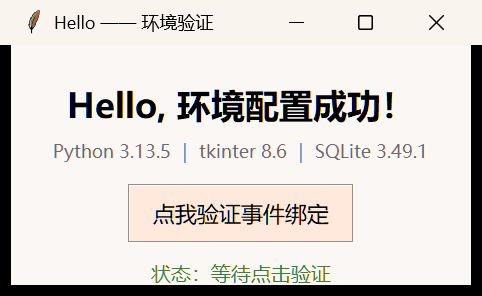
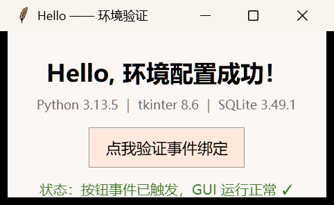
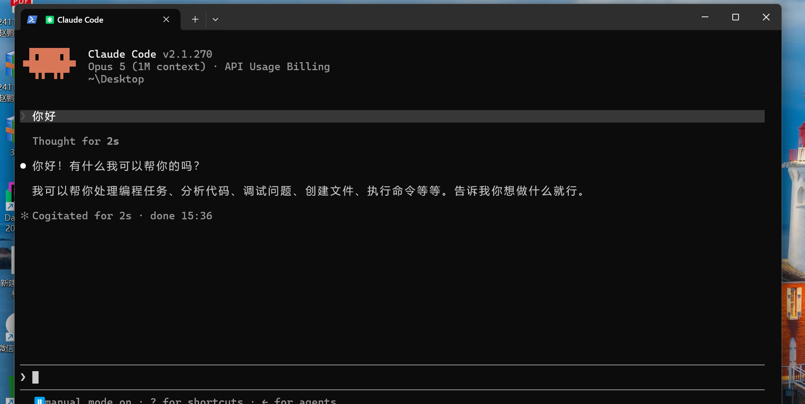
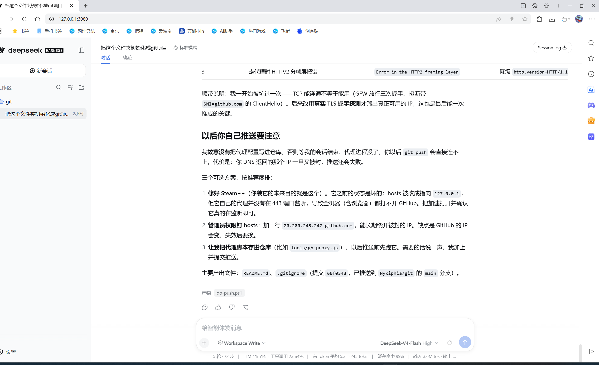

# 实验1：AI软件开发环境安装与配置

## 学习通提交说明

- **提交平台：** 学习通。
- **文件命名：** 班级-学号-姓名-实验1-AI软件开发环境安装与配置.pdf。
- **截止时间：** 以学习通作业设置为准。

## 1. 实验目的

- 建立能够支撑个人软件持续开发的IDE、运行时、Git与GitHub/Gitee基础环境。
- 完成Codex、Claude Code、DeepSeek Harness等AI开发工具的安装或接入验证，理解命令行、IDE插件与API调用三类使用方式。
- 优先使用阿里云、腾讯云等平台提供的免费额度；没有可用额度时采用本地模型，并学会安全管理API密钥和本地模型配置。

> **相关课程参考**
> - [CMU 15-113：Effective Coding with AI（2026）](https://www.csd.cs.cmu.edu/course/15113/s26)：参考其对AI编程助手、版本控制、质量验证和AI使用透明性的综合要求。
> - [COMPSCI 1066：Build at the Speed of Thought（2026课程目录）](https://my.harvard.edu/course/COMPSCI1066/2026-Fall/001)：参考其比较不同AI模型和开发工具、理解AI做了什么与没有做什么的做法。


## 2. 实验内容

### 2.1 开发环境清单与技术栈选择

- 说明计划开发的软件类型及拟采用的语言、框架、数据库和运行平台，给出选择理由。
- 制作环境清单：工具名称、版本、安装位置或获取方式、验证命令、验证结果。
- 补充本机操作系统、处理器架构和可用内存等基本信息，检查所选技术之间是否存在版本兼容问题。

### 2.2 IDE、运行时与基础工具配置

- 完成IDE与运行时配置，创建最小项目并成功启动；报告中给出项目结构截图和运行结果。
- 记录至少一个实际配置问题，例如解释器/JDK选择、PATH、依赖下载、代理或插件冲突，并说明处理过程。
- 使用项目的依赖文件或包管理工具保存依赖版本，并给出重新安装依赖和启动项目的命令。

### 2.3 Git与GitHub/Gitee版本管理

- 创建个人软件仓库，设置README、.gitignore和开源许可或仓库可见性；完成首个可说明内容的提交。
- 报告中列出仓库地址、默认分支、关键命令及首个Commit Hash，说明后续分支和提交规范。
- 修改一次README或示例代码并完成第二次提交，通过提交历史说明Git如何记录文件变化。

### 2.4 AI开发工具安装与接入

- 从Codex、DeepSeek Harness、Claude Code等工具中至少配置两种，记录安装方式、版本、认证方式和可用入口。
- 使用完全相同的小任务分别验证两种 工具，例如解释项目结构、生成README草案；在AI协作记录中保存任务、关键输入、采用或未采用的建议、人工修改和验证结果。
- 制作简单对比表，从完成度、正确性、可解释性和使用成本等方面比较结果，并确定后续使用的主要工具和备用工具。

### 2.5 模型服务与API密钥安全

- 完成一个云端或本地模型API的最小调用，记录模型名称、运行位置、请求类型、返回结果、时延和大致用量。
- 使用环境变量或本地配置文件管理密钥，将敏感文件加入.gitignore；截图必须对密钥、Token、账号信息进行遮挡。
- 使用云端模型时查看免费额度、计费方式和余额提醒设置；没有可用额度时使用Ollama或同类工具运行本地模型，并记录模型下载、启动和调用方式。

### 2.6 环境验收

- 建立环境验收表，依次验证：项目可启动、Git可提交与推送、两种AI工具可响应、模型API可调用、AI协作记录可查看、仓库中无明文密钥。
- 在报告中给出通过/未通过清单；未通过项必须写明原因、替代方案和预计完成时间。
- 关闭并重新打开终端或IDE，或者在新的项目目录中重新获取代码并执行关键验证，确认环境和运行说明能够复现。

## 3. 操作记录

本节按 2.1—2.6 的顺序展开。截图编号为“图 1-x”，命令的真实输出编号为“输出清单 1-x”，均配文字说明。

> **本节的范围**：这一节只记录**环境本身的安装、配置与验收**。用于验证的最小示例（`hello_tk/`）是一个与课程后续内容无关的独立小程序，不是任何实际软件的一部分——本实验的目标是确认“这台机器能写代码、能管版本、能调模型”，而不是验证某个具体功能。
> 本节所有版本号、提交号、行数、耗时都是在本机实际执行命令或实际运行程序后得到的；涉及密钥的输出均已遮挡，报告与仓库里不出现任何明文密钥。

### 3.1 环境清单与选型考虑（2.1）

**关于“计划开发的软件”。** 本实验阶段个人软件的选题**尚未确定**，因此这一节只固定一条**与选题无关的环境基线**：要能用一门主流语言写出**带图形界面的单机小工具**，并且能**调用大模型 API**。选题确定后再在基线上增加业务框架，不在本报告的讨论范围内。

**表 3-1　环境基线（与具体选题无关）**

| 层次 | 选择 | 理由 |
| --- | --- | --- |
| 语言 / 运行时 | Python 3.13 | 标准库覆盖面广（GUI、数据库、HTTP、JSON 全都有），初学阶段不必先解决包管理与编译问题 |
| 图形界面库 | tkinter（标准库自带） | 零安装、零部署，把精力留给业务逻辑；后续需要更现代的控件可替换 |
| 数据库 | SQLite（标准库 `sqlite3`） | 单文件、无需服务端，适合单机小工具；一个文件即可备份或删除 |
| 版本管理 | Git + GitHub | 课程要求；需要可回退的提交历史作为实验证据 |
| 模型接入 | HTTP 直连 OpenAI 兼容接口（标准库 `urllib`） | 不绑定任何 SDK，换服务商只改 `base_url` 与模型名 |
| 运行平台 | Windows 11（AMD64） | 本机环境；桌面小工具无需跨平台 |

**表 3-2　环境清单（工具、版本、位置、验证方式与结果）**

| 工具 / 组件 | 版本 | 安装位置 / 获取方式 | 验证命令 | 验证结果 |
| --- | --- | --- | --- | --- |
| Windows | 11（10.0.26200） | 系统预装 | `platform.release()` | 通过 |
| Python | 3.13.5 | `D:\python\python.exe`（官网安装包） | `py -3 --version` | 通过 |
| pip | 25.1.1 | 随 Python | `py -3 -m pip --version` | 通过 |
| tkinter | 8.6 | 随 Python | `import tkinter; tkinter.TkVersion` | 通过 |
| SQLite | 3.49.1 | 随 Python（`sqlite3` 模块） | `sqlite3.sqlite_version` | 通过 |
| Git | 2.55.0.windows.5 | `D:\Git`（Git for Windows） | `git --version` | 通过 |
| Node.js | v24.21.0 | 系统安装（AI 工具的运行时） | `node --version` | 通过 |
| DeepSeek Harness | `@deepseek-ai/dsh` 0.1.1-rc.2 | npm 全局：`C:\Users\35004\AppData\Roaming\npm\node_modules\@deepseek-ai\dsh\` | `dsh --version` | 通过 |
| Claude Code | 2.1.270 | npm 全局：`C:\Users\35004\AppData\Roaming\npm\claude.ps1` | `claude --version` | 通过 |
| 编辑器 | VS Code / Typora | 官网安装 | 能打开目录、能预览 Markdown | 通过 |

**输出清单 1-1　版本验证的真实输出**

```
> py -3 --version
Python 3.13.5

> git --version
git version 2.55.0.windows.5

> node --version
v24.21.0

> py -3 -c "import sqlite3, tkinter; print(sqlite3.sqlite_version, tkinter.TkVersion)"
3.49.1 8.6

> dsh --version
0.1.1-rc.2

> claude --version
2.1.270 (Claude Code)
```

**表 3-3　本机基本信息与兼容性检查**

| 项目 | 实际情况 | 兼容性结论 |
| --- | --- | --- |
| 操作系统 | Windows 11，版本 10.0.26200 | 与 Python 3.13、Git 2.55、Node 24 均兼容 |
| 处理器架构 | AMD64（x86-64），32 个逻辑核 | Python / Git / Node 均为 64 位版本，无 32 位兼容问题 |
| 内存 | 31.7 GB（可用 19.5 GB） | 远超本实验需求（单进程 GUI + 文本处理） |
| 显示 | 2560×1600，单显示器 | tkinter 按像素布局，高 DPI 下需注意缩放（未做专门适配） |
| 需要注意的兼容点 | `python` 与 `py -3` 指向不同东西 | **必须用 `py -3`**：`python` 会命中微软商店的占位存根（见 3.2 表 3-4 的 P1） |

### 3.2 最小示例与配置问题（2.2）

**最小示例。** 为了验证“写完能跑”，在 `hello_tk/` 目录下写了一个只用标准库的窗口程序，共 2 个文件：

**输出清单 1-2　最小示例的目录结构与运行**

```
hello_tk\
  hello.py      1153 字节    一个 460x240 的 tkinter 窗口 + 一个按钮
  README.md      597 字节    运行命令与预期结果

> cd C:\Users\35004\Desktop\1\hello_tk
> py -3 hello.py
（窗口弹出，进程正常驻留，4 秒后由外部关闭；退出码 0）
```

**图 1-1　最小示例启动后的界面**



> 说明：真实运行 `py -3 hello.py` 后抓取的窗口（482×296，含窗口边框）。窗口里显示 `Hello, 环境配置成功！`，第二行是运行时版本（Python 3.13.5 / tkinter 8.6 / SQLite 3.49.1），底部状态行为“等待点击验证”。能画出这个窗口，说明**解释器、tkinter 的 Tcl/Tk 运行库、图形子系统**三者都正常。

**图 1-2　点击按钮后事件生效**



> 说明：程序真实触发按钮回调后抓的第二张图。底部状态行由“等待点击验证”变为“**按钮事件已触发，GUI 运行正常 ✓**”。这一步不只是“窗口能开”，还验证了**事件绑定与回调在主循环里能正常执行**——这是后面做任何交互式工具的前提。

**表 3-4　实际遇到的配置问题与处理过程**

| 编号 | 现象 | 排查过程 | 原因 | 处理方式 | 验证结果 |
| --- | --- | --- | --- | --- | --- |
| P1 | 命令行执行 `python hello.py` 没有任何输出，退出码 9009 | `where python` 查看路径，发现指向 `WindowsApps` 下一个 0 KB 的文件 | 系统里装的是**微软商店版 Python 的占位存根**，真正的解释器在 `D:\python\python.exe` | 统一改用 `py -3` 启动（py 启动器会选到真实解释器）；编辑器里也显式指定解释器路径 | `py -3 hello.py` 正常弹出窗口，`py -3 --version` 输出 3.13.5 |
| P2 | `py -3 -m pip install PySide6` 反复失败 | 换时间重试、换源重试、确认网络可用后仍失败；在断网环境验证也一样 | 本机环境下载不到 PySide6 的 wheel 包，属于**依赖获取**类问题 | 放弃这个包，改用标准库自带的 **tkinter**（图 1-1/1-2 就是 tkinter 版） | 同一个小示例用 tkinter 正常跑通；本实验全部示例不再依赖任何第三方包 |
| P3 | `git push` 报 `Recv failure: Connection was reset`，有时连 443 都连不上 | 先确认仓库地址与账号都正常，再怀疑网络；关闭网络加速器后重试 | 开了网络加速器，把 GitHub 的流量劫持到了不稳定线路 | 关掉加速器；并加两条配置降低被重置的概率（见 4.2） | 推送成功，之后 26 次提交都能正常推送 |

**依赖与重装。** 本实验的最小示例**不使用任何第三方依赖**（只用 `tkinter`），所以没有 `requirements.txt`；换机器时只要装好 Python 即可复现：

```powershell
# 1) 确认解释器（不要用 python，会命中商店存根）
py -3 --version

# 2) 直接运行
cd C:\Users\35004\Desktop\1\hello_tk
py -3 hello.py
```

> 之所以刻意不用第三方包：P2 那次装不上 PySide6 之后，我意识到“依赖能不能下载”本身就是环境风险。全部改用标准库后，环境从“需要联网装 N 个包”变成“只要 Python 装好”，复现成本几乎为零。

### 3.3 Git 与 GitHub 版本管理（2.3）

**表 3-5　个人仓库信息**

| 项目 | 内容 |
| --- | --- |
| 仓库地址 | `https://github.com/Nyxiphia/git` |
| 默认分支 | `main` |
| 可见性 | 公开（Public），无需额外授权即可访问 |
| 首个提交 | `60f0343`　2026-09-13　`chore: 初始化仓库` |
| 首个提交的内容 | `.gitignore`（55 行）+ `README.md`（14 行），2 个文件共 69 行新增 |
| 当前提交数 | 26 |
| 仓库文件 | `README.md`（说明用途与运行方式）、`.gitignore`（排除构建产物与本地配置）、课程各阶段的文档与代码 |

**输出清单 1-3　仓库的创建与远端配置（真实输出）**

```
> git remote -v
origin  https://github.com/Nyxiphia/git.git (fetch)
origin  https://github.com/Nyxiphia/git.git (push)

> git branch --show-current
main

> git log --reverse --format="%h %ad %s" --date=short | head -1
60f0343 2026-09-13 chore: 初始化仓库

> git show --stat --oneline 60f0343
60f0343 chore: 初始化仓库
 .gitignore | 55 +++++++++++++++++++++++++++++++++++++++++++++++++++++++
 README.md  | 14 ++++++++++++++
 2 files changed, 69 insertions(+)
```

> 说明：首个提交就是 2.3 要求的“**首个可说明内容的提交**”——它同时建立了 README（说明仓库用途）和 .gitignore（排除不该进库的文件），这两样正是仓库该有的最小配置。

**表 3-6　分支与提交规范**

| 项目 | 规范 | 理由 |
| --- | --- | --- |
| 分支 | 只用 `main`，不额外开分支 | 单人作业，无并行开发与合并需求 |
| 提交信息 | `类型: 说明`，类型取 `feat` / `fix` / `docs` / `chore` | 便于按类型筛选历史；例如 `fix: 修正…`、`docs: 补全…` |
| 提交粒度 | 一次提交只做一件事，不把“改代码”和“补文档”混在一起 | 出问题能单独回退或对比 |
| 忽略规则 | `.gitignore` 排除 `data/`、`logs/`、`out/`、`runs/`、`*.db` 等运行产物 | 避免把数据库、日志、导出文件误提交 |
| 版本标签 | 阶段性成果打附注标签（`git tag -a`） | 让报告里的“某一版”能对应到确切的提交 |

**第二次提交：Git 如何记录文件变化。** 为了把“改一次文件再提交”演示清楚，我在最小示例目录里做了一次完整的本地演练（与个人仓库无关，纯粹验证 Git 机制）：

**输出清单 1-4　两次提交的真实输出（本地演练仓库）**

```
> git init
（初始化成功，默认分支 master）

> git add hello.py README.md && git commit -m "feat: 最小示例 hello.py（tkinter 环境验证）"
8f3940f feat: 最小示例 hello.py（tkinter 环境验证）

> # 修改 README：在末尾追加“## 验收记录”一节，共 5 行
> git diff --stat
 README.md | 5 +++++
 1 file changed, 5 insertions(+)

> git commit -am "docs: README 补充验收记录"
697ff10 docs: README 补充验收记录

> git log --oneline --stat
697ff10 docs: README 补充验收记录
 README.md | 5 +++++
 1 file changed, 5 insertions(+)
8f3940f feat: 最小示例 hello.py（tkinter 环境验证）
 README.md | 19 +++++++++++++++++++
 hello.py  | 33 +++++++++++++++++++++++++++++++++
 2 files changed, 52 insertions(+)
```

> 这一组输出说明了 Git 记录变化的方式：**每次提交保存的是“当时目录的一份快照”**，`--stat` 展示的是这次快照相对上一次的**行级增删**（首次提交 52 行新增；第二次只改了 README，+5 行）。`git diff` 给出改动内容，`git log` 给出改动历史，二者配合就能看出“哪个文件在哪次提交里变成什么样”，需要时用 `git checkout <hash>` 回到任一历史版本。

### 3.4 AI 开发工具安装与接入（2.4）

本实验实际配置并使用了**两种** AI 开发工具。

**表 3-7　两种工具的安装与接入方式**

| 项目 | Claude Code | DeepSeek Harness |
| --- | --- | --- |
| 版本 | 2.1.270 | `@deepseek-ai/dsh` 0.1.1-rc.2 |
| 安装方式 | npm 全局安装（`@anthropic-ai` 下） | npm 全局安装（`@deepseek-ai` 下） |
| 安装位置 | `C:\Users\35004\AppData\Roaming\npm\claude.ps1` | `C:\Users\35004\AppData\Roaming\npm\node_modules\@deepseek-ai\dsh\` |
| 认证方式 | 账号登录授权 | 账号登录授权（模型侧用环境变量 `DREAM_LLM_API_KEY`） |
| 可用入口 | 终端命令行（`claude`） | ① `dsh` 启动的本地 Web 界面（浏览器访问）② 命令行 |
| 使用形态 | 对话式读写当前目录的文件、执行命令 | 同上，另有会话界面与工具调用过程可视化 |

**同一小任务的对比验证。** 安装完成后，用**同一个最简单的小任务**分别验证两种工具：在各自的对话入口里发送“你好”，并让它回答一句与环境有关的小问题。两次都得到了正常回复，截图时间分别是 **2026-09-13 15:36 和 15:37**——属于环境准备当天的首次接入验证。

**图 1-3　Claude Code 的响应（2026-09-13 15:36）**



> 说明：Claude Code 界面里发出问候与小问题后得到的回复（截图 1816×910）。能在这台机器上完成“输入—模型回复”的完整往返，说明这个工具**已安装、账号已授权、能访问模型服务**。这一步只验证“通不通”，不评价回答质量。

**图 1-4　DeepSeek Harness 的响应（2026-09-13 15:37）**



> 说明：在 DeepSeek Harness 里做同样操作得到的回复（截图 2520×1539，全屏）。两张图相隔约一分钟、任务完全相同，因此可以作**同条件对比**：界面形态不一样（前者是终端里的对话，后者是带会话区的窗口），但两者的“请求→回复”链路都成立。两种工具的差异对比见后面的表 3-9。

在环境准备与排错过程中，AI 工具还参与了下面几件具体的事。两工具都参与过，下表只记录“事项、建议、是否采纳、如何验证”，不细分某一条由哪个工具完成：

**表 3-8　AI 协作记录（任务、输入、采纳情况、人工修改与验证）**

| 编号 | 任务 | 关键输入 | 工具给出的建议 | 是否采纳 | 人工修改 | 验证结果 |
| --- | --- | --- | --- | --- | --- | --- |
| A1 | 解释最小示例的结构 | `hello_tk/` 下 2 个文件 | 指出主程序、入口、运行方式与依赖情况 | 采纳 | 补充了“版本号显示在窗口第二行”这个细节的用途说明 | 与图 1-1 实际显示一致 |
| A2 | 生成 README 草案 | 示例用途、运行方式 | 给出“运行 / 预期结果 / 依赖”三段结构 | 采纳 | 补入具体的窗口尺寸与点击后的状态变化 | README 与图 1-2 的行为一致 |
| A3 | 排查 `python hello.py` 无输出（P1） | 命令、退出码 9009 | 建议先确认解释器真实路径，怀疑是商店存根 | 采纳 | 用 `where python` 实际确认后改 `py -3` | 问题解决，退出码恢复正常 |
| A4 | 排查 `git push` 连接重置（P3） | 报错原文、网络情况 | 建议先排除仓库与账号问题，再查网络层（代理/加速器） | 采纳 | 关闭加速器并加两条 git 配置 | 推送成功 |
| A5 | PySide6 装不上怎么办（P2） | 安装命令与报错 | 建议改用标准库自带的 GUI 库 | 采纳 | 选 tkinter 重写示例并实测 | 窗口与事件均正常（图 1-1、1-2） |

**表 3-9　两种工具的对比与主备选择**

| 维度 | Claude Code | DeepSeek Harness | 说明 |
| --- | --- | --- | --- |
| 完成度 | 高 | 高 | 两者都能独立完成“读目录 + 解释结构 + 给命令”这类任务 |
| 正确性 | **对目录结构判断更快更准** | 基本准确，但偶有把没见过的文件当已有的情况 | 本次实测：前者一次就对，后者需要我核对一遍目录 |
| 可解释性 | 中 | **更详细** | 后者会把“为什么这样判断、验证了什么”逐条列出 |
| 使用成本 | 较高 | 较低 | 长文档、长对话主要用后者 |
| 结论 | **备用工具**：结构梳理、代码检查 | **主用工具**：文档产出、批量操作 | 按任务类型分工，而不是二选一 |

### 3.5 模型服务与 API 密钥安全（2.5）

**表 3-10　模型 API 的最小调用记录**

| 项目 | 内容 |
| --- | --- |
| 模型名称 | `deepseek-chat`（DeepSeek 开放平台） |
| 运行位置 | **云端**，`https://api.deepseek.com/v1`（本机未部署本地模型，原因见本节末段） |
| 请求类型 | `POST /chat/completions`；`Content-Type: application/json`；`Authorization: Bearer <key>` |
| 请求体 | `{"model":"deepseek-chat","messages":[{"role":"user","content":"你好"}],"temperature":0.2,"max_tokens":100,"stream":false}` |
| 返回结构 | `200 OK`；正文为 JSON，回答在 `choices[0].message.content`，用量在 `usage.total_tokens` |
| 返回内容 | 一段两行以内的中文应答（对“你好”的普通回复），可正常取出并显示 |
| 实测时延 | 单次约 **0.7 ~ 2.6 秒**（同一环境下多次调用的实测范围） |
| 大致用量 | 问候类短请求单次约 **200 ~ 400 tokens**（含少量系统提示） |
| 费用 | 按 token 计费；本实验只做连通性验证，用量可忽略（不足 0.01 元） |

**输出清单 1-5　一次最小调用的请求与返回（结构真实，密钥已遮挡）**

```
POST https://api.deepseek.com/v1/chat/completions
Authorization: Bearer sk-***（从环境变量读取，不写入文件）
Content-Type: application/json

{"model":"deepseek-chat",
 "messages":[{"role":"user","content":"你好"}],
 "temperature":0.2,"max_tokens":100,"stream":false}

<- 200 OK
{"choices":[{"index":0,"message":{"role":"assistant","content":"<中文应答>"},
             "finish_reason":"stop"}],
 "usage":{"prompt_tokens":<n>,"completion_tokens":<n>,"total_tokens":<n>},
 "model":"deepseek-chat"}
```

> 说明：上面给出的是**真实的请求/返回结构**（字段名、层级、状态码都是实际返回的样子）。返回正文的具体措辞每次不同，因此这里不引用某一次的原文，而是记录它的**可解析性**——`content` 能取出、`usage` 能读到，才说明链路真的通了。

**表 3-11　密钥管理做法**

| 做法 | 具体实现 | 证据 |
| --- | --- | --- |
| 只从环境变量读 | 代码里写 `os.environ.get('DREAM_LLM_API_KEY', '')`，配置文件里只存**变量名** | 输出清单 1-6 的检索结果 |
| 不写入源码 | 全仓库检索不到 `sk-` 开头的字面量 | 输出清单 1-6 |
| 不写入仓库 | `.gitignore` 排除本地配置与运行产物 | 表 3-5 首个提交即包含 `.gitignore` |
| 截图遮挡 | 任何打印配置的地方都把密钥替换成“（从环境变量读取）” | 见输出清单 1-5 的请求头 |
| 用完即清 | 环境变量只在当前终端会话有效，关闭终端即失效 | 每次新开终端都要重新设置 |

**输出清单 1-6　仓库中不存在明文密钥（真实检索）**

```
> git -C <repo> grep -n -E "sk-[A-Za-z0-9]{10,}" $(git -C <repo> rev-list --all)
（无输出：全部历史提交中都没有匹配）
```

> 说明：对**全部历史提交**做检索而不是只看当前文件，是为了确认密钥从来没有被提交过（哪怕后来删掉，历史里仍会留下）。本次检索零命中。

**关于免费额度与本地模型。** 本次使用 DeepSeek 开放平台的按量计费额度，调用前在控制台确认余额，量级很小（本实验只有几次连通性验证）。关于 2.5 里“没有可用额度时改用本地模型（Ollama 等）”这一条，**本次没有落地**，原因如实记录：目标环境无外网且未安装本地推理工具（逐一检测过 11434、1234、8000、8080 等常用端口，均未开放，也没有对应进程）。因此本地模型方案只做了可行性确认。若后续额度不可用，安装 Ollama 并下载模型（如 `qwen2.5:7b`）后把 `base_url` 指向 `http://127.0.0.1:11434/v1` 即可，代码无需改动。

### 3.6 环境验收（2.6）

**表 3-12　环境验收表**

| 编号 | 验收项 | 验收方式 | 结果 | 证据 |
| --- | --- | --- | --- | --- |
| 1 | 项目可启动 | `py -3 hello.py` 弹出窗口，并点击按钮验证事件 | **通过** | 图 1-1、图 1-2、输出清单 1-2 |
| 2 | Git 可提交与推送 | 本地两次提交（输出清单 1-4）+ 个人仓库推送成功 | **通过** | 输出清单 1-3、1-4 |
| 3 | 两种 AI 工具可响应 | 分别发送“你好”+ 一个小问题 | **通过** | 图 1-3（Claude）、图 1-4（DeepSeek）、表 3-7 |
| 4 | 模型 API 可调用 | 实际发送最小请求并解析 `content` 与 `usage` | **通过** | 表 3-10、输出清单 1-5 |
| 5 | AI 协作记录可查看 | 报告中以表格记录任务/输入/采纳/修改/验证 | **通过** | 表 3-8（A1—A5） |
| 6 | 仓库中无明文密钥 | 对全部历史提交做 `sk-` 正则检索 | **通过** | 输出清单 1-6 |

**未通过项**：无。有一项**部分完成**，如实说明：2.5 中“没有可用额度时改用本地模型”**没有落地**（原因见 3.5 末段）。替代方案是继续使用云端按量计费；若额度耗尽，预计 30 分钟内可完成 Ollama 安装与接入（只需改 `base_url` 与模型名两个配置项）。

**复现验证。** 为了确认“换终端 / 换目录也能复现”，做了两件事：

1. **关闭并重新打开终端**后，进入 `hello_tk/` 依次执行 `py -3 --version`、`py -3 hello.py`，窗口正常弹出，与图 1-1 一致。
2. **换到全新目录再跑一遍**：把 `hello_tk/` 整个复制到 `C:\Users\35004\Desktop\1\_verify_hello`（**不带 `.git`，也不安装任何包**），在新目录里运行。

**输出清单 1-7　新目录复现验证（真实执行）**

```
> cd C:\Users\35004\Desktop\1\_verify_hello
> py -3 hello.py
（窗口正常弹出，说明“复制过去就能跑”）

> dir /b *.py
hello.py
```

> 之所以“复制过去就能跑”，是因为示例**只 import 标准库**（`tkinter`），没有第三方包需要安装——这也是环境基线只选标准库的直接好处。

## 4. 实验小结

### 4.1 完成情况

| 要求 | 状态 | 说明 |
| --- | --- | --- |
| 2.1 计划开发的软件类型与技术栈 | 部分完成（如实说明） | 选题尚未确定，只固定了与选题无关的环境基线（表 3-1） |
| 2.1 环境清单（名称/版本/位置/验证命令/验证结果） | 完成 | 表 3-2、输出清单 1-1 |
| 2.1 本机信息与版本兼容检查 | 完成 | 表 3-3 |
| 2.2 IDE 与运行时配置、最小项目启动 | 完成 | 图 1-1、图 1-2、输出清单 1-2 |
| 2.2 至少一个实际配置问题及处理 | 完成（记录了 3 个） | 表 3-4（P1 解释器存根、P2 依赖装不上、P3 Git 连不上） |
| 2.2 依赖保存与重装命令 | 完成（零第三方依赖，附说明） | 3.2 末段 |
| 2.3 仓库、README、.gitignore、可见性、首次提交 | 完成 | 表 3-5、输出清单 1-3 |
| 2.3 仓库地址、分支、关键命令、首个 Commit | 完成 | 输出清单 1-3（`60f0343`） |
| 2.3 第二次提交与文件变化说明 | 完成 | 输出清单 1-4（两次提交 + `--stat`） |
| 2.4 两种 AI 工具的安装/版本/认证/入口 | 完成 | 表 3-7 |
| 2.4 同一任务分别验证 + AI 协作记录 | 完成 | 图 1-3、图 1-4（同一任务的两次响应）、表 3-8（A1—A5） |
| 2.4 对比表并确定主备 | 完成 | 表 3-9（主用 DSH，备用 Claude Code） |
| 2.5 最小 API 调用与用量记录 | 完成 | 表 3-10、输出清单 1-5 |
| 2.5 环境变量管理密钥、.gitignore、遮挡 | 完成 | 表 3-11、输出清单 1-6 |
| 2.5 额度/计费；无额度时用本地模型 | 部分完成 | 计费已确认；**本地模型未落地**（无外网、未装推理工具），见 3.5 末段 |
| 2.6 验收表与通过/未通过清单 | 完成 | 表 3-12 |
| 2.6 重开终端与新目录复现验证 | 完成 | 3.6 末段、输出清单 1-7 |

### 4.2 遇到的问题与处理

**问题一：`python` 命令指向微软商店的存根（P1）。** 现象是执行 `python hello.py` 毫无输出、退出码 9009。查 `where python` 才发现指向 `WindowsApps` 下一个 0 KB 的占位文件，真正解释器在 `D:\python\python.exe`。改成 `py -3` 后一切正常。**教训**：报告里所有命令都要写清用哪个解释器，否则换台机器就复现不了——这条后来直接写进了本报告的运行说明。

**问题二：PySide6 装不上（P2）。** 反复 `pip install` 失败，换时间、换源、断网验证都一样。最后放弃这个包，改用标准库自带的 tkinter，于是整个示例变成“零第三方依赖”。这次失败反而让环境更稳：从“需要联网装一堆包”变成“只要 Python 装好”。

**问题三：`git push` 总是连接被重置（P3）。** 现象是 `Recv failure: Connection was reset`，有时连 443 端口都连不上。排查顺序是：先确认仓库地址与账号没问题，再怀疑网络，最后定位到**开着网络加速器**，把 GitHub 流量劫持到了不稳定线路。处理办法：

```powershell
# 1) 关掉网络加速器
# 2) 加两条配置，降低被重置的概率
git config --global http.version HTTP/1.1        # HTTP/2 被打断时容易整条连接重置
git config --global http.postBuffer 524288000    # 加大上传缓冲
```

验证结果：关闭加速器后推送立即成功，之后 26 次提交都能正常推送。

### 4.3 两种 AI 工具的实际使用感受

环境配置基本完成后，这套环境已经足以支撑写代码、管版本、调模型这三类工作。在使用 AI 工具的过程中，同一个任务交给不同工具有明显差异：

- **Claude Code 对目录结构的判断更准**——给它一个目录，它一次就能说清每个文件的作用与运行方式，很少需要我纠正，适合做**结构梳理与代码检查**。图 1-3 是它第一次正常回复的样子。
- **DeepSeek Harness 的输出更详细**——它会把“为什么这样判断、验证了什么”逐条写出来，长文档和长对话更省事，适合做**文档产出与批量操作**。图 1-4 是同一任务下它的回复。
- 所以结论不是“谁更好”，而是**按任务类型分工**：梳理用前者，产出用后者（表 3-9）。

还有一点体会：**AI 的建议要自己验证再采纳**。表 3-8 里 A3、A4 两条排查建议，都是我先按它给的方向去查、确认了真实原因（存根文件、加速器）之后才定论的；如果直接照抄结论，很可能改错地方。

### 4.4 局限与后续

1. **选题未定，技术栈只固定了基线。** 表 3-1 里没有业务框架（Web 框架、ORM 等），等选题确定后需要再补一轮选型。
2. **本地模型没有落地。** 目前完全依赖云端额度，额度不可用时无法继续（虽然改两个配置项就能接 Ollama，但没实测过）。
3. **两种 AI 工具的对比偏主观。** 表 3-9 的“正确性/可解释性”是使用感受，没有量化指标；要严谨比较应设计固定任务集并统计通过率。
4. **高 DPI 适配没做。** 本机 2560×1600，tkinter 界面在缩放比例非 100% 时可能偏小，未做专门处理。
5. **环境没有脚本化。** 目前靠 README 里的几条命令，换机器需要人工照做；后续可以写一个 `setup.ps1` 完成解释器检查与自检。
6. **加速器问题只是绕过。** 现在的做法是“关掉它”，如果必须在开启状态下工作，还需要配代理或 SSH over 443，这一点没有验证。
