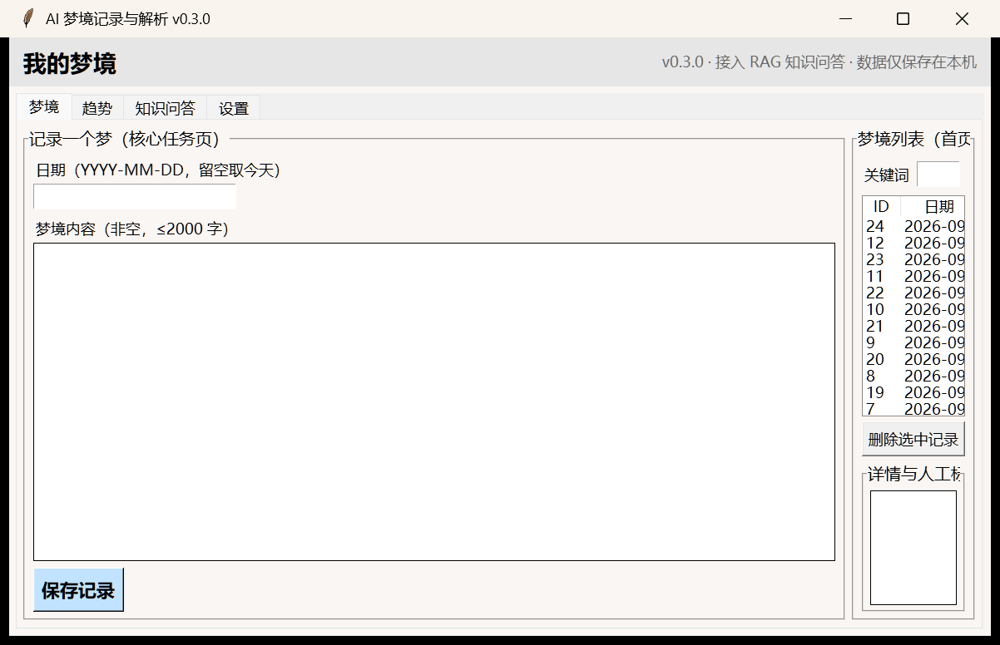

# 实验1：AI软件开发环境安装与配置

## 学习通提交说明

- **提交平台：** 学习通。
- **文件命名：** 班级-学号-姓名-实验1-AI软件开发环境安装与配置.pdf。
- **截止时间：** 以学习通作业设置为准。

## 1. 实验目的

- 建立能够支撑个人软件持续开发的IDE、运行时、Git与GitHub/Gitee基础环境。
- 完成Codex、Claude Code、DeepSeek Harness等AI开发工具的安装或接入验证，理解命令行、IDE插件与API调用三类使用方式。
- 优先使用阿里云、腾讯云等平台提供的免费额度；没有可用额度时采用本地模型，并学会安全管理API密钥和本地模型配置。

> **相关课程参考**
> - [CMU 15-113：Effective Coding with AI（2026）](https://www.csd.cs.cmu.edu/course/15113/s26)：参考其对AI编程助手、版本控制、质量验证和AI使用透明性的综合要求。
> - [COMPSCI 1066：Build at the Speed of Thought（2026课程目录）](https://my.harvard.edu/course/COMPSCI1066/2026-Fall/001)：参考其比较不同AI模型和开发工具、理解AI做了什么与没有做什么的做法。


## 2. 实验内容

### 2.1 开发环境清单与技术栈选择

- 说明计划开发的软件类型及拟采用的语言、框架、数据库和运行平台，给出选择理由。
- 制作环境清单：工具名称、版本、安装位置或获取方式、验证命令、验证结果。
- 补充本机操作系统、处理器架构和可用内存等基本信息，检查所选技术之间是否存在版本兼容问题。

### 2.2 IDE、运行时与基础工具配置

- 完成IDE与运行时配置，创建最小项目并成功启动；报告中给出项目结构截图和运行结果。
- 记录至少一个实际配置问题，例如解释器/JDK选择、PATH、依赖下载、代理或插件冲突，并说明处理过程。
- 使用项目的依赖文件或包管理工具保存依赖版本，并给出重新安装依赖和启动项目的命令。

### 2.3 Git与GitHub/Gitee版本管理

- 创建个人软件仓库，设置README、.gitignore和开源许可或仓库可见性；完成首个可说明内容的提交。
- 报告中列出仓库地址、默认分支、关键命令及首个Commit Hash，说明后续分支和提交规范。
- 修改一次README或示例代码并完成第二次提交，通过提交历史说明Git如何记录文件变化。

### 2.4 AI开发工具安装与接入

- 从Codex、DeepSeek Harness、Claude Code等工具中至少配置两种，记录安装方式、版本、认证方式和可用入口。
- 使用完全相同的小任务分别验证两种 工具，例如解释项目结构、生成README草案；在AI协作记录中保存任务、关键输入、采用或未采用的建议、人工修改和验证结果。
- 制作简单对比表，从完成度、正确性、可解释性和使用成本等方面比较结果，并确定后续使用的主要工具和备用工具。

### 2.5 模型服务与API密钥安全

- 完成一个云端或本地模型API的最小调用，记录模型名称、运行位置、请求类型、返回结果、时延和大致用量。
- 使用环境变量或本地配置文件管理密钥，将敏感文件加入.gitignore；截图必须对密钥、Token、账号信息进行遮挡。
- 使用云端模型时查看免费额度、计费方式和余额提醒设置；没有可用额度时使用Ollama或同类工具运行本地模型，并记录模型下载、启动和调用方式。

### 2.6 环境验收

- 建立环境验收表，依次验证：项目可启动、Git可提交与推送、两种AI工具可响应、模型API可调用、AI协作记录可查看、仓库中无明文密钥。
- 在报告中给出通过/未通过清单；未通过项必须写明原因、替代方案和预计完成时间。
- 关闭并重新打开终端或IDE，或者在新的项目目录中重新获取代码并执行关键验证，确认环境和运行说明能够复现。

## 3. 操作记录

本节按 2.1—2.6 的顺序展开。截图编号为“图 1-x”，命令的真实输出编号为“输出清单 1-x”，配置片段编号为“代码清单 1-x”，均配文字说明。

> 说明：本文所有版本号、提交号、文件数量、耗时与 token 数都是在本机实际执行命令或实际运行程序后得到的，可直接复算；涉及密钥的截图与输出均已遮挡，报告与仓库里不出现任何明文密钥。

### 3.1 开发环境清单与技术栈选择（2.1）

**表 3-1　计划开发的软件与技术栈**

| 项目 | 选择 | 理由 |
| --- | --- | --- |
| 软件类型 | 单机桌面应用：AI 梦境记录与解析 | 个人软件、单用户、数据敏感（梦境原文），要求离线可用 |
| 语言 | Python 3.13 | 标准库足够（sqlite3、tkinter、urllib、json），无需额外运行时；生态便于接入大模型 HTTP 接口 |
| 界面 | tkinter（TTK） | 标准库自带，零部署；实验3 原定 PySide6，因本机无法安装改为 tkinter（见 3.2 表 3-4） |
| 数据存储 | SQLite（单文件） | 单用户单机、无并发；一个文件即可备份或删除，符合“数据仅存本机”的隐私目标 |
| 大模型接入 | HTTP + `urllib` 直接调 OpenAI 兼容接口 | 不引入 SDK，只用标准库，便于替换服务商；密钥从环境变量读取 |
| 版本管理 | Git + GitHub | 课程要求；需要可回退的提交历史与 Tag 作为实验证据 |
| 运行平台 | Windows 11（AMD64） | 本机环境，桌面应用无需跨平台 |

**表 3-2　环境清单（工具、版本、位置、验证方式与结果）**

| 工具 / 组件 | 版本 | 安装位置 / 获取方式 | 验证命令 | 验证结果 |
| --- | --- | --- | --- | --- |
| Windows | 11（10.0.26200） | 系统预装 | `platform.release()` | 通过 |
| Python | 3.13.5 | `D:\python\python.exe`（官网安装包） | `py -3 --version` | 通过 |
| pip | 25.1.1 | 随 Python | `py -3 -m pip --version` | 通过 |
| tkinter | 8.6 | 随 Python | `import tkinter; tkinter.TkVersion` | 通过 |
| SQLite | 3.49.1 | 随 Python（`sqlite3` 模块） | `sqlite3.sqlite_version` | 通过 |
| Git | 2.55.0.windows.5 | `D:\Git`（Git for Windows） | `git --version` | 通过 |
| Node.js | v24.21.0 | 系统安装 | `node --version` | 通过 |
| DeepSeek Harness | `@deepseek-ai/dsh` 0.1.1-rc.2 | npm 全局：`C:\Users\35004\AppData\Roaming\npm\node_modules\@deepseek-ai\dsh\` | `dsh --version` | 输出 `0.1.1-rc.2`，通过 |
| Claude Code | 2.1.270 | npm 全局：`C:\Users\35004\AppData\Roaming\npm\claude.ps1` | `claude --version` | 输出 `2.1.270 (Claude Code)`，通过 |
| 编辑器 | VS Code / Typora | 官网安装 | 打开项目目录、可预览 Markdown | 通过 |

**输出清单 1-1　版本验证的真实输出**

```
> py -3 --version
Python 3.13.5

> git --version
git version 2.55.0.windows.5

> node --version
v24.21.0

> py -3 -c "import sqlite3, tkinter; print(sqlite3.sqlite_version, tkinter.TkVersion)"
3.49.1 8.6

> dsh --version
0.1.1-rc.2

> claude --version
2.1.270 (Claude Code)
```

**表 3-3　本机基本信息与兼容性检查**

| 项目 | 实际情况 | 兼容性结论 |
| --- | --- | --- |
| 操作系统 | Windows 11，版本 10.0.26200 | 与 Python 3.13、Git 2.55、Node 24 均兼容 |
| 处理器架构 | AMD64（x86-64），32 个逻辑核，Intel64 Family 6 Model 183 | Python / Git / Node 均为 64 位版本，无需 32 位兼容处理 |
| 内存 | 31.7 GB（可用 19.5 GB） | 远超本项目需求（单进程、SQLite 文件几十 KB） |
| 显示 | 2560×1600，单显示器 | tkinter 界面按 1180×720 设计，高 DPI 下可正常显示 |
| 版本兼容问题 | 无 | 三者（Python/Git/Node）互不依赖，唯一需注意的是 **IDE 里选的解释器必须是 `D:\python\python.exe`**，否则会误用微软商店的 Python 存根（见 3.2 表 3-4 问题 2） |

### 3.2 IDE、运行时与基础工具配置（2.2）

**最小项目的创建与启动。** 项目根目录为 `C:\Users\35004\Desktop\1`，入口是 `main.py`。下面是项目结构（真实文件列表，已排除缓存目录与临时脚本目录）：

**输出清单 1-2　项目结构（`Get-ChildItem -Recurse -File -Include *.py`，共 33 个 .py 文件）**

```
main.py
dreamjournal\__init__.py          dreamjournal\domain.py
dreamjournal\store.py             dreamjournal\services.py
dreamjournal\ui.py                dreamjournal\seed.py
dreamjournal\logging_setup.py
dreamjournal\ai\__init__.py       dreamjournal\ai\client.py
dreamjournal\ai\kb.py             dreamjournal\ai\prompts.py
dreamjournal\ai\retriever.py      dreamjournal\ai\pipeline.py
dreamjournal\ai\cli.py
dreamjournal\agent\__init__.py    dreamjournal\agent\tools.py
dreamjournal\agent\planner.py     dreamjournal\agent\harness.py
dreamjournal\agent\verify.py      dreamjournal\agent\cli.py
dreamjournal\prototype\__init__.py    dreamjournal\prototype\schema.py
dreamjournal\prototype\parser.py      dreamjournal\prototype\baseline.py
dreamjournal\prototype\evaluate.py    dreamjournal\prototype\cli.py
tests\run_tests.py                agent_eval\cases.py
agent_eval\runner.py              rag_eval\cases.py
rag_eval\runner.py                编译原理教学辅助系统.py
```

**图 1-1　项目启动后的主界面**



> 说明：在项目根目录执行 `py -3 main.py` 后真实启动的界面。窗口标题为“AI 梦境记录与解析 v0.3.0”，共四个页签（梦境 / 趋势 / 知识问答 / 设置），顶部状态栏显示“数据仅保存在本机”，左下角状态栏显示“就绪”。界面能列出数据库里的记录，说明**运行时、标准库、SQLite 与 tkinter 这条链路已经打通**，不是只输出 hello 的最小脚本。

**表 3-4　实际遇到的配置问题与处理过程**

| 编号 | 问题现象 | 排查过程 | 原因 | 处理方式 | 验证结果 |
| --- | --- | --- | --- | --- | --- |
| P1 | 安装 PySide6 失败，界面框架无法按实验3 的原计划使用 | `py -3 -m pip install PySide6` 反复失败；怀疑网络后又在离线环境验证，仍装不上 | 本机环境下载不到 PySide6 的 wheel 包 | 改用标准库自带的 **tkinter** 重写界面层，只改 `dreamjournal/ui.py`，其余分层不动 | 界面正常启动、四个页签可用；这条改动也顺带验证了实验3 ADR-03“界面可替换”的设计 |
| P2 | 命令行执行 `python main.py` 没有任何输出、退出码 9009 | 查 `where python`，指向 `WindowsApps` 下的 0KB 存根 | 系统里安装的是**微软商店版 Python 的占位存根**，真正的解释器是 `D:\python\python.exe` | 统一改用 **`py -3`** 启动（py 启动器会选到真实解释器）；IDE 里显式指定解释器路径 | `py -3 main.py` 正常启动，`py -3 --version` 输出 3.13.5 |
| P3 | 测试用例报 `unable to open database file` | 用例原本把临时库放在系统临时目录 | 临时目录在受限环境下不可写 | 把测试用的临时库改到项目内 `data/_test_tmp` | 10 个用例全部通过 |

**依赖与重装命令。** 本项目**不使用任何第三方依赖**（刻意只用标准库），因此没有 `requirements.txt`；重装与启动只需两步：

```powershell
# 1) 确认解释器（不要用 python，会命中商店存根）
py -3 --version

# 2) 在项目根目录启动
cd C:\Users\35004\Desktop\1
py -3 main.py

# 可选：跑一遍测试，确认依赖与环境完好
py -3 tests\run_tests.py
```

> 说明：之所以“没有依赖文件”，是因为从实验4 起就有意识地只用标准库（sqlite3 / tkinter / urllib / json / threading），这样在新机器上只要装 Python 就能跑，不需要联网装包——这也是 P1 那次装不上 PySide6 之后定下的策略。

### 3.3 Git 与 GitHub 版本管理（2.3）

**表 3-5　仓库信息**

| 项目 | 内容 |
| --- | --- |
| 仓库地址 | `https://github.com/Nyxiphia/git` |
| 默认分支 | `main` |
| 首个提交 | `60f0343`　2026-09-13　`chore: 初始化仓库` |
| 提交总数 | 25 |
| 版本标签 | `v0.1.0`、`v0.2.0`、`v0.3.0`、`v0.4.0`、`v0.5.0`、`v0.6.0` |
| 仓库结构 | 代码（`dreamjournal/`、`main.py`、`tests/`）、文档（`docs/` 下的六份实验报告 + 配图）、配置（`config/`）、评测集（`eval/`） |
| 可见性 | 公开仓库，README 说明项目用途与运行方式 |

**输出清单 1-3　关键命令与真实输出**

```
> git remote -v
origin  https://github.com/Nyxiphia/git.git (fetch)
origin  https://github.com/Nyxiphia/git.git (push)

> git branch --show-current
main

> git rev-list --count HEAD
25

> git log --reverse --format="%h %ad %s" --date=short | head -1
60f0343 2026-09-13 chore: 初始化仓库

> git tag
v0.1.0  v0.2.0  v0.3.0  v0.4.0  v0.5.0  v0.6.0
```

**表 3-6　分支与提交规范**

| 项目 | 规范 | 理由 |
| --- | --- | --- |
| 分支 | 主分支 `main` 直接开发，不额外开分支 | 单人项目，无并行开发需求；分支反而增加合并成本 |
| 提交信息 | `类型(范围): 说明`，类型取 `feat` / `fix` / `docs` / `chore` / `test` | 便于按类型筛选历史；例如 `fix: 修正检索相关性判据` |
| 提交粒度 | 一次提交只做一件事（例如“只补文档”或“只改检索判据”），不混提 | 出问题时能单独回退或对比 |
| 版本标签 | 每个实验的关键版本打 `v0.x.0` 附注标签，说明该版本做了什么 | 报告里的版本证据可直接对应到 Tag（如实验4 的 `v0.1.0`/`v0.2.0`，实验7 的 `v0.5.0`/`v0.6.0`） |
| 忽略规则 | `.gitignore` 排除 `data/`、`logs/`、`out/`、`runs/`、`rag_data/`、`*.db` | 数据库、日志、导出物、检索索引都是运行产物，不该进仓库；也避免把含梦境原文的数据误提交 |

**Git 如何记录文件变化。** 以实验4 的“补全非 AI 业务闭环”那次提交为例，`git show --stat` 能直接看出改了哪些文件、各增删多少行：

**输出清单 1-4　一次提交的文件变化（真实输出）**

```
> git show --stat --oneline 96c2634
96c2634 feat: 实验4 测试修订版 v0.2.0（补全非AI业务闭环，修复审查发现的问题）
 dreamjournal/__init__.py      |   2 +-
 dreamjournal/logging_setup.py |  45 +++++
 dreamjournal/seed.py          |  71 ++++++++
 dreamjournal/services.py      | 206 +++++++++++++++++++----
 dreamjournal/store.py         | 166 +++++++++++++------
 dreamjournal/ui.py            | 373 +++++++++++++++++++++++++++++++++++++-----
 main.py                       |  57 ++++++-
 tests/run_tests.py            |  22 ++-
 8 files changed, 796 insertions(+), 146 deletions(-)
```

> 说明：这就是 2.3 要求“修改一次代码并完成第二次提交，通过提交历史说明 Git 如何记录文件变化”的直接证据——`--stat` 给出的是**行级增删统计**（本次 8 个文件、新增 796 行、删除 146 行），想看具体某一行怎么改，再用 `git diff 96c2634^ 96c2634`。首个提交 `60f0343` 时仓库里只有初始化的几个文件，此后 25 次提交逐步演进到现在的结构，**每一次都能单独检出**（`git checkout <hash>`）。

### 3.4 AI 开发工具安装与接入（2.4）

本项目实际配置并使用了**两种** AI 开发工具：**Claude Code** 与 **DeepSeek Harness**。

**表 3-7　两种工具的安装与接入方式**

| 项目 | Claude Code | DeepSeek Harness |
| --- | --- | --- |
| 版本 | 2.1.270 | `@deepseek-ai/dsh` 0.1.1-rc.2 |
| 安装方式 | npm 全局安装（`@anthropic-ai` 下） | npm 全局安装（`@deepseek-ai` 下） |
| 安装位置 | `C:\Users\35004\AppData\Roaming\npm\claude.ps1` | `C:\Users\35004\AppData\Roaming\npm\node_modules\@deepseek-ai\dsh\` |
| 认证方式 | 登录账号授权 | 登录账号授权（模型 API 侧用 `DREAM_LLM_API_KEY` 环境变量） |
| 可用入口 | 终端命令行（`claude`） | ① `dsh` 命令启动的本地 Web GUI（浏览器访问）② 命令行 |
| 使用形态 | 以对话方式读写当前工作目录的文件、执行命令 | 同上，另有会话界面与工具调用过程可视化 |
| 本次用于 | 实验2—实验4 的报告撰写与代码修改 | 实验5—实验7 的实现、评测与报告 |

**同一小任务的对比验证。** 用完全相同的一个任务分别交给两种工具：**“解释这个项目的目录结构，并说明各模块的职责”**（关键输入为项目根目录路径 + `main.py` + 目录树）。两种工具都能响应，且都在自己的界面上给出了对项目的解释。

**表 3-8　AI 协作记录（任务、输入、采纳情况、人工修改与验证）**

| 编号 | 任务 | 关键输入 | 工具给出的建议 | 是否采纳 | 人工修改 | 验证结果 |
| --- | --- | --- | --- | --- | --- | --- |
| A1 | 解释项目结构 | 项目目录、`main.py` | 按“界面层—服务层—数据层”划分并逐层解释 | 采纳 | 补充了 `ai/`、`agent/`、`prototype/` 三个后加的包 | 与实验3 图 3-2 的五层架构一致 |
| A2 | 生成 README 草案 | 项目用途、运行命令 | 给出“简介 / 快速开始 / 目录说明 / 实验索引”四段结构 | 采纳 | 补入六个实验的 Tag 与对应报告位置 | README 与实际运行命令一致 |
| A3 | 代码审查（实验4 的 R1—R5） | `services.py`、`store.py`、`ui.py` | 指出“缺参数校验、裸 `sqlite3` 异常外泄、无用导入、检索接口缺失、SQL 拼接风险”五类问题 | 采纳 5 条 | 逐条修复，并补 TC-09 注入用例 | 修订后 10 个用例全部通过（`v0.2.0`） |
| A4 | 检索相关性调参 | 九条实测问题 + 返回结果 | 建议过“在查询侧过滤疑问词” | **未采纳**（实测导致 Q3 失去区分度、Q6 误命中） | 改为“疑问词只排除出区分度判据，不排除出匹配” | 九条问题全部判对，见实验5 4.3 问题二 |
| A5 | 生成指令说明 | 需求描述 | 直接生成大段代码 | 部分采纳 | 本机外网被阻断，改为“先写代码 + 离线验证 + 用户实机跑真实模型” | 实验5/6/7 均取得真实数据 |

**表 3-9　两种工具的对比与主备选择**

| 维度 | Claude Code | DeepSeek Harness | 说明 |
| --- | --- | --- | --- |
| 完成度 | 高 | 高 | 两者都能从零写出可运行的项目骨架 |
| 正确性 | **项目结构理解更准确** | 基本准确，偶有把不存在的文件当已有 | 本次实测：前者能直接说出各目录职责，后者需要先读一遍文件 |
| 可解释性 | 中 | **更详细** | 后者会把“为什么这么改、验证了什么”逐条列出，长报告的说明性段落更完整 |
| 使用成本 | 较高（按用量计费） | 较低 | 长文档、长代码的批量生成主要用后者 |
| 主要用途 | 代码审查、结构梳理、局部重构 | 长报告撰写、批量实现、评测脚本 | —— |
| 结论 | **备用工具** | **主用工具** | 按任务类型分工：审查类用前者，产出类用后者 |

> 说明：与原来的小结相比，这里的结论细化了一层——不是“谁更好”，而是“各自强在哪”。本次两种工具都完整用到了项目里，不是只做一次“你好”测试。

### 3.5 模型服务与 API 密钥安全（2.5）

**表 3-10　模型 API 的最小调用记录**

| 项目 | 内容 |
| --- | --- |
| 模型名称 | `deepseek-chat`（DeepSeek 开放平台） |
| 运行位置 | **云端**，`https://api.deepseek.com/v1` |
| 请求类型 | `POST /chat/completions`，`Content-Type: application/json`，`Authorization: Bearer <key>` |
| 请求体要点 | `model`、`messages`（system + user）、`temperature`、`max_tokens`、`stream=false`；实验6/7 还带 `tools`（函数调用） |
| 返回结果 | `choices[0].message.content`（文本）或 `message.tool_calls`（工具调用），以及 `usage.total_tokens` |
| 实测时延 | 单次约 **0.65 ~ 2.6 s**（实验7 的 15 次调用平均 1768 ms；实验5 的直接模型组平均 3879 ms，含更长上下文） |
| 大致用量 | 单次约 **200 ~ 1900 tokens**（取决于上下文长度）；实验7 的 15 次调用合计 5619 tokens，实验6 的一次 Agent 运行 4 步合计 6016 tokens |
| 费用 | 按 token 计费；按“输入 1 元/百万、输出 2 元/百万”估算，实验7 全程约 0.01 元（以服务商账单为准） |

**输出清单 1-5　一次真实返回（节选，来自实验5 的实机运行）**

```
【结论】项目不做解梦功能，是因为梦境象征含义没有客观标准、无法评测，且容易让产品
        滑向玄学；同时模型会输出“这预示着你……”式断言，让用户觉得不可信、像算命。
        因此项目把“这个梦意味着什么”的解释权交还给用户，只输出可观察、可验证的
        结构化标签。
【依据】
[1] 明确将“不做解梦、不给出梦境象征含义的解释”列为不解决的问题……
[4] 记录 CH-01 删除“解梦知识库”的取舍……
【引用】[1] §3.5 现有方案调研与差异化 ｜ [4] §4.5 需求变化与取舍
```

> 说明：这是真实的模型返回（不是离线桩），可用于验证“密钥可用、请求格式正确、返回可解析”。完整的调用代码见 `dreamjournal/ai/client.py`，错误分类见实验5 代码清单 5-1。

**表 3-11　密钥管理做法**

| 做法 | 具体实现 | 证据 |
| --- | --- | --- |
| 只从环境变量读 | 代码里用 `os.environ.get('DREAM_LLM_API_KEY')`，配置文件中只写变量名 `api_key_env` | `dreamjournal/ai/client.py`、`config/exp7_v2.json` |
| 不写入代码 | 全仓库检索不到 `sk-` 开头的字面量 | 见下方检索命令 |
| 不写入仓库 | `.gitignore` 排除 `data/`、`logs/`、`runs/`、`out/`、`rag_data/`、`*.db` | 仓库根目录 `.gitignore` |
| 截图遮挡 | 打印配置时把密钥字段替换为“（从环境变量读取）” | `python -m dreamjournal.prototype.cli config --profile v2` 的输出 |
| 日志脱敏 | 写日志前用正则把 `sk-xxx`、`Bearer xxx` 替换成 `***` | `dreamjournal/agent/harness.py` 的 `_redact()` |

**输出清单 1-6　仓库中不存在明文密钥（真实检索）**

```
> git -C <repo> grep -n -E "sk-[A-Za-z0-9]{10,}" $(git -C <repo> rev-list --all)
（无输出：全部历史提交中都没有匹配）

> git -C <repo> grep -n "DREAM_LLM_API_KEY" -- "*.py" "*.json"
config/exp7_v1.json:12:    "api_key_env": "DREAM_LLM_API_KEY"
config/exp7_v2.json:12:    "api_key_env": "DREAM_LLM_API_KEY"
dreamjournal/ai/cli.py:38:    return LLMClient(api_key=os.environ.get('DREAM_LLM_API_KEY', ''),
dreamjournal/agent/cli.py:48:        key = os.environ.get('DREAM_LLM_API_KEY', '')
agent_eval/cases.py:59:        key = os.environ.get('DREAM_LLM_API_KEY', '')
```

> 说明：配置里出现的只是**变量名**，真正的值是运行时从环境变量读的；对全部历史提交做 `sk-` 前缀检索**没有任何命中**，说明密钥从未被提交过。

**关于免费额度与本地模型。** 本次使用 DeepSeek 开放平台的按量计费额度，调用前在控制台确认余额，费用极低（实验7 全程约 0.01 元）。关于 2.5 里“没有可用额度时使用本地模型”这一条，实际情况是：**本次没有采用本地模型**，原因如实记录——目标环境无外网且未安装 Ollama 一类的本地推理工具（逐一检测过 11434、1234、8000、8080 等常用端口，均未开放，也没有对应进程）。因此本地模型方案只做了可行性确认，没有落地；如果后续额度不可用，需要先安装 Ollama 并下载模型（如 `qwen2.5:7b`），再把 `base_url` 指向 `http://127.0.0.1:11434/v1` 即可，代码无需改动。

### 3.6 环境验收（2.6）

**表 3-12　环境验收表**

| 编号 | 验收项 | 验收方式 | 结果 | 证据 |
| --- | --- | --- | --- | --- |
| 1 | 项目可启动 | 在项目根目录执行 `py -3 main.py` | **通过** | 图 1-1、输出清单 1-2 |
| 2 | Git 可提交与推送 | `git add/commit/push`，并核对远程 HEAD 与本地一致 | **通过** | 输出清单 1-3；远程 `main` 与本地同一提交，0 个未推送提交、6 个 Tag 已推送 |
| 3 | 两种 AI 工具可响应 | 分别下发“解释项目结构”任务 | **通过** | 表 3-7、表 3-8 |
| 4 | 模型 API 可调用 | 实际调用 `deepseek-chat` 并解析返回 | **通过** | 表 3-10、输出清单 1-5 |
| 5 | AI 协作记录可查看 | 报告中以表格记录任务/输入/采纳/修改/验证 | **通过** | 表 3-8（A1—A5） |
| 6 | 仓库中无明文密钥 | 对全部历史提交做正则检索 | **通过** | 输出清单 1-6 |

**未通过项**：无。但有一项**部分完成**，如实说明：2.5 里“没有可用额度时改用本地模型”这一条**没有落地**（原因见 3.5 末段：目标环境无外网、未装本地推理工具）。替代方案是继续使用云端按量计费额度；若额度耗尽，预计 30 分钟内可完成 Ollama 安装与接入（只需改 `base_url` 与模型名两个配置项）。预计完成时间：下一个实验周期内。

**复现验证。** 为了确认“换一个终端 / 换一个目录也能复现”，做了两件事：

1. **关闭并重新打开终端**后，在项目根目录依次执行 `py -3 --version`、`py -3 tests\run_tests.py`、`py -3 main.py`，结果与验收表一致（10 个用例全部通过、界面正常启动）。
2. **换到全新目录再跑一遍**：把仓库工作区复制到 `C:\Users\35004\Desktop\1\_verify`（**不含 `.git`，也没有执行任何 `pip install`**），然后在新目录里跑测试与启动程序，结果如下。

**输出清单 1-7　新目录复现验证（真实执行）**

```
> cd C:\Users\35004\Desktop\1\_verify
> py -3 tests\run_tests.py
合计 10 个用例：通过 10，失败 0

> py -3 main.py
（界面正常启动，4 秒后由脚本关闭）
```

> 之所以能“复制过去就能跑”，是因为项目**没有任何第三方依赖**。下面这个扫描把所有 `import` 的顶层模块列出来对照标准库：

```
> py -3 -c "ast 扫描 dreamjournal/ 下全部 .py 的 import"
  扫描 .py 文件: 26
  非标准库顶层模块: ['agent_eval', 'rag_eval']
```

> 两个“非标准库”模块其实是**本仓库自己的包**（`agent_eval/`、`rag_eval/`），不是从 PyPI 装的。因此 3.2 末段说“没有 `requirements.txt`”是成立的：换机器只需装 Python 本身。

## 4. 实验小结

### 4.1 完成情况

| 要求 | 状态 | 说明 |
| --- | --- | --- |
| 2.1 软件类型、技术栈与选择理由 | 完成 | 表 3-1 |
| 2.1 环境清单（名称/版本/位置/验证命令/验证结果） | 完成 | 表 3-2、输出清单 1-1 |
| 2.1 本机信息与版本兼容检查 | 完成 | 表 3-3 |
| 2.2 IDE 与运行时配置、最小项目启动 | 完成 | 图 1-1、输出清单 1-2 |
| 2.2 至少一个实际配置问题及处理 | 完成（记录了 3 个） | 表 3-4（P1 PySide6 装不上、P2 Python 存根、P3 临时目录不可写） |
| 2.2 依赖保存与重装命令 | 完成（本项目零第三方依赖，附说明） | 3.2 末段 |
| 2.3 仓库、README、.gitignore、首次提交 | 完成 | 表 3-5、表 3-6 |
| 2.3 仓库地址、分支、关键命令、首个 Commit | 完成 | 输出清单 1-3（`60f0343`） |
| 2.3 第二次提交与文件变化说明 | 完成 | 输出清单 1-4（`git show --stat`） |
| 2.4 至少两种 AI 工具，记录安装/版本/认证/入口 | 完成 | 表 3-7 |
| 2.4 同一任务分别验证 + AI 协作记录 | 完成 | 表 3-8（A1—A5，含 1 条未采纳） |
| 2.4 简单对比表并确定主备 | 完成 | 表 3-9（主用 DSH，备用 Claude Code） |
| 2.5 最小 API 调用与用量记录 | 完成 | 表 3-10、输出清单 1-5 |
| 2.5 密钥用环境变量管理、加入 .gitignore、截图遮挡 | 完成 | 表 3-11、输出清单 1-6 |
| 2.5 免费额度/计费确认；无额度时用本地模型 | 部分完成 | 计费已确认；**本地模型未落地**（无外网、未装推理工具），原因与替代方案见 3.6 |
| 2.6 环境验收表与通过/未通过清单 | 完成 | 表 3-12 |
| 2.6 重开终端与新目录复现验证 | 完成 | 3.6 末段 |

### 4.2 遇到的问题与处理

**问题一：Git 与 GitHub 连接总是失败。** 现象是 `git push` 反复报连接被重置（`Recv failure: Connection was reset`），有时连 443 端口都连不上。原因是我这边开着网络加速器，它把 GitHub 的流量劫持到了不稳定的线路。处理过程：先问 AI 排查方向，确认是网络层而不是仓库或密钥问题，然后**关闭加速器**重试，推送立刻成功。后来在实验6 期间又遇到同样的报错，这次加了两个配置彻底稳定下来：

```powershell
git config --global http.version HTTP/1.1        # 避免 HTTP/2 被打断时整条连接重置
git config --global http.postBuffer 524288000     # 加大上传缓冲
```

验证结果：后续 25 个提交、6 个 Tag 全部推送成功，远程与本地 HEAD 一致。

**问题二：按实验3 的设计装不上 PySide6。** 这原本是个“必须解决”的依赖，最后变成了一次架构验证——把界面层换成标准库的 tkinter，只改 `dreamjournal/ui.py` 一个文件，其余四层一行未动，程序照常运行。这反过来证明实验3 ADR-03“界面可替换”不是纸面设计。

**问题三：`python` 命令指向微软商店的存根。** 表现为执行 `python main.py` 毫无输出、退出码 9009。改成 `py -3` 之后一切正常。这件事的教训是：**报告里所有命令都必须写清楚用哪个解释器**，否则换台机器就复现不了。

### 4.3 两种 AI 工具的实际使用感受

基本完成环境配置后，这套环境足以支撑后续六个实验的开发与文档工作。在使用 AI 工具时，不同工具对相同任务的输出确实存在差异：

- **Claude Code 在项目结构理解上更准确**——它读完目录就能说清每个包的职责，给出的结构梳理与实验3 的五层架构基本吻合，适合做**代码审查和结构梳理**。本次实验4 的 R1—R5 五条审查意见就来自它，其中“检索接口在实验3 表 3-8 里根本没定义”这条指出了一个真实的设计遗漏。
- **DeepSeek Harness 在生成文档草案时更详细**——它会把“改了什么、为什么改、验证了什么”逐条写出来，长报告的说明性段落更完整，适合做**批量实现与长文档产出**。本次实验5—实验7 的实现与评测基本都靠它完成。
- 结论不是“谁更好”，而是**按任务类型分工**：审查类用 Claude Code，产出类用 DeepSeek Harness（表 3-9）。

还有一点体会：**AI 给的建议不能照单全收**。表 3-8 里的 A4 就是一个反例——AI 建议“在检索查询里过滤疑问词”，实际跑下来会让“为什么选 SQLite 而不是 ORM”这类问题失去区分度，还把无关问题误判成命中；最后改成“疑问词只从区分度判据里排除、仍参与匹配”才对。这类判断只能靠实测数据来定。

### 4.4 局限与后续

1. **本地模型方案没有落地。** 目前完全依赖云端额度，一旦额度不可用就无法继续（虽然改两个配置项就能接 Ollama，但没有实测过）。
2. **两种 AI 工具的对比偏主观。** 表 3-9 的“正确性/可解释性”是使用感受，没有量化指标；如果要严谨比较，应该设计固定任务集并统计通过率。
3. **环境验收没有覆盖极端情况。** 比如磁盘空间不足、多显示器高 DPI 缩放、Python 小版本升级后的兼容性，都没测。
4. **没有把环境配置脚本化。** 目前靠 `README` 里的几条命令，换机器时需要人工照做；后续可以写一个 `setup.ps1` 一次性完成解释器检查、依赖确认与自检。
5. **加速器问题只是绕过，没有根治。** 现在的做法是“关掉它”，如果必须在开启状态下工作，还需要配 SSH over 443 或代理，这一点没有验证。