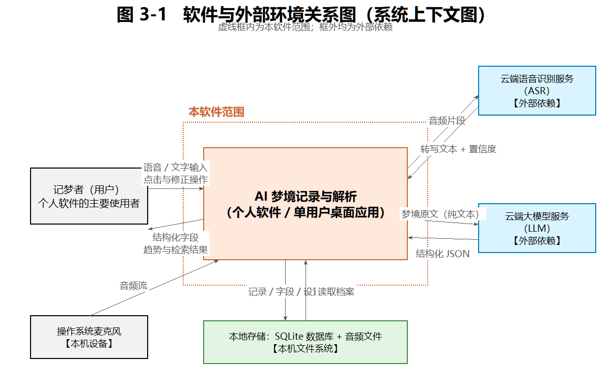
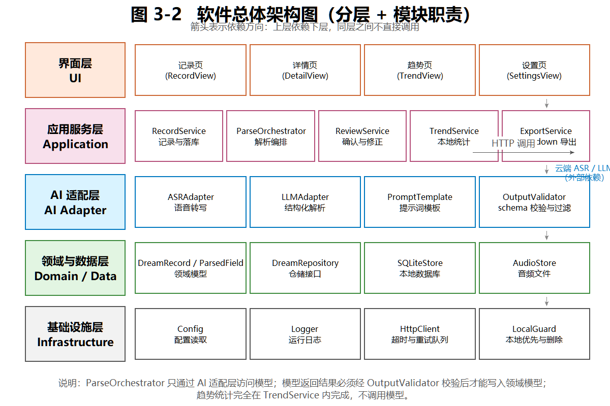
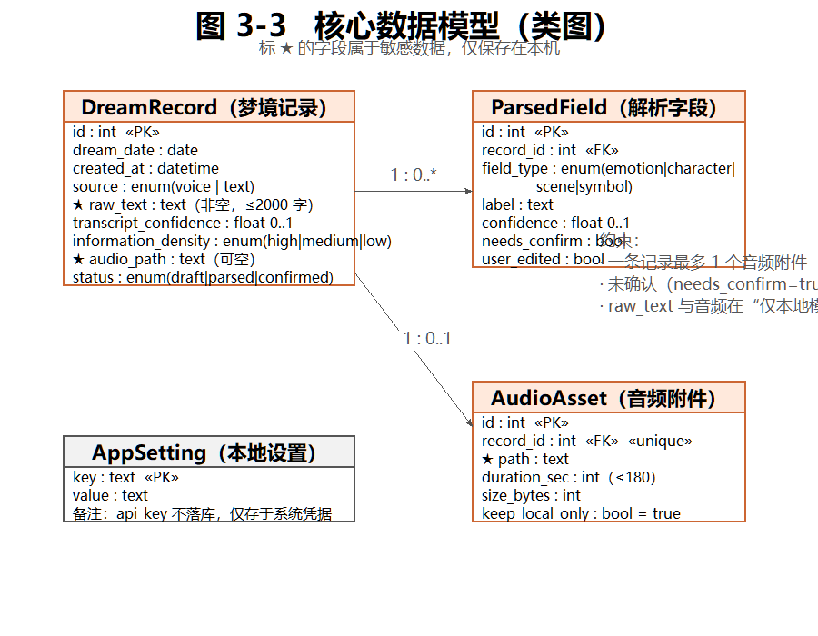
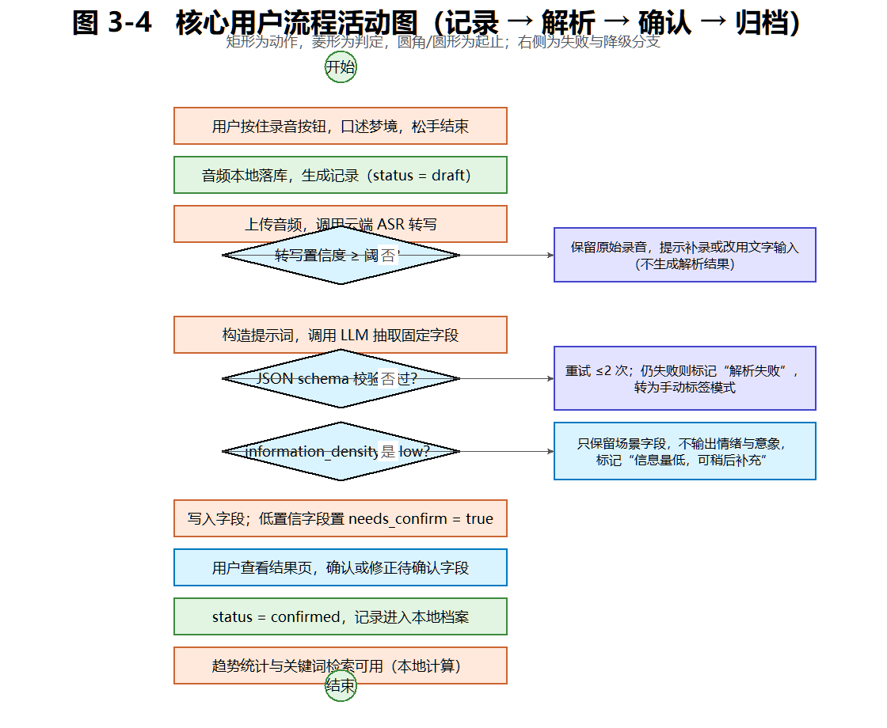
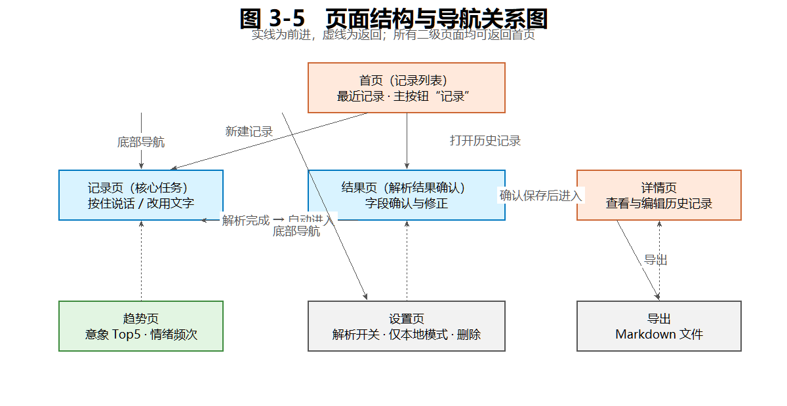
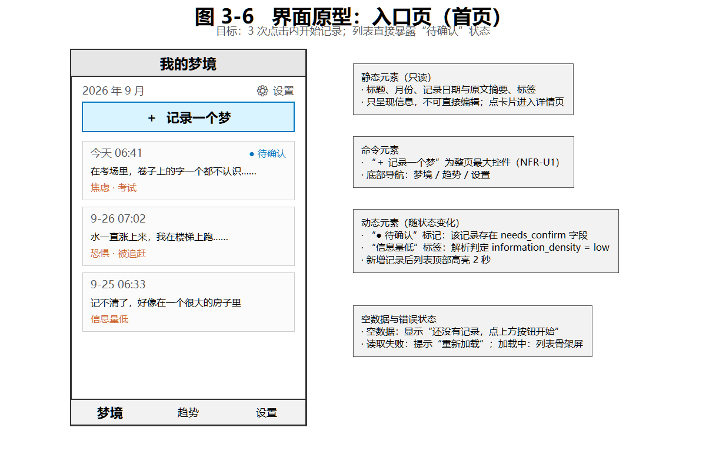
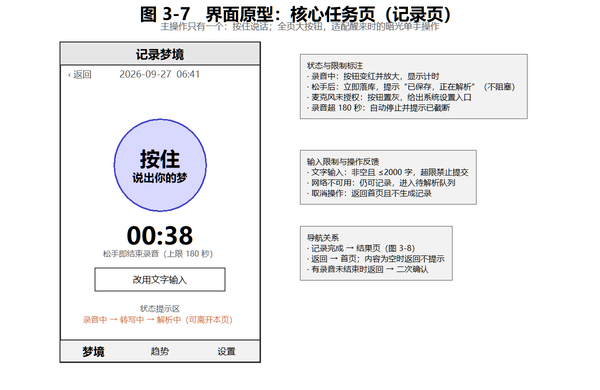
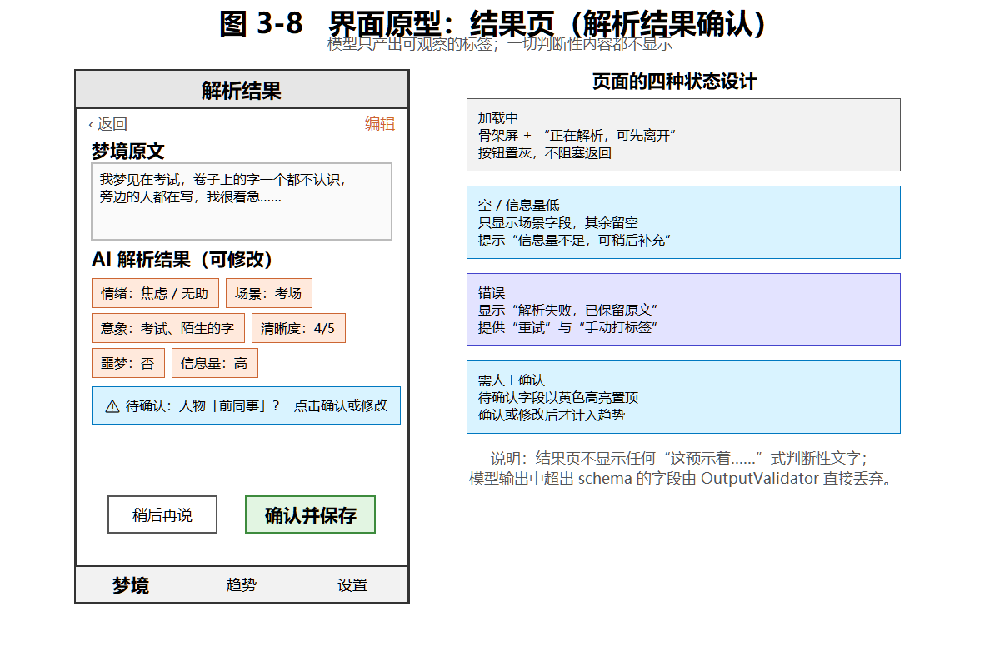

# 实验3：软件架构与界面设计

## 学习通提交说明

- **提交平台：** 只向学习通对应的“实验报告”作业上传一份PDF文件。
- **文件命名：** 班级-学号-姓名-实验3-软件架构与界面设计.pdf。
- **PDF内容：** 需求与设计对应表、技术选型与架构决策、软件与外部环境关系图、总体架构图与模块说明、数据与接口设计、核心流程图、关键界面原型、设计检查记录及仓库版本证据。
- **截止时间：** 以学习通作业设置为准。

## 1. 实验目的

- 把实验2的需求说明转化为可指导后续开发的软件架构、模块边界、数据模型、接口和交互方案。
- 形成与个人能力匹配的技术选型，并保留关键决策依据。
- 完成关键设计，检查需求、架构与界面之间是否一致，为实验4的软件基础功能开发提供设计基线。


## 2. 实验内容


### 2.1 需求输入与设计范围

- 从实验2中选定一条核心用户流程，列出该流程对应的用户故事、功能需求、非功能需求和验收条件，作为本次设计的输入。
- 运用软件工程课程中学习的双向追踪原则，先建立“需求编号—准备完成的设计内容—对应图或文档”对应表，确保每项核心需求都有后续设计任务，后续也能从设计内容追溯到需求来源。
- 初步划分普通软件功能与AI功能的边界，说明哪些任务可以由确定的程序逻辑完成，哪些任务准备交给LLM处理，以及哪些结果需要程序校验或用户确认。本阶段不要求确定RAG、Agent等具体实现方法。

### 2.2 技术选型与架构决策

- 结合已学习的程序设计语言和软件设计约束，从本人熟悉程度、实现成本、框架生态、AI接入、测试和运行环境等方面比较候选方案。比较可以使用简单表格，不要求罗列过多技术或原因。
- 对开发语言与框架、数据保存方式、软件体系结构风格等关键选择编写简短的设计决策说明。设计决策说明也称架构决策记录（ADR），只需写清要解决的问题、考虑过的方案、最终选择、理由和可能的不足。
- 为一项可能影响项目继续开发的关键依赖准备替代方案，例如模型服务、数据库或主要框架。

### 2.3 软件架构与模块设计

- 绘制软件与外部环境关系图（也称简化的系统上下文图），标出用户、个人软件、模型或模型服务以及项目需要访问的外部系统或数据源，说明哪些内容属于本软件、哪些属于外部依赖。模型应根据实际运行和调用方式放在合适位置，并注明使用本地模型还是云端模型服务。图形可以参考已经学习的数据流图，用简单的方框和带名称的箭头表示。
- 绘制软件总体架构图和模块结构图，根据项目特点选择已学习的分层、MVC等体系结构风格，并可使用包图或构件图表示界面、业务、数据和AI能力等模块。两张图可以合并，但要写明各模块的职责和依赖关系。
- 在总体架构图中标明主要数据、调用方向或交互关系，并制作“用户—普通程序—模型—工具职责划分表”，说明核心流程中每一方负责什么以及由谁检查AI结果。

### 2.4 数据、接口与核心流程设计

- 使用已经学习的类图、ER图或其他合适的图形描述核心数据，说明主要数据对象、关键字段、约束和关系，并标明需要保存的数据和敏感数据。
- 设计支撑核心用户流程的主要接口，说明接口由哪个模块提供、由谁调用、用途、输入、输出和失败情况，并至少给出一个正常调用与错误调用示例。
- 选择已经学习的顺序图、活动图、状态图或普通流程图，描述一次核心任务从用户输入到结果反馈的过程，包含正常路径、失败处理以及必要的人工确认点。

### 2.5 界面原型与交互设计

- 绘制页面结构图、导航关系图或顺序图，说明用户如何从软件入口进入核心功能，以及如何在页面之间跳转、返回、退出或重新操作。
- 完成不少于3张关键界面原型图，至少包括首页或入口页、核心任务页和结果页。界面原型是编码前的页面草图，用于确定页面上显示什么以及怎样操作，不要求编写前端代码，可以使用Figma、墨刀、Axure等工具，也可以使用清晰的**手绘图**。
- 结合已经学习的静态元素、动态元素、用户输入元素和用户命令元素，在原型中标注主要信息、输入区域、按钮、输入限制和操作反馈，并补充与项目有关的加载、空数据、错误、重新操作或人工确认状态。

### 2.6 设计一致性检查与版本保存

- 完善2.1建立的需求与设计对应表，补充“架构模块—数据或接口—界面—验收条件”等内容，逐项检查实验2中的核心需求是否已经落实，不需要重新制作一张内容重复的表格。
- 记录检查范围、发现的问题和设计调整；如果未发现问题，应说明检查依据。将架构图、数据模型图、流程图、界面原型图和其他设计文件保存到个人GitHub/Gitee仓库并提交。

## 3. 操作记录

本节的记录按 2.1—2.6 的顺序展开，保留比较、取舍、检查与调整的过程。文中图统一编号为“图 3-x”，表格统一编号为“表 3-x”，每张图都配有说明图中元素与关系的文字。本次设计的设计基线来自实验2 的《个人软件选题与需求分析》。

### 3.1 需求输入与设计范围（第 3 周）

第一步是从实验2 中把设计输入挑出来，而不是重新写一遍需求。选定的核心用户流程仍是实验2 确定的那一条：

**清晨醒来 → 60 秒内语音（或文字）记录 → 异步 AI 结构化解析 → 用户确认与修正 → 本地归档 → 趋势查看与检索**

围绕这条流程，把实验2 中与之直接相关的用户故事（US-01、US-02、US-03、US-06、US-07）、用例（UC-01—UC-06）、验收条件（AC-01—AC-05）、异常场景（异常场景 E1—E4）和非功能需求（NFR-P1、NFR-P2、NFR-R1、NFR-R2、NFR-S1—S3、NFR-U1、NFR-U2）提取出来作为设计输入，其余功能（如社交分享等）已在实验2 中排除，不再进入本次设计。

为避免“需求写在一边、设计做在另一边”，先按双向追踪原则建立需求与设计的对应表。本表在 3.1 建立，在 3.6 完成逐项核对，中间不另制内容重复的表格。

**表 3-1　需求—设计对应表（双向追踪）**

| 需求编号 | 需求摘要（来自实验2） | 架构模块 | 数据 / 接口 | 界面 | 对应图 / 表 | 验收条件 |
| --- | --- | --- | --- | --- | --- | --- |
| US-01 / UC-01 | 醒来 60 秒内用语音记录梦境 | RecordService、AudioStore | DreamRecord（status=draft）、IRecordService.create | 记录页 | 图 3-4、图 3-7、表 3-8 | AC-01、NFR-P1、NFR-U1 |
| US-02 / UC-02 | 自动把原文整理成固定字段 | ParseOrchestrator、ASRAdapter、LLMAdapter、OutputValidator | ParsedField、IParseService.parse、解析 JSON schema | 结果页 | 图 3-2、图 3-4、图 3-8、表 3-8 | AC-01、AC-02、NFR-P2 |
| US-03 / UC-03 | 修改 AI 抽取错误的字段 | ReviewService | ParsedField.needs_confirm / user_edited、IReviewService.updateField | 结果页 | 图 3-8、表 3-7、表 3-9 | AC-03 |
| US-04 / UC-04 | 看到反复出现的意象与情绪 | TrendService | 按 field_type 本地聚合，不调用模型 | 趋势页 | 图 3-2、图 3-5 | UC-04（满 10 条可用） |
| US-05 / UC-05 | 用关键词检索历史梦境 | DreamRepository、SQLiteStore | raw_text 全文检索 | 首页 | 图 3-5、图 3-6 | UC-05 |
| US-06 / UC-06 | 数据默认只存本机，可导出与一键删除 | LocalGuard、AudioStore、ExportService | 无账号体系、音频本机、删除不可恢复 | 设置页 | 图 3-1、图 3-5、表 3-7 | NFR-S1、NFR-S2、NFR-S3 |
| US-07 | 导出 Markdown 作为创作素材 | ExportService | IExportService.exportMarkdown | 设置页、详情页 | 图 3-5 | US-07 |
| 异常场景 E1 | 转写置信度低于阈值 | ASRAdapter、OutputValidator | transcript_confidence 阈值判定 | 结果页错误态 | 图 3-4、图 3-8 | AC-04 |
| 异常场景 E2 | 信息量不足，无法抽取 | ParseOrchestrator | information_density = low | 结果页低信息态 | 图 3-4、图 3-8 | AC-02 |
| 异常场景 E3 | 断网或模型接口超时 | HttpClient、LocalGuard | 重试队列、保留 draft 与原文 | 记录页状态提示 | 图 3-2、图 3-4 | NFR-R1、NFR-R2 |
| 异常场景 E4 | 模型输出越界（判断性文字） | OutputValidator | schema 外字段直接丢弃 | 结果页 | 图 3-2、图 3-8、表 3-8 | AC-05 |
| NFR-P2 | 解析异步，不阻塞记录 | ParseOrchestrator | 落库与解析解耦 | 记录页、结果页 | 图 3-4 | NFR-P2 |
| NFR-U2 | 暗光环境下可辨识 | 界面层 | — | 全部页面（大按钮、高对比） | 图 3-7 | NFR-U2 |
| NFR-S2 | 上传前明示，且只上传文本 | HttpClient、LocalGuard | 请求体只含 raw_text，不含身份信息 | 设置页 | 图 3-1、表 3-7 | NFR-S2 |

人工智能（AI）功能与普通程序功能的边界在 2.1 就已划清：**由普通程序完成**的是录音、落库、状态流转、schema 校验、阈值判定、统计聚合、检索与导出——这些都有确定的逻辑，不需要模型；**交给 LLM 完成**的只有一件事，即“把自由、口语化、带隐喻的梦境原文抽取成固定字段”；**需要用户确认**的是置信度低的字段与具名人物。这个“划清边界”的动作直接决定了后面 3.3 节要把 AI 单独做成一个可替换、可关闭的适配层。

### 3.2 技术选型与架构决策（第 3 周）

**表 3-2　候选技术方案比较**

| 候选方案 | 熟悉程度 | 实现成本 | 框架生态 | 音频与 AI 接入 | 测试与运行环境 | 结论 |
| --- | --- | --- | --- | --- | --- | --- |
| A. Python + Tkinter + SQLite | 最高（实验1 已用过） | 低 | 一般，界面组件少 | 录音需额外第三方库；无原生深色主题 | 简单，PyInstaller 可打包 | 淘汰：暗光界面与录音交互能力不足 |
| B. Python + PySide6（Qt）+ SQLite | 一般，需学习 Qt | 中 | 好，Qt 组件完整 | QtMultimedia 原生录音；HTTP 调模型简单 | 简单，PyInstaller 成熟 | **选用** |
| C. Python（FastAPI）+ 浏览器前端 | 一般 | 中高 | 好 | 需处理浏览器录音授权 | 需同时维护服务与前端，测试面大 | 淘汰：个人项目运维面过大 |
| D. Electron + React | 低 | 高 | 好 | 需引入 Node 音频库 | 构建链复杂、安装包体积大 | 淘汰：学习成本超出课程周期 |
| E. Android（Kotlin）原生 | 低 | 高 | 好 | 原生录音方便 | 打包、权限、上架工作量大 | 淘汰：实验2 已排除（CH-02） |

**表 3-3　架构决策记录（ADR）**

| 编号 | 决策问题 | 考虑过的方案 | 最终选择 | 理由 | 可能的不足 |
| --- | --- | --- | --- | --- | --- |
| ADR-01 | 开发语言与界面框架 | Python + Tkinter / Python + PySide6 / Electron | Python 3.12 + PySide6 | 实验1 已熟悉 Python，学习成本可控；PySide6 自带 QtMultimedia 原生录音，直接支撑 AC-01 与 NFR-U1；组件与主题能力满足 NFR-U2 的暗光要求；LGPL 许可无授权风险 | 需要额外学习 Qt 的布局与信号槽机制，第 3—4 周进度可能变慢 |
| ADR-02 | 数据保存方式 | 本地 SQLite / 云端数据库 / 纯文件（Markdown + JSON） | 本地 SQLite + 音频文件 | 单用户单机、无并发需求；满足 NFR-S1“默认仅存本机”；SQLite 为标准库，零部署零配置；仍可随时导出 Markdown 保证可迁移 | 不具备多设备同步能力（已在 MVP 中排除） |
| ADR-03 | 软件体系结构风格 | 分层架构 / MVC / 事件驱动 | 分层架构（界面—应用服务—领域与数据—AI 适配—基础设施） | 实验2 已判断“AI 是可降级的一层而非产品地基”，分层架构能把这一判断落实为独立的一层，可整体替换或关闭；界面与业务解耦，便于对解析编排与校验器单独测试 | 层次较多，个人项目下文件数量偏多，需克制不过度拆分 |
| ADR-04 | 模型调用位置 | 云端 API / 本地小模型 | 云端 API（ASR + LLM） | 本地小模型对中文梦境意象的抽取质量不足以支撑 AC-01；云端按量计费，单条 ≤500 字成本极低，符合费用预期 | 依赖网络（由 NFR-R1 的离线队列兜底）；隐私须靠“仅上传纯文本 + 仅本地模式”控制 |

**表 3-4　关键依赖的替代方案**

| 关键依赖 | 作用 | 一旦不可用的影响 | 替代方案 | 切换成本 |
| --- | --- | --- | --- | --- |
| 云端 LLM 服务 | 结构化解析（核心链路唯一的模型依赖） | 无法自动抽取字段；但记录、归档、检索、导出仍可用 | 一级替代：更换同规格的其它模型 API，只需替换 LLMAdapter 的实现；二级替代：关闭 AI 适配层，切到“手动标签模式”（实验2 表 3-14 已定义） | 低。界面层、领域层、数据层均不改动，仅替换适配层实现 |
| 云端 ASR 服务 | 语音转写 | 无法语音记录，但文字记录入口始终保留 | 一级替代：换用其它 ASR 服务；二级替代：改用文字输入；三级替代：用本地 ASR 引擎 | 极低。“改用文字输入”按钮在记录页始终存在（图 3-7） |

### 3.3 软件架构与模块设计（第 3 周）

**图 3-1　软件与外部环境关系图（系统上下文图）**



> 图中的元素与关系：左侧为唯一的用户角色“记梦者”，它与本软件之间双向传递“语音/文字输入与确认操作”和“结构化字段、趋势与检索结果”；本软件（蓝色虚线框内）与右上方的“云端语音识别服务（ASR）”之间来回传递“音频片段”与“转写文本 + 置信度”，与右下方的“云端大模型服务（LLM）”之间传递“梦境原文（纯文本）”与“结构化 JSON”；下方“本地存储（SQLite + 音频文件）”属于本机文件系统，本软件向其写入记录、字段与设置，并从中读取档案；左下“操作系统麦克风”向本软件提供音频流。虚线框外的三个方框都是外部依赖，其中 ASR 与 LLM 是**云端**服务，与本地存储、麦克风的性质不同——前者受网络与服务可用性影响，后者不受。

**图 3-2　软件总体架构图（分层 + 模块职责）**



> 图中的元素与关系：自上而下分为五层——界面层、应用服务层、AI 适配层、领域与数据层、基础设施层，右侧的箭头表示依赖方向，即上层依赖下层，同层模块之间不直接调用。最关键的约束是：**应用服务层只能通过 AI 适配层访问模型，不能直接发 HTTP 请求**；模型返回的 JSON 必须先经 OutputValidator 校验，才能写入领域模型。右侧出口表明 AI 适配层是唯一与云端 ASR / LLM 通信的位置，因此替换或关闭 AI 只需改动这一层。趋势统计由 TrendService 在本地完成，图中刻意没有从趋势页连向模型——这与实验2 “禁止预测性输出”的结论一致。

**表 3-5　模块职责与依赖**

| 层次 | 模块 | 职责 | 依赖 | 不负责 |
| --- | --- | --- | --- | --- |
| 界面层 | RecordView / DetailView / TrendView / SettingsView | 采集输入、展示结果与状态 | 应用服务层 | 不直接调用模型，不直接读写数据库 |
| 应用服务层 | RecordService | 录音落库、生成记录、维护状态流转 | DreamRepository、AudioStore | 不做字段抽取与校验 |
| 应用服务层 | ParseOrchestrator | 编排转写与解析、处理重试与降级 | AI 适配层、DreamRepository | 不判断 schema 是否合法（交 OutputValidator） |
| 应用服务层 | ReviewService | 待确认字段的确认与修正 | DreamRepository | 不参与解析 |
| 应用服务层 | TrendService | 本地统计意象与情绪频次 | DreamRepository | 不调用模型 |
| 应用服务层 | ExportService | 生成 Markdown 导出文件 | DreamRepository | 不修改数据 |
| AI 适配层 | ASRAdapter | 上传音频、接收文本与置信度 | HttpClient | 不落库 |
| AI 适配层 | LLMAdapter | 构造请求、解析模型返回 | PromptTemplate、HttpClient | 不直接写业务字段 |
| AI 适配层 | PromptTemplate | 固定提示词与禁止性约束 | — | — |
| AI 适配层 | OutputValidator | schema 校验、丢弃超纲字段、标记低置信 | — | 不做语义判断与解释 |
| 领域与数据层 | DreamRecord / ParsedField / AudioAsset / AppSetting | 领域模型与约束 | — | — |
| 领域与数据层 | DreamRepository / SQLiteStore / AudioStore | 持久化与全文检索 | SQLite、文件系统 | 不含业务规则 |
| 基础设施层 | Config / Logger / HttpClient / LocalGuard | 配置、日志、超时重试、本地优先与删除 | — | — |

**表 3-6　用户—普通程序—模型—工具职责划分表**

| 核心流程环节 | 用户负责 | 普通程序负责 | 模型负责 | 谁检查 AI 结果 | 是否必须人工确认 |
| --- | --- | --- | --- | --- | --- |
| 记录梦境 | 按住说话、松手结束 | 录音、落库、生成 draft 记录、校验时长与空音频 | — | 程序 | 否 |
| 语音转写 | （仅在失败时补录） | 上传音频、接收文本、判定置信度是否达阈值 | 语音转文本 | 程序（阈值判定） | 置信度低于阈值时需用户补录或改文字 |
| 结构化解析 | — | 构造提示词、校验 schema、丢弃超纲字段、写入字段 | 从原文抽取情绪、人物、场景、意象 | 程序校验 + 用户确认 | **是**（needs_confirm 字段） |
| 结果确认 | 确认或修改标签 | 保存修订、置 user_edited、更新统计 | — | 用户 | 是 |
| 趋势统计 | 查看 | 本地聚合与展示 | **不参与** | 程序 | 否 |
| 导出 | 触发导出 | 生成 Markdown 文件 | — | 程序 | 否 |
| 删除数据 | 二次确认 | 删除记录、音频与缓存 | — | 程序 + 用户 | 是 |

### 3.4 数据、接口与核心流程设计（第 4 周）

**图 3-3　核心数据模型（类图）**



> 图中的元素与关系：`DreamRecord` 是核心实体，`ParsedField` 与 `AudioAsset` 都通过外键 `record_id` 挂在它下面，形成 `1 : 0..*`（一条记录可有多个解析字段）与 `1 : 0..1`（一条记录最多一个音频附件）两种关系；`AppSetting` 独立存在，存放本地设置。标 ★ 的 `raw_text` 与 `audio_path` 是敏感数据，加上字段里的具名人物，构成本项目需要保护的三类内容。图中右下角的三条约束是设计上的硬规则：未确认的字段不计入趋势统计（对应表 3-1 的 AC-03）、`raw_text` 与音频在“仅本地模式”下不出本机（对应 NFR-S2）。

**表 3-7　主要数据对象、关键字段与约束**

| 数据对象 | 关键字段 | 约束 | 是否落盘 | 是否敏感 |
| --- | --- | --- | --- | --- |
| DreamRecord | id、dream_date、created_at、source、raw_text、transcript_confidence、information_density、audio_path、status | raw_text 非空且 ≤2000 字；confidence ∈ [0,1]；status 只能按 draft → parsed → confirmed 单向流转 | 是（SQLite） | raw_text 敏感 |
| ParsedField | id、record_id、field_type、label、confidence、needs_confirm、user_edited | field_type 限 emotion / character / scene / symbol 四值；needs_confirm=true 时不参与统计 | 是（SQLite） | 具名人物敏感 |
| AudioAsset | id、record_id、path、duration_sec、size_bytes、keep_local_only | 每条记录最多一个；时长 ≤180 秒；keep_local_only 默认 true | 音频以文件落盘，元数据入库 | 音频敏感 |
| AppSetting | key、value | api_key 不落库，仅存于系统凭据管理器 | 是（SQLite，不含密钥） | 否 |

**表 3-8　主要接口清单**

| 接口 | 提供模块 | 调用方 | 用途 | 输入 | 输出 | 失败情况 |
| --- | --- | --- | --- | --- | --- | --- |
| IRecordService.create | RecordService | 记录页 | 落库生成 draft 记录 | (text 或 audio_path, source) | record_id、status=draft | 文本超长 / 音频为空 → 参数错误 |
| IASRAdapter.transcribe | ASRAdapter | ParseOrchestrator | 语音转写 | audio_path | {text, confidence} | 超时、网络失败、置信度低于阈值 |
| IParseService.parse | ParseOrchestrator | 结果页 / 后台队列 | 编排一次完整解析 | record_id | ParsedField 列表、information_density、status=parsed | 重试 2 次后仍失败 → 置“解析失败”，转手动标签 |
| IOutputValidator.validate | OutputValidator | ParseOrchestrator | schema 校验与字段过滤 | 模型原始 JSON | (ok, cleaned_fields, dropped_fields) | schema 不符 → 标记失败；超纲字段 → 丢弃并记录 |
| IReviewService.updateField | ReviewService | 结果页 | 确认或修正字段 | (record_id, field_id, new_label) | 更新后的字段 | 字段不存在 / record 已 confirmed → 拒绝修改 |
| ITrendService.getTopSymbols | TrendService | 趋势页 | 本地聚合统计 | (days=30) | 意象 Top5、情绪频次 | 记录不足 10 条 → 返回提示而非结果 |
| IExportService.exportMarkdown | ExportService | 设置页 / 详情页 | 导出档案 | target_path | 生成的 .md 文件路径 | 目标不可写 → 返回错误并提示换路径 |

**表 3-9　接口调用示例**

正常调用示例（`IParseService.parse`）：

```json
请求：{ "record_id": 1024 }

响应 200：
{
  "record_id": 1024,
  "status": "parsed",
  "information_density": "high",
  "fields": [
    { "field_id": 8801, "field_type": "emotion",   "label": "焦虑", "confidence": 0.86, "needs_confirm": false },
    { "field_id": 8802, "field_type": "emotion",   "label": "无助", "confidence": 0.61, "needs_confirm": false },
    { "field_id": 8803, "field_type": "scene",     "label": "考场", "confidence": 0.93, "needs_confirm": false },
    { "field_id": 8804, "field_type": "symbol",    "label": "考试", "confidence": 0.90, "needs_confirm": false },
    { "field_id": 8805, "field_type": "character", "label": "前同事", "confidence": 0.42, "needs_confirm": true }
  ],
  "dropped_fields": []
}
```

错误调用示例（模型返回越界字段并超时，分两次返回）：

```json
第一次：模型在 schema 之外多返回了解释性文字
{
  "information_density": "high",
  "fields": [ { "field_type": "emotion", "label": "焦虑", "confidence": 0.86 } ],
  "interpretation": "这预示着你近期将面临重要考核，建议……"
}
→ OutputValidator 丢弃 interpretation（未在 schema 中定义），记入 dropped_fields，其余字段正常写入。

第二次：接口超时
请求：{ "record_id": 1031 }
响应 504：{ "error": "upstream_timeout", "record_id": 1031 }
→ ParseOrchestrator 重试 2 次（指数退避）；仍失败则置 status=draft、
   information_density=null，界面提示“解析失败，已保留原文”，并提供
   “重试”与“手动打标签”两个出口。
```

**图 3-4　核心用户流程活动图**



> 图中的元素与关系：竖直方向是核心流程的主路径，从上到下依次为“开始 → 录音 → 本地落库 → ASR 转写 → 三个判定 → 写入字段 → 用户确认 → 归档 → 趋势与检索可用 → 结束”；矩形表示动作，菱形表示判定，圆形表示起止。图右侧的三个方框是判定的“否/是”分支：第一个判定（转写置信度是否达阈值）失败时保留原始录音并提示补录，且**不生成解析结果**，避免基于错误文本产出错误标签；第二个判定（JSON schema 是否通过）失败时先重试 ≤2 次，仍失败则转手动标签模式；第三个判定（信息量是否为 low）成立时只保留场景字段，不输出情绪与意象。需要特别注意的是图中“用户查看结果页，确认或修正待确认字段”这一步（橙色框）——它是 AI 与人工的交接点，也是整个流程中唯一必须由人参与的位置，对应表 3-6 的“是否必须人工确认 = 是”。

### 3.5 界面原型与交互设计（第 4 周）

**图 3-5　页面结构与导航关系图**



> 图中的元素与关系：最上方是首页（记录列表），它是所有路径的起点；实线箭头表示前进方向——首页可直接进入记录页（核心任务）、结果页（解析完成后自动进入）、详情页（打开历史记录）、趋势页与设置页（底部导航），结果页确认保存后进入详情页，详情页可导出；虚线箭头表示返回关系，三个二级页面均可直接返回首页。图中刻意把“记录页 → 结果页”做成**自动跳转**：用户松手后立即落库并提示“已保存，正在解析”，解析完成后才进入结果页，因此用户不必停留在记录页等待，这对应 NFR-P2 的异步要求。

**图 3-6　界面原型：入口页（首页）**



> 图中的元素与关系：页面自下而上由底部导航（梦境 / 趋势 / 设置）、记录列表、橙色主按钮“＋ 记录一个梦”和顶部标题栏组成。主按钮放在列表上方且面积最大，保证 NFR-U1“3 次点击内开始录音”。列表中的每条卡片包含日期、原文摘要和标签，其中第三条用“信息量低”标注——直接把解析状态暴露在入口页，用户不必点进去才知道哪些记录还没确认。卡片右上角用“● 待确认”提示存在 needs_confirm 字段，这是表格中橙色标记在列表层面的延续。图下方两行文字补充了空数据状态与操作反馈。

**图 3-7　界面原型：核心任务页（记录页）**



> 图中的元素与关系：页面中央是唯一的主动作——圆形“按住 / 说出你的梦”按钮，下方依次是录音计时、上限说明、次要入口“改用文字输入”和状态提示区；右侧三个方框是标注说明，分别给出状态与限制、输入限制与反馈、导航关系。设计上的关键点是**单主动作**：醒来时用户不需要在多个控件之间选择，全页只有按住/松手一种操作，满足 NFR-U2 的暗光与单手场景。同时“改用文字输入”始终存在，它是 ASR 不可用时的降级入口（表 3-4）。

**图 3-8　界面原型：结果页（解析结果确认）**



> 图中的元素与关系：左侧是结果页原型，自上而下为原文区、AI 解析结果区、黄色的待确认条和底部两个按钮（“稍后再说”“确认并保存”）；解析结果区的每个字段都是一个可点选的标签，点击即可修改，这也是 AC-03 的界面落点。橙色待确认条是 AI 与用户的交接点：needs_confirm=true 的字段在此提示，确认或修改后才计入趋势统计。右侧四个方框给出了同一页面的四种状态设计——加载中、空 / 信息量低、错误、需人工确认，对应 2.5 要求补充的加载、空数据、错误与人工确认状态。图底部两行说明强调：结果页不显示任何“这预示着……”式判断性文字，模型输出中超出 schema 的字段由 OutputValidator 直接丢弃。

**表 3-10　界面元素分类与标注**

| 元素类别 | 在本项目中的具体元素 | 出现在哪些原型 | 标注要点 |
| --- | --- | --- | --- |
| 静态元素（只读信息，不响应操作） | 页面标题、日期时间、梦境原文文本、解析结果标签、趋势页的 Top5 条形图与数值 | 图 3-6、图 3-7、图 3-8 | 只负责呈现：原文区不可直接编辑，修改须通过“编辑”命令进入；趋势数值由程序计算，不是模型生成的文字 |
| 动态元素（随程序状态变化） | 录音计时（00:38）、状态提示区（录音中 / 转写中 / 解析中）、列表卡片的“● 待确认”标记、骨架屏、新增条目高亮 | 图 3-6、图 3-7、图 3-8 | 由程序状态驱动而非用户直接操作：解析在后台进行，界面提示“已保存，正在解析”，完成后自动跳转结果页（NFR-P2） |
| 用户输入元素 | 语音输入（按住说话）、文字输入框、解析字段标签的编辑输入、导出目标路径选择 | 图 3-7、图 3-8、设置页 | 输入限制：文字非空且 ≤2000 字、录音 ≤180 秒；超限立即禁止提交并提示，不产生脏数据 |
| 用户命令元素 | “＋ 记录一个梦”、“按住说话”、“改用文字输入”、“确认并保存”、“稍后再说”、“重试”、“手动打标签”、底部导航、一键删除 | 图 3-6、图 3-7、图 3-8、设置页 | 每个命令都要有反馈：保存成功给出提示、删除需二次确认、解析失败必须提供“重试”与“手动打标签”两个出口 |

**表 3-11　界面状态设计清单**

| 界面 | 加载中 | 空数据 | 错误 | 需人工确认 |
| --- | --- | --- | --- | --- |
| 首页 | 列表骨架屏 | “还没有记录，点上方按钮开始” | 读取失败：提示重新加载 | 卡片右上角显示“● 待确认” |
| 记录页 | 按钮置灰 + “正在保存” | — | 麦克风未授权：给出系统设置入口；网络不可用：提示已进入待解析队列 | — |
| 结果页 | 骨架屏 + “正在解析，可先离开”，按钮置灰 | 信息量低：只显示场景字段，其余留空 | 解析失败：显示“已保留原文”，提供“重试”与“手动打标签” | 待确认字段黄色高亮置顶，确认后才计入趋势 |
| 趋势页 | 图表骨架屏 | 记录不足 10 条：“样本过少，暂不出统计” | 统计异常：提示稍后重试 | — |
| 设置页 | — | — | 导出路径不可写：提示更换路径 | 一键删除需二次确认 |

### 3.6 设计一致性检查与版本保存（第 4 周）

检查范围覆盖表 3-1 中的 14 项设计输入，逐项核对“架构模块—数据或接口—界面—验收条件”是否都已落实。检查方法是：先看该项是否有明确的架构模块承接，再看是否有对应的数据对象或接口，再看是否在界面原型上有落点，最后看能否用实验2 的验收条件判定。

**表 3-12　设计一致性检查记录**

| 检查项 | 检查依据 | 检查结果 | 发现的问题 | 设计调整 |
| --- | --- | --- | --- | --- |
| US-01 / AC-01（60 秒内记录） | 图 3-7、表 3-8 | 通过 | 初版原型把“改用文字输入”与“按住说话”并列摆放，两个主动作会拖慢选择 | 改为单主动作：文字入口降为次要按钮并下移 |
| US-02 / AC-02（结构化解析） | 图 3-2、图 3-4、表 3-8 | 通过 | 初版把 schema 校验写在 LLMAdapter 内部 | 独立出 OutputValidator，使校验与模型调用解耦（ADR-03） |
| US-03 / AC-03（字段修正） | 图 3-8、表 3-7 | 通过 | 初版未定义“未确认字段是否参与统计” | 在 ParsedField 增加 needs_confirm，并写入图 3-3 的约束 |
| US-04 / UC-04（趋势统计） | 图 3-2、表 3-5 | 通过 | 初版架构图曾从趋势页连一条“生成洞察”到 LLM | 删除该连线：趋势统计完全本地计算，防止出现判断性结论 |
| US-05 / UC-05（关键词检索） | 图 3-5、图 3-6 | 通过 | — | 无需调整 |
| US-06 / NFR-S1—S3（本地与删除） | 图 3-1、表 3-7、表 3-11 | 通过 | 初版把 api_key 作为设置项存入数据库 | 改为密钥不落库，仅存系统凭据管理器 |
| US-07（导出） | 图 3-5、表 3-8 | 通过 | — | 无需调整 |
| 异常场景 E1（转写失败） | 图 3-4、图 3-8、表 3-11 | 通过 | 初版流程图在转写失败后仍继续解析 | 修改流程：失败即终止解析并保留原文（AC-04） |
| 异常场景 E2（信息量不足） | 图 3-4、图 3-8 | 通过 | 初版未规定低信息量时输出什么 | 补充判定分支：只保留场景字段 |
| 异常场景 E3（断网超时） | 图 3-2、图 3-4 | 通过 | 初版把解析放在记录主流程内，断网会阻塞记录 | 改为落库与解析解耦，增加重试队列（NFR-R1、NFR-R2） |
| 异常场景 E4（输出越界） | 图 3-2、图 3-8 | 通过 | — | 无需调整 |
| NFR-P2（异步解析） | 图 3-4、图 3-5 | 通过 | 同 E3，见上 | 同 E3 |
| NFR-U2（暗光可用） | 图 3-7 | 通过 | 初版按钮偏小 | 扩大主按钮并提高对比度 |
| NFR-S2（只上传文本） | 图 3-1、表 3-7 | 通过 | 初版上下文图把音频与文本画成同一条上传通道 | 改为音频只走 ASR、文本只走 LLM 两条独立通道 |
| 2.5 界面元素标注（要求项复核） | 图 3-6—图 3-8、表 3-10 | 通过 | 复核时发现界面原型只按“状态”组织标注，未按静态元素、动态元素、用户输入元素、用户命令元素四类归类，与 2.5 的表述不一致 | 补充表 3-10，把四类元素逐一对应到具体控件并写明输入限制与操作反馈 |

检查结论：14 项设计输入全部有承接，另加 1 项要求项复核，共发现 10 处问题并已调整，均已反映到本节的图与表中。除表 3-12 记录的问题外，其余检查项未发现问题，依据是该项在架构模块、数据/接口、界面三个层面都有明确落点，且能在图 3-1—图 3-8 或表 3-5—表 3-11 中逐一定位。

**表 3-13　仓库文件与提交记录**

| 类别 | 文件路径 | 说明 |
| --- | --- | --- |
| 设计文档 | `docs/实验3-软件架构与界面设计.md` | 本文件（项目设计基线） |
| 架构与流程图 | `docs/figures3/图3-1-外部环境关系图.png`、`图3-2-软件总体架构图.png`、`图3-4-核心流程活动图.png` | 对应 2.3 与 2.4 |
| 数据模型图 | `docs/figures3/图3-3-核心数据模型类图.png` | 对应 2.4 |
| 界面设计图 | `docs/figures3/图3-5-页面结构与导航图.png`、`图3-6-界面原型-首页.png`、`图3-7-界面原型-记录页.png`、`图3-8-界面原型-结果页.png` | 对应 2.5 |
| 仓库地址 | https://github.com/Nyxiphia/git | 全部设计文件已提交并留有 Commit |
| 本次提交 | `3e089f5`　提交时间 2026-09-27 10:17:15 | 本文档与 8 张设计图的首次提交 |

> 完整 Commit 哈希为 `3e089f560fdb8bcf013c5c3d3797572b7d5695cb`，可在 `https://github.com/Nyxiphia/git/commit/3e089f560fdb8bcf013c5c3d3797572b7d5695cb` 处核验；此后的修订见该仓库中对应路径的提交历史。

## 4. 实验小结

### 4.1 本次设计概要

本次设计把实验2 的需求说明转化成了一套可直接进入编码的设计基线：一条核心用户流程（记录 → 解析 → 确认 → 归档 → 趋势）、五层分层架构（界面层、应用服务层、AI 适配层、领域与数据层、基础设施层）、四个核心数据对象、七个主要接口、八张设计图，以及一张贯穿始终的需求—设计对应表。选定的技术栈是 Python 3.12 + PySide6 + SQLite，模型能力通过云端 ASR 与 LLM 提供。

### 4.2 关键设计决策与理由

**决策一：把 AI 做成独立且可关闭的一层（ADR-03）。** 这是本次设计中最重要的一条。实验2 已经判断“AI 是增强项而不是地基”，本次设计把这个判断落成了具体的结构约束：应用服务层只能通过 AI 适配层访问模型，模型返回的 JSON 必须先经 OutputValidator 校验才能写入领域模型，趋势统计完全在本地计算、不调用模型。这样做的直接好处是——表 3-4 的替代方案才真的可执行：更换模型只改 LLMAdapter 一个实现，关掉 AI 只影响一个适配层。

**决策二：趋势统计绝不由模型生成。** 初版架构图里，我曾从趋势页连了一条“生成洞察”的线到 LLM，画完图之后发现它与实验2 中删掉“解梦知识库”的理由直接冲突——模型擅长描述，不擅长下判断，而趋势页正是最容易滑向“这预示着……”的位置。于是删掉该连线，趋势页只做本地聚合与展示。这也解释了为什么图 3-2 中没有任何一条箭头从界面层指向模型。

**决策三：字段校验独立于模型调用。** 初版把 schema 校验写在 LLMAdapter 内部，检查时发现这会导致“换模型就得重写校验”。把 OutputValidator 独立出来后，校验规则与具体模型解耦，它同时承担了三个职责：丢弃 schema 外字段（对应异常场景 E4）、标记低置信字段、判定信息量是否过低。

### 4.3 设计一致性检查结论

按 3.6 的方法逐项核对表 3-1 的 14 项设计输入，全部有承接；过程中发现并修正了 10 处问题，其中影响较大的有三处：一是把解析从记录主流程中拆出来改为异步，否则断网会阻塞记录（异常场景 E3、NFR-P2）；二是转写失败后必须终止解析而不是继续，否则会基于错误文本产出错误标签（AC-04）；三是密钥不再入库（NFR-S1—S3）。此外，复核 2.5 的表述时发现界面原型原先只按“状态”组织标注，未按静态元素、动态元素、用户输入元素、用户命令元素四类归类，已补充表 3-10 补齐。这些调整都已反映到相应的图与表中，没有遗留未落实的需求。

### 4.4 与实验2 的衔接

本次设计没有推翻实验2 的任何结论，而是把它逐条落实：实验2 排除的“解梦知识库”“社交分享”没有重新出现在设计里；实验2 定义的 5 组验收示例（AC-01—AC-05）都能在表 3-8 与图 3-4 中找到对应的接口与分支；实验2 判断“AI 可降级”也在架构上兑现为独立的适配层。同时，实验2 遗留的“桌面/移动技术栈摇摆”这一风险，由 ADR-01 与 ADR-02 正式关闭。

### 4.5 遗留问题与风险

1. **界面原型仍是线框，未做可用性验证。** 图 3-6—图 3-8 只确定了页面上显示什么、怎样操作，按钮尺寸与暗光下的实际可读性需要等实验4 做出真实界面后再验证（NFR-U2）。
2. **ASR 置信度阈值尚未量化。** 图 3-4 只写了“是否达阈值”，具体取值需要在实验4 中用真实录音标定。
3. **信息量判定依赖模型，稳定性未知。** information_density 由模型给出，若判断不稳，低信息量分支可能误触发；应对办法是把它也纳入 OutputValidator 的可校验字段。
4. **分层较多带来文件数量增长。** 个人项目下需要克制，避免为了“分层完整”而拆出没有实际职责的模块。

### 4.6 下一步

按本次设计基线进入实验4：先按图 3-2 搭出五层骨架并打通“文字记录 → 落库 → 列表”这条最小闭环，再接入 AI 适配层与 OutputValidator，最后回到图 3-6—图 3-8 把界面原型实现为真实界面，并用表 3-11 的状态清单逐项自测。

