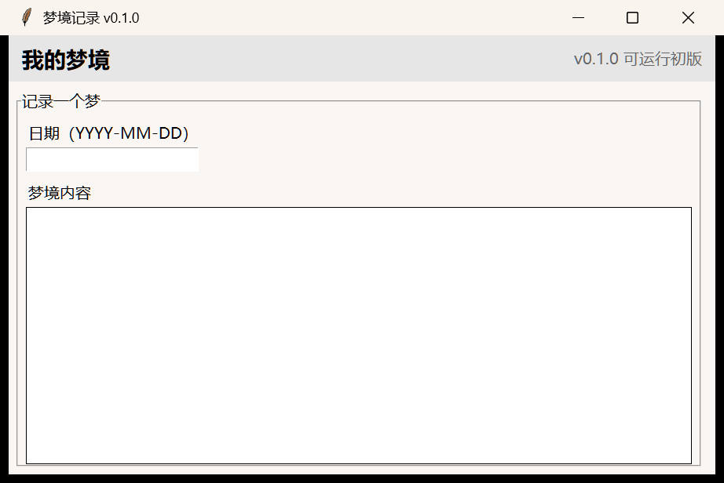
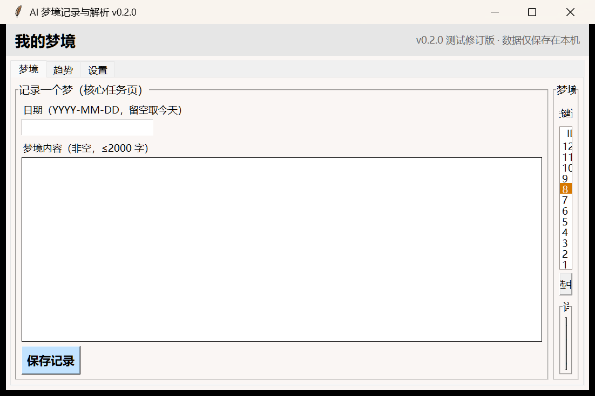
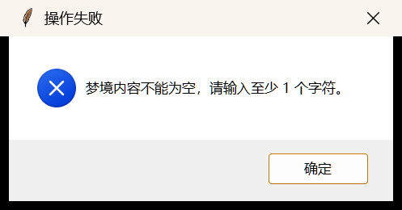
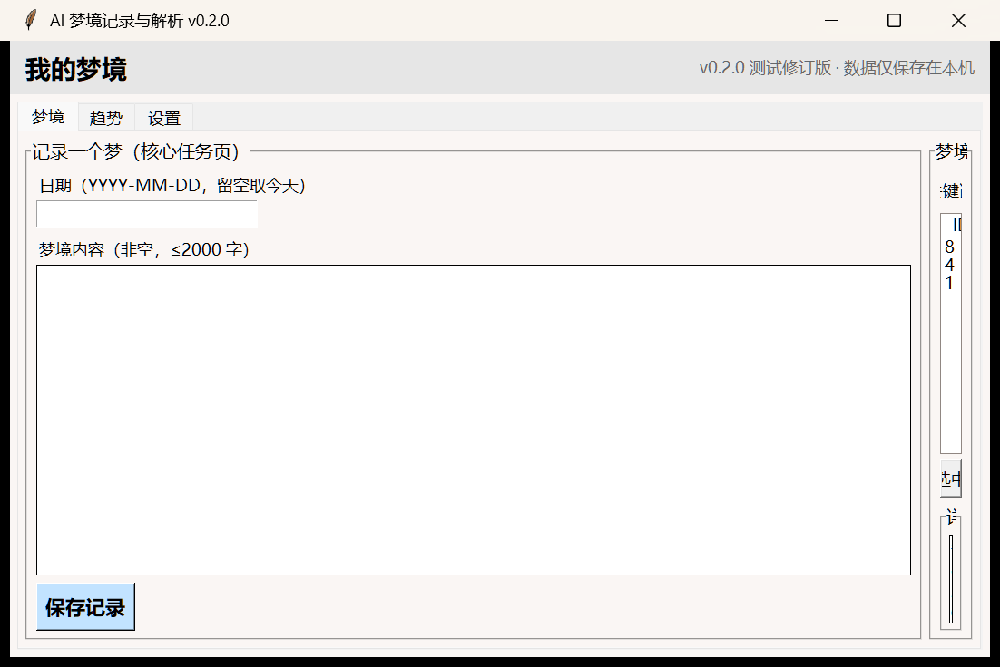
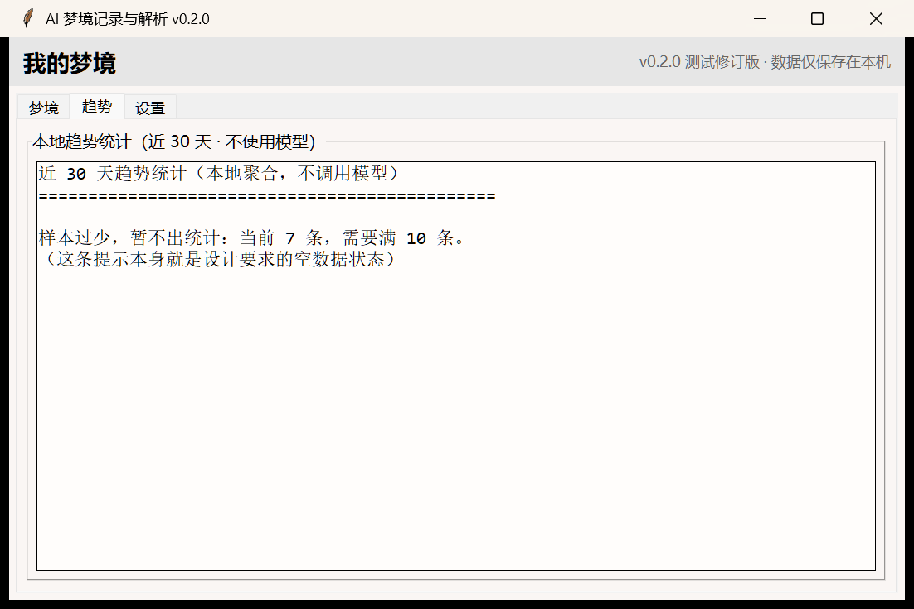

# 实验4：软件基础功能开发

## 学习通提交说明

- **提交平台：** 只向学习通对应的作业上传一份PDF文件。
- **文件命名：** 班级-学号-姓名-实验4-软件基础功能开发.pdf。
- **PDF内容：** 可运行基础功能版本说明、核心业务闭环、测试与复测记录、AI辅助编码审查，以及初版与修订版的仓库版本证据。
- **截止时间：** 以学习通作业设置为准；报告中的仓库链接与Commit用于过程核验。

## 1. 实验目的

- 依据需求与设计基线实现个人软件的非AI业务闭环，形成可持续迭代的工程骨架。
- 以Spring Boot + Vue前后端开发为课堂讲解和示范案例，理解界面、接口、业务逻辑与数据保存之间的协作方式，并能将这些方法应用到本人选择的技术栈中。
- 学会审查AI辅助生成的代码，并以版本记录、测试和解释证明本人完成。


## 2. 实验内容


### 2.1 迭代计划

- 将实验四拆分为“可运行初版”和“测试修订版”两个版本迭代，列出任务、完成条件和风险。
- “可运行初版”完成项目骨架，使程序能够正常启动，并至少完成一次核心数据的读取或保存以及一个页面、接口或操作入口。
- “测试修订版”补全一条基础业务流程，根据检查和测试结果修复问题。
- 为初版和修订版分别保留可运行、可演示的Commit或Tag，并说明两个版本之间的具体变化。

### 2.2 项目骨架与核心数据

- 以课堂示例项目为例，后端可以按照控制层、业务层和数据访问层组织代码，前端可以按照页面、组件、路由和接口调用组织代码；不限制技术栈，但需说明各目录或模块承担的职责。
- 实现核心数据结构及数据保存或状态管理，说明数据库、文件或内存数据的初始化方式。数据库类型和数据访问技术可根据项目需要自行选择并给出选择理由。
- 提供一组可重复使用的样例数据，并说明如何初始化、清空或恢复；同时处理数据为空、重复、格式错误或读取失败等与本项目有关的情况。

### 2.3 主要页面、接口与数据交互

- 在课堂示例项目中，使用后端接口接收请求、调用业务逻辑并返回结果，由Vue页面发起请求和显示数据；采用其他技术栈时，应实现等价的界面或操作入口与业务逻辑之间的数据交互。
- 根据个人软件的核心流程，实现必要的输入、列表或详情、编辑或业务操作页面。
- 说明主要接口或模块调用的输入、输出和校验规则，并分别展示正常数据、空数据和错误输入时的页面、接口或程序反馈。

### 2.4 非AI关键业务闭环

- 选择一条核心用户故事，从用户输入、业务处理、数据保存到结果反馈完整实现。
- 对照实验3的设计结果，说明各步骤对应的页面、接口、业务模块、数据处理和验收条件。
- 模拟真实用户，使用具有真实业务含义的测试输入完整运行该流程，保存关键步骤和最终结果，不能用静态页面代替实际执行。

### 2.5 异常处理、日志与基础测试

- 选择与个人软件实际有关的无效输入、数据不存在、依赖不可用或数据冲突等异常进行处理，避免程序直接崩溃或没有反馈。
- 结合实验2和实验3的设计，整理并执行不少于6个测试用例，记录预期结果、初版结果、修复内容和修订版复测结果。
- 记录能够帮助定位问题的必要日志，说明日志位置和主要内容。

### 2.6 AI辅助编码审查

- 选取一次AI生成或修改代码的任务，使用AI协作记录说明任务、关键输入、AI建议、采用或拒绝的内容、人工修改和测试验证。
- 不得只粘贴AI回答；必须解释关键代码为何正确、有哪些局限。
- 使用代码审查检查不存在的接口、无用依赖、遗漏的异常处理或明显安全问题，并记录至少一处“AI初稿—人工修正—测试通过”的完整证据。

## 3. 操作记录

本节按 2.1—2.6 的顺序展开。截图统一编号为“图 4-x”，代码片段编号为“代码清单 4-x”，日志片段编号为“日志 4-x”，均配文字说明；每张截图都注明了它是哪一步、哪个版本、以及当时的真实状态，**包括失败与报错的状态**，不只展示最终成功页面。所有编号与运行结果均可通过仓库中的 `v0.1.0`、`v0.2.0` 两个 Tag 复现。

### 3.1 迭代计划（第 5—6 周）

按 2.1 的要求把实验4 拆成两个版本迭代：**v0.1.0 可运行初版**只做骨架和一条最小闭环，**v0.2.0 测试修订版**补全非AI关键业务闭环并按测试结果修复。

**表 3-1　两个迭代的任务、完成条件与风险**

| 迭代 | 主要任务 | 完成条件 | 主要风险 |
| --- | --- | --- | --- |
| v0.1.0 可运行初版 | 搭出分层骨架；建库建表；实现“文字记录 → 落库 → 列表”一条最小闭环；做一个可操作的入口 | 程序能正常启动，能保存并读出一条记录，界面能列出记录 | ① 骨架分层过度、文件过多，反而拖慢进度；② 只做漂亮界面而没有真实数据读写 |
| v0.2.0 测试修订版 | 补全校验、人工标注、确认、本地趋势、检索、导出、删除；补日志与异常处理；按 10 个测试用例修复问题 | 非AI关键业务闭环完整跑通；10 个测试用例全部通过；两版各有可复现的 Commit/Tag | ① 校验规则与界面提示对不上，用户看不懂为什么失败；② 修一处引入另一处，缺少回归手段 |

**表 3-2　两个版本的可运行证据**

| 版本 | 仓库版本证据 | 可运行 / 可演示状态 | 测试结果 |
| --- | --- | --- | --- |
| v0.1.0 | Commit `e343927`，Tag `v0.1.0` | `python main.py` 可启动界面；可保存文字记录并在列表看到（图 4-1） | 10 个用例通过 1 个 |
| v0.2.0 | Commit `96c2634`，Tag `v0.2.0` | 完整非AI闭环：记录 → 校验 → 落库 → 列表 → 详情 → 人工标注 → 确认 → 趋势 → 检索 → 导出 → 删除 | 10 个用例全部通过 |

**表 3-3　初版 → 修订版的具体变化**

| 层次 | v0.1.0 初版 | v0.2.0 修订版 | 为什么这样改 |
| --- | --- | --- | --- |
| 界面层 | 单窗口：左输入右列表，只有“保存 / 刷新” | 三页签结构：梦境（记录 + 列表 + 详情标注）、趋势、设置；补检索、导出、删除、确认 | 对应实验3 图 3-5 的页面结构与导航关系，初版只落地了其中一页 |
| 界面层 | 保存按钮直接调用业务层，无 try/except | 所有操作捕获 `ValidationError` / `StorageError`，状态栏 + 弹窗双反馈 | 审查项 R2：异常会打断 tkinter 主循环，用户得不到任何提示 |
| 应用服务层 | 仅 `RecordService.create/list/get/delete`，其余方法抛 `NotImplementedError` | 补 `validate_text` / `validate_date`；补 `ReviewService` 增改确认、`TrendService` 本地聚合、`ExportService` 导出、`RecordService.search` | 审查项 R1、R4：初版无校验、且实验3 表 3-8 遗漏了检索接口签名 |
| 数据访问层 | 每个方法直接用裸 `sqlite3`，异常直接向上抛 | 统一 `_exec()` 包装，`sqlite3.Error` 一律转成 `StorageError`；补 `search()`（参数化 LIKE + 转义通配符）、`count_pending`、`stats_by_field_type` | 审查项 R2、R4 |
| 数据校验 | 无 | 文本非空且 ≤2000 字；日期必须可解析并**规范化**为 YYYY-MM-DD；字段类型限 4 种；置信度必须在 0~1 | 初版把空文本、2001 字、`2026-13-45` 都存进了库 |
| 日志 | 无 | 新增 `dreamjournal/logging_setup.py`，输出到 `logs/app.log` | 2.5 要求记录能定位问题的日志 |
| 样例数据 | 无 | 新增 `dreamjournal/seed.py`，`--seed` / `--reset` 可初始化与清空 | 2.2 要求一组可重复使用的样例数据 |
| 测试 | 10 个用例，通过 1 个 | 同一批用例通过 10 个；TC-06 的断言按分析结论修正 | 见 3.5 与 3.6 |

### 3.2 项目骨架与核心数据（第 5 周）

骨架按实验3 图 3-2 的五层架构落地，目录与层的对应关系如下。

**表 3-4　目录结构与职责**

| 路径 | 对应层（实验3 图 3-2） | 职责 |
| --- | --- | --- |
| `main.py` | 入口 / 装配 | 解析命令行参数、初始化日志、装配各层、启动界面；提供 `--seed / --reset / --export / --no-gui` |
| `dreamjournal/domain.py` | 领域与数据层 | 领域模型 `DreamRecord`、`ParsedField` 与枚举取值、字段上限常量（对应实验3 图 3-3） |
| `dreamjournal/store.py` | 领域与数据层 | `DreamRepository`：建表、增删改查、检索、按字段类型聚合；统一异常 `StorageError` |
| `dreamjournal/services.py` | 应用服务层 | `RecordService`、`ReviewService`、`TrendService`、`ExportService` 与校验函数（对应实验3 表 3-5 / 表 3-8） |
| `dreamjournal/ui.py` | 界面层 | 三页签 tkinter 界面（对应实验3 图 3-5、图 3-6、图 3-7、图 3-8） |
| `dreamjournal/logging_setup.py` | 基础设施层 | 日志配置，输出到 `logs/app.log` |
| `dreamjournal/seed.py` | 基础设施层 | 样例数据的初始化与清空 |
| `tests/run_tests.py` | 测试 | 10 个测试用例，每个用例独立数据库，可从命令行重复执行 |
| `data/`、`logs/`、`out/` | 运行产物 | 数据库、日志与导出文件；已加入 `.gitignore`，不入库 |

**图 4-1　v0.1.0 可运行初版界面（Tag `v0.1.0`）**



> 说明：这是初版的真实运行截图，不是设计稿。左侧是“记录一个梦”输入区（日期 + 内容 + 保存按钮），右侧是记录列表，下方状态栏显示“共 0 条”。窗口标题带 `v0.1.0`，右上有“v0.1.0 可运行初版”字样。此版本只能保存与列出记录：没有校验、没有详情、没有检索、没有趋势、没有导出，这些正是修订版要补的内容。

**表 3-5　核心数据保存方式与选择理由**

| 项目 | 选择 | 理由 | 对应实验3 |
| --- | --- | --- | --- |
| 数据保存 | 本地 SQLite 单文件 `data/dream.db`，用 Python 标准库 `sqlite3` | 单用户单机、无并发需求；标准库零部署零配置；一个文件即可整体备份或删除，天然满足“数据仅存本机” | ADR-02 |
| 表结构 | `dream_record` / `parsed_field` / `app_setting` 三张表，`parsed_field.record_id` 外键 `ON DELETE CASCADE` | 与实验3 图 3-3 的类图一一对应；一条记录可有多个字段、最多一个音频附件 | 图 3-3 |
| 主键与索引 | 自增主键；`idx_record_date`、`idx_field_record` | 列表按日期倒序、详情按 `record_id` 取字段，都是高频访问路径 | — |
| 敏感字段 | `raw_text`、`audio_path` 仅存本机，界面与导出均提示隐私 | 实验3 表 3-7 把这两个字段标为敏感 | 表 3-7 |
| 初始化 | `DreamRepository.init_schema()` 用 `executescript` 建表，`CREATE TABLE IF NOT EXISTS` 可重复执行 | 首次运行自动建库，不需要额外脚本 | — |

**表 3-6　样例数据的初始化、清空与恢复**

| 操作 | 命令 | 效果 | 可重复性 |
| --- | --- | --- | --- |
| 初始化 | `python main.py --db data/demo.db --seed` | 写入 12 条样例梦境与 31 条解析字段，覆盖情绪 / 人物 / 场景 / 意象四类，其中 1 条含“待确认”字段、1 条无字段（信息量低） | 可重复执行，`--seed` 不重复清空，不会产生重复主键 |
| 清空 | `python main.py --db data/demo.db --reset` | 删除全部记录与字段，恢复为空库 | 可重复执行 |
| 恢复 | 先 `--reset` 再 `--seed` | 得到与首次完全一致的样例数据 | 数据由 `seed.DEMO` 常量定义，结果确定 |
| 导出备份 | `python main.py --db data/demo.db --export out/dreams.md` | 生成含全部记录与字段的 Markdown | 可重复执行 |

**表 3-7　与本项目有关的数据异常情况处理**

| 情况 | 处理方式 | 对应测试用例 |
| --- | --- | --- |
| 数据为空 | 列表显示“共 0 条”，趋势页返回 `insufficient` 并提示“样本过少，暂不出统计”，不报错 | TC-04（图 4-3） |
| 记录不存在 | `get()` 返回 `None`；`require()` 抛 `ValidationError`，界面提示“记录 #x 不存在，可能已被删除” | TC-05 |
| 重复数据 | 允许同一天多条记录（一个晚上可能做多个梦）；靠 `dream_date + id` 倒序排列保证顺序稳定 | TC-06 的排序断言 |
| 格式错误 | 空文本、超长文本、非法日期、非法字段类型、越界置信度一律抛 `ValidationError` 并给出具体原因 | TC-02、TC-03、TC-06 |
| 读取 / 写入失败 | 数据层把所有 `sqlite3.Error` 转成 `StorageError`，界面捕获后弹窗提示，不崩溃 | TC-10（不可写路径） |
| 检索输入异常 | 关键词为空时提示输入；检索使用参数化 LIKE 并转义 `%` `_`，注入型输入不会破坏数据 | TC-09 |

### 3.3 主要页面、接口与数据交互（第 5—6 周）

**表 3-8　页面与职责**

| 页面 | 职责 | 对应实验3 |
| --- | --- | --- |
| 梦境页 · 记录区 | 输入日期与梦境内容，保存记录 | 图 3-7 记录页原型 |
| 梦境页 · 列表区 | 按日期倒序显示记录、显示标签摘要与状态；支持关键词检索 | 图 3-6 首页原型 |
| 梦境页 · 详情区 | 显示原文与全部字段，支持新增字段、确认记录 | 图 3-8 结果页原型 |
| 趋势页 | 本地聚合近 30 天意象 Top5 与情绪频次；样本不足时给出提示 | 图 3-5 趋势页 |
| 设置页 | 显示数据文件与日志文件位置、隐私说明、样例数据用法；提供清空与导出 | 图 3-5 设置页 |

**表 3-9　主要接口 / 模块调用的输入、输出与校验规则**

| 接口 | 由谁调用 | 输入 | 输出 | 校验规则 | 失败反馈 |
| --- | --- | --- | --- | --- | --- |
| `RecordService.create` | 梦境页保存按钮 | 文本、可选日期 | 记录对象（含 id，状态 draft） | 文本非空且 ≤2000 字；日期可解析并规范化；来源合法 | 弹窗“梦境内容不能为空”/“超过 2000 字”/“日期格式不正确” |
| `RecordService.search` | 梦境页检索 | 关键词 | 记录列表 | 关键词非空；LIKE 通配符转义 | 弹窗“请输入检索关键词” |
| `RecordService.delete` | 梦境页删除按钮 | 记录 id | `True` | 记录必须存在 | 弹窗“记录 #x 不存在” |
| `ReviewService.add_field` | 详情区添加字段 | 记录 id、类型、标签、是否待确认 | 字段对象 | 记录存在；类型限 4 种；标签非空；置信度 0~1 | 弹窗具体原因 |
| `ReviewService.confirm_record` | 详情区确认按钮 | 记录 id | 剩余待确认字段数量 | 记录必须存在 | 弹窗“记录 #x 不存在，无法确认” |
| `TrendService.top_symbols` | 趋势页 | 天数、条数 | 统计结果或“样本过少”标记 | 不足 10 条不出统计 | 页面提示，不弹窗、不报错 |
| `ExportService.export_markdown` | 设置页 / 梦境页导出 | 目标路径 | 导出条数 | 目录可创建、文件可写 | 弹窗“导出失败（目标路径不可写）” |

**图 4-2　v0.2.0 主界面与详情（正常数据）**



> 说明：修订版在 12 条样例数据下的正常状态。左侧记录区、右上列表、右下详情区三块同时可见；列表中选中的是第 5 条（含待确认字段的那条），详情区显示原文、状态、四个字段（含置信度、“待确认”“已人工修改”标记），并给出黄色提示“仍有 1 个待确认字段，确认前不计入趋势统计”。这条提示是实验3 图 3-3 约束在界面上的直接体现。

**图 4-3　空数据状态（清空数据库后）**


> 说明：清空数据库后进入趋势页的真实状态，页面显示“样本过少，暂不出统计：当前 0 条，需要满 10 条”。这是 2.5 要求的“数据为空时的反馈”，也是实验3 表 3-11（界面状态设计清单）中趋势页“空数据”一行的落地效果。注意此处是**提示而非报错**，程序不会崩溃。

**图 4-4　错误输入时的反馈（空内容点保存）**



> 说明：在内容为空时点击“保存记录”，程序弹出的真实错误对话框：“梦境内容不能为空，请输入至少 1 个字符。”这是初版缺失、修订版补上的校验（审查项 R1）。对话框关闭后记录不会入库，窗口状态栏同样保留这条提示。图中是实际弹出的对话框截图，不是模拟。

### 3.4 非 AI 关键业务闭环（第 6 周）

按 2.4 选定的核心用户故事（在实验2 的 US-01 / US-03 / US-04 基础上，改写成不含 AI 的版本）：

> **作为一名记梦者，我希望把梦境记下来、把它归好类，并能看到自己反复梦到的东西，以便在没有 AI 的情况下也能完成记录与自我观察。**

**表 3-10　闭环步骤与实验3 设计的对照**

| 步骤 | 用户动作 | 页面（实验3 图 3-5） | 接口（实验3 表 3-8） | 业务模块 | 数据处理 | 验收条件 |
| --- | --- | --- | --- | --- | --- | --- |
| 1 输入 | 输入日期与梦境内容 | 记录区（图 3-7） | — | — | — | 文本非空且 ≤2000 字 |
| 2 校验 | 点击“保存记录” | 记录区 | `RecordService.create` | 应用服务层 | `validate_text` / `validate_date`，日期规范化 | 非法输入被拒绝且给出原因（图 4-4） |
| 3 落库 | — | — | `DreamRepository.add` | 数据层 | 写入 `dream_record`，状态 `draft` | 记录可被 `get` 读出 |
| 4 列表 | 查看记录列表 | 列表区（图 3-6） | `RecordService.list_recent` | 数据层 | 按 `dream_date DESC, id DESC` | 列表条数与库内一致（图 4-2） |
| 5 详情 | 点击某条记录 | 详情区（图 3-8） | `RecordService.require` | 应用服务层 | 取记录与全部字段 | 记录不存在时给出提示而非异常 |
| 6 标注 | 选类型填标签后“添加字段” | 详情区 | `ReviewService.add_field` | 应用服务层 | 写入 `parsed_field` | 类型限 4 种、置信度 0~1 |
| 7 确认 | 点击“确认记录” | 详情区 | `ReviewService.confirm_record` | 应用服务层 | 状态改为 `confirmed`，返回剩余待确认数 | 待确认字段仍存在但不计入统计 |
| 8 统计 | 打开趋势页 | 趋势页（图 3-5） | `TrendService.top_symbols` | 应用服务层 | 本地聚合，`needs_confirm=0` 才计入 | 不足 10 条出提示（图 4-3、图 4-6） |
| 9 检索 | 输入关键词检索 | 列表区 | `RecordService.search` | 数据层 | 参数化 LIKE + 通配符转义 | 命中条数正确（图 4-5） |
| 10 导出 | 点击“导出 Markdown” | 设置页 | `ExportService.export_markdown` | 应用服务层 | 生成含隐私声明的 Markdown | 文件可读、路径错误有反馈 |

**代码清单 4-1　闭环的核心业务代码（`dreamjournal/services.py` 节选）**

```python
def validate_date(s, allow_empty=True):
    """校验并规范化日期为 YYYY-MM-DD。

    必须规范化而不是原样入库：dream_record.dream_date 是字符串列，
    list_all 依赖字符串排序，recent_records 依赖字符串比较，
    若允许 '2026-9-7' 这类非规范写法入库，排序与趋势的日期筛选都会出错。
    """
    if s is None or not str(s).strip():
        if allow_empty:
            return _today()
        raise ValidationError('日期不能为空，格式应为 YYYY-MM-DD。')
    s = str(s).strip()
    try:
        d = datetime.strptime(s, '%Y-%m-%d').date()
    except ValueError:
        raise ValidationError('日期格式不正确：%r，应为 YYYY-MM-DD（如 2026-09-27）。' % s)
    if d > date.today() + timedelta(days=1):
        raise ValidationError('记录日期 %s 晚于今天，请确认日期是否填错。' % s)
    return d.strftime('%Y-%m-%d')
```

> 说明：这段代码为什么正确——`strptime` 负责解析，解析失败即拒绝；解析成功后**必须回写规范格式**，否则字符串排序与 `>= 日期` 的趋势筛选都会出错。它的局限是只认 `YYYY-MM-DD` 一种分隔符，`2026/09/27` 会被拒绝；这是有意选择，因为本项目所有日期都由日期输入框产生，宽松解析会掩盖输入错误。

**图 4-5　关键词检索命中（输入“考试”）**



> 说明：在 12 条样例数据中检索“考试”，命中 4 条，状态栏与计数标签同时显示“检索‘考试’命中 4 条”。对应的测试是 TC-09：除命中数量外，还验证了注入型输入 `x'; DROP TABLE dream_record; --` 不会破坏数据表（参数化查询 + 通配符转义）。

**图 4-6　趋势统计页（12 条样例数据）**



> 说明：趋势页是纯本地聚合，不调用任何模型——这是实验2 结论“禁止预测性输出”与实验3 表 3-5 的直接落地。图中显示近 30 天有效记录数、意象 Top5（考试 4 次、水 3 次、被追赶 2 次、楼梯 2 次、迟到 2 次）与情绪频次，并以文字给出“待确认字段不计入统计”的说明。带“待确认”标记的“前同事”字段因此没有出现在统计里。

**代码清单 4-2　导出的 Markdown 文件片段（`out/dreams.md`）**

```markdown
# 梦境档案导出

> 本文件包含敏感的私人内容，仅保存在本机，请勿上传到任何第三方服务。

## #11  2026-09-21
梦见赶不上火车，行李也丢了。

| 类型 | 内容 | 置信度 | 待确认 |
|---|---|---|---|
| 情绪 | 焦虑 | 0.76 | 否 |
| 意象 | 迟到 | 0.72 | 否 |
```

> 说明：导出文件首行即写入隐私声明（对应实验3 表 3-7 的敏感数据标记），字段以表格形式附在原文之后，便于在本地笔记软件中检索。导出不包含任何云端动作。

### 3.5 异常处理、日志与基础测试（第 6 周）

**表 3-11　异常处理清单**

| 异常 | 触发条件 | 处理方式 | 用户看到的反馈 | 用例 |
| --- | --- | --- | --- | --- |
| 无效输入 | 内容为空 / 超过 2000 字 | `validate_text` 抛 `ValidationError` | 弹窗 + 状态栏提示，不入库 | TC-02、TC-03 |
| 格式错误 | 日期无法解析（`2026-13-45`、`2026/09/27`） | `validate_date` 抛 `ValidationError` | 弹窗说明正确格式 | TC-06 |
| 数据不存在 | 查询或确认已被删除的 id | `require()` 抛 `ValidationError` | “记录 #x 不存在，可能已被删除” | TC-05 |
| 依赖不可用 | 导出目标路径不可写 | 捕获 `OSError` 转 `ValidationError` | “导出失败（目标路径不可写）” | TC-10 |
| 数据冲突 / 入库失败 | 数据库不可写、磁盘异常 | 数据层把 `sqlite3.Error` 转 `StorageError`，界面捕获 | 弹窗提示，不崩溃 | TC-10 同族场景 |
| 数据为空 | 库里没有任何记录 | 返回空列表；趋势返回 `insufficient` | 列表“共 0 条”，趋势提示样本过少 | TC-04 |

**表 3-12　测试用例记录（预期结果 / 初版结果 / 修复内容 / 修订版复测）**

| 编号 | 用例 | 预期结果 | 初版 v0.1.0 结果 | 修复内容 | 修订版 v0.2.0 复测 |
| --- | --- | --- | --- | --- | --- |
| TC-01 | 正常记录并落库 | 落库成功，状态 draft | 通过 | — | 通过（记录 #1 落库，status=draft） |
| TC-02 | 空输入被拒绝 | 抛 `ValidationError`，不落库 | 失败：断言失败，空白输入 `''` 未被拒绝 | 新增 `validate_text`，空 / 全空白一律拒绝 | 通过（3 种空白输入全部被拒绝，未产生脏数据） |
| TC-03 | 超长文本被拒绝 | 超过 2000 字被拒绝 | 失败：超长文本未被拒绝 | `validate_text` 增加长度上限判定 | 通过（2001 字被拒绝） |
| TC-04 | 空数据不崩溃 | 空列表 + 趋势提示样本过少 | 失败：未实现（趋势统计） | 实现 `TrendService.top_symbols`，不足 10 条返回 `insufficient` | 通过（空库列表为空；趋势返回“样本过少”提示） |
| TC-05 | 记录不存在 | 返回 `None`，确认时报错 | 失败：未实现（确认记录） | 实现 `confirm_record`，记录不存在时抛 `ValidationError` | 通过（查询返回 None；确认不存在的记录被拒绝） |
| TC-06 | 非法日期格式 | 非法格式被拒绝 | 失败：断言失败，`2026-13-45` 未被拒绝 | 实现 `validate_date`；并按分析结论把断言从“拒绝 2026-9-7”改为“规范化 2026-9-7” | 通过（4 种非法日期被拒绝；`2026-9-7` 规范化为 `2026-09-07`，排序正确） |
| TC-07 | 人工标注与确认 | 字段可增改，确认生效 | 失败：未实现（手动标注字段） | 实现 `ReviewService.add_field / update_field / confirm_record` | 通过（字段可增可改；确认返回 1 个待确认项） |
| TC-08 | 待确认字段不计入趋势 | 确认的计入、待确认的排除 | 失败：未实现（手动标注字段） | 聚合查询加 `needs_confirm = 0` 条件 | 通过（已确认字段计入统计；待确认字段被排除） |
| TC-09 | 关键词检索与注入安全 | 命中正确且数据未被破坏 | 错误：`AttributeError: 'RecordService' object has no attribute 'search'` | 补 `RecordService.search` 与 `DreamRepository.search`（参数化 + 转义） | 通过（关键词命中正确；注入型输入未破坏数据） |
| TC-10 | 删除与导出 | 删除生效，导出可用且路径错误有反馈 | 失败：未实现（导出 Markdown） | 实现 `ExportService.export_markdown`、`RecordService.delete` | 通过（删除生效；导出成功且对不可写路径报错） |

> 合计：初版 10 个用例通过 1 个、失败 9 个；修订版 10 个全部通过。两个版本的结果可用 `git checkout v0.1.0` / `v0.2.0` 后执行 `python tests/run_tests.py` 复现。

**日志 4-1　运行日志片段（`logs/app.log`）**

```
2026-10-11 17:28:53 [INFO] dreamjournal: 日志系统启动，日志文件：...\logs\app.log
2026-10-11 17:28:53 [INFO] dreamjournal: 启动：db=data/demo.db seed=True reset=False export=None
2026-10-11 17:28:53 [INFO] dreamjournal: 已写入 12 条样例数据
2026-10-11 17:28:54 [INFO] dreamjournal: 启动：db=data/demo.db seed=False reset=False export=out/dreams.md
```

> 说明：日志写在 `logs/app.log`（已加入 `.gitignore`，不随仓库提交）。记录的内容包括：启动参数与数据库路径、样例数据写入条数、界面启动时绑定的数据文件、每次业务操作的结果（保存记录 id、检索命中条数、导出条数）、被拒绝的输入原因，以及异常的完整堆栈。控制台只输出 WARNING 及以上，避免干扰界面演示。定位问题时的用法：先看最后一条启动日志确认用的是哪个数据库，再看失败操作前后的两条日志，即可区分“界面没调用”与“业务层抛错”。

### 3.6 AI 辅助编码审查（第 6 周）

**表 3-13　AI 协作记录**

| 项目 | 内容 |
| --- | --- |
| 任务 | 依据实验3 的设计基线，实现“AI 梦境记录与解析”的非AI业务闭环（分层骨架 + 记录/列表/详情/标注/确认/趋势/检索/导出/删除） |
| 关键输入 | 实验3 图 3-2（五层架构）、图 3-3（数据模型）、图 3-5~3-8（页面原型）、表 3-5（模块职责）、表 3-7（字段与约束）、表 3-8（接口清单）、表 3-10（界面状态） |
| 采用的建议 | ① 按实验3 的分层直接落地为 `domain / store / services / ui` 四个模块，接口名沿用表 3-8；② 数据层用标准库 `sqlite3`，表结构与图 3-3 一一对应；③ 界面按图 3-5 做成“梦境 / 趋势 / 设置”三页签 |
| 拒绝的建议 | ① 建议引入 ORM（SQLAlchemy）——拒绝：单表结构简单，引入 ORM 会增加依赖且与 ADR-02“标准库零部署”冲突；② 建议用一个 `main.py` 单文件写完——拒绝：与实验3 的分层设计冲突，也无法用测试单独验证业务层；③ 建议把数据库放到用户主目录——拒绝：与“数据仅存本机工程目录、便于整体备份删除”的隐私设计不符 |
| 人工审查方式 | ① 逐条对照实验3 表 3-8 检查接口是否齐全；② 用 AST 静态检查未使用的 import；③ 先写测试用例再跑初版，用失败结果定位缺陷；④ 审查 SQL 是否全部参数化 |
| 测试验证 | 初版 10 个用例通过 1 个 → 修订版 10 个全部通过（表 3-12） |

**表 3-14　代码审查发现清单**

| 编号 | 审查类别 | 发现的问题 | 风险 | 修正 |
| --- | --- | --- | --- | --- |
| R1 | 遗漏的异常处理 | `RecordService.create` 完全没有参数校验，空文本、2001 字、`2026-13-45` 都会被写进数据库 | 脏数据入库，污染列表与趋势统计；用户不知道自己做错了什么 | 新增 `validate_text` / `validate_date` / `validate_field_type`，统一抛 `ValidationError`，界面弹窗提示 |
| R2 | 遗漏的异常处理 | 数据层直接把裸 `sqlite3.Error` 抛给界面，界面 `on_save` 没有 try/except | 异常会打断 tkinter 主循环，用户点击后界面“没反应”，违反实验3 表 3-10 的错误状态要求 | 数据层统一包装为 `StorageError`；界面所有操作捕获两类异常，状态栏 + 弹窗双反馈 |
| R3 | 无用依赖 | `dreamjournal/ui.py` 导入了 `messagebox` 但从未使用；`tests/run_tests.py` 导入了 `traceback` 但从未使用 | 代码可读性下降，读者会误以为有相关逻辑 | 用 AST 脚本 `_work/check_imports.py` 扫描全部模块，确认后删除无用导入（修订版扫描结果：0 个） |
| R4 | 不存在的接口 | 实验3 表 3-8 只定义了 `IRecordService.create`，没有定义检索接口的签名；编码时按 UC-05 直接调用 `record.search()` 导致 `AttributeError` | 这是**设计文档的遗漏**，不是编码笔误：设计阶段没有给出检索接口，实现阶段必然踩空 | 补上 `RecordService.search` 与 `DreamRepository.search`；该遗漏同时记录在实验4，建议回填实验3 表 3-8 |
| R5 | 明显安全问题 | 检索初稿准备用字符串拼接构造 SQL；`raw_text` 是敏感数据，初版也没有任何隐私提示 | SQL 注入可破坏整张表；敏感数据外泄无提示 | 改为参数化查询 `LIKE ? ESCAPE '\'` 并转义 `%` `_`；导出文件头部写入隐私声明，设置页显示“数据仅保存在本机”；新增 TC-09 注入用例 |

**表 3-15　“AI 初稿 — 人工修正 — 测试通过”的完整证据链**

| 环节 | 内容 | 证据 |
| --- | --- | --- |
| AI 初稿 | 初版按实验3 表 3-8 实现 `RecordService.create`，只做了“建对象、写库、返回”，没有任何校验 | `v0.1.0` 的 `dreamjournal/services.py`；图 4-1 |
| 缺陷暴露 | 写好 TC-02 后用真实输入运行：`create('')`、`create('   ')`、`create('\n\t ')` 全部成功落库，断言失败 | 表 3-12 中 TC-02 的初版结果；`git checkout v0.1.0 && python tests/run_tests.py` |
| 人工修正 | 分析后确认问题不在测试而在实现：校验必须放在业务层而不是界面层，否则任何入口（界面、CLI、脚本）都能写脏数据。新增 `validate_text`，在 `create` 入口调用 | 修订版 `services.py` 的 `validate_text` / `create`（代码清单 4-1 为同族的 `validate_date`） |
| 测试通过 | 重跑 TC-02，3 种空白输入全部被拒绝且库内记录数为 0；重跑全部 10 个用例通过 | 表 3-12 中 TC-02 的复测结果 |

> 补充说明：同一轮审查还暴露了一次**测试用例自身的修正**（TC-06）。初稿断言“`2026-9-7` 应被拒绝”，实测发现 `strptime` 接受非零填充写法。经分析，拒绝它是过度严格且损害易用性，真正的风险在于非规范日期会破坏字符串排序与趋势的日期筛选，因此把断言改为“规范化”。这次修正记录在测试文件的 docstring 中，属于“需求—测试—实现”三方对齐的一次调整，而不是为了让测试变绿而放水。

## 4. 实验小结

### 4.1 完成情况

本次实验按实验3 的设计基线实现了“AI 梦境记录与解析”的**非AI关键业务闭环**，并交付了两个可运行、可复现的版本：

- **v0.1.0 可运行初版**（Tag `v0.1.0`，Commit `e343927`）：分层骨架 + 建库建表 + “文字记录 → 落库 → 列表”最小闭环；
- **v0.2.0 测试修订版**（Tag `v0.2.0`，Commit `96c2634`）：补全校验、人工标注、确认、本地趋势、检索、导出、删除与异常处理，10 个测试用例全部通过。

非AI闭环的完整链路为：**输入 → 校验 → 落库 → 列表 → 详情 → 人工标注 → 确认 → 本地趋势 → 检索 → 导出 → 删除**，每一步都能在实验3 的图或表中找到对应设计（表 3-10 已逐条对照）。

### 4.2 两个版本的差异与迭代收获

两个版本之间共修改 8 个文件、796 行新增 / 146 行删除，测试通过数从 1/10 提升到 10/10。收获主要有三点：

**第一，“能跑”和“对”是两件事。** 初版确实能启动、能保存、能显示，看上去完成了 2.1 对初版的全部要求；但一旦用真实输入去测，10 个用例里 9 个不通过。如果只在界面上点几下“保存成功了”，很容易误以为已经完成。

**第二，校验必须放在业务层。** 初版把校验的责任默认留给了“使用者会输入正确内容”。修订时曾考虑在界面按钮里加判断，但这样 CLI（`main.py --seed`）和测试脚本就绕过了校验，脏数据照样能进库。最终把校验下沉到 `RecordService`，界面只负责把 `ValidationError` 转成用户能看懂的话。

**第三，异常要在层的边界上转换。** 初版让 `sqlite3.Error` 一路冒到界面，界面一旦没接住就会打断 tkinter 主循环。修订后确定了边界规则：数据层统一产出 `StorageError`，业务层统一产出 `ValidationError`，界面只认识这两种异常，异常类型本身就是分层的。

### 4.3 与实验3 设计的对照

**完全落实的部分**：五层架构与模块划分（表 3-4 对上实验3 表 3-5）、数据模型与约束（图 3-3 → `store.py` 的三张表）、接口清单（表 3-8 → 表 3-9）、页面结构（图 3-5 → 三页签）、界面状态（表 3-10 → 图 4-3 的空数据、图 4-4 的错误提示）、以及“趋势统计不由模型生成”这条约束（图 4-6 全部为本地聚合）。

**主动偏离的部分有两处，都记录在此**：

1. **界面框架由 PySide6 换成 tkinter。** 实验3 的 ADR-01 选择 PySide6，但本次开发环境无法安装（无网络，`import PySide6` 失败）。依据 ADR-03 的分层设计，界面层是唯一依赖 GUI 框架的一层——`dreamjournal/domain.py`、`store.py`、`services.py` 完全不导入任何 GUI 库，测试脚本也直接调用业务层而不启动界面，所以这次替换只改动了 `ui.py` 一个文件，其余各层零改动。这反过来验证了 ADR-03“AI 与界面都可替换”的判断是成立的。代价是 tkinter 的控件能力弱于 Qt，界面观感（图 4-2）不如实验3 的原型精致，录音等能力也需另外的库支持。
2. **本阶段不实现语音入口与 AI 解析。** 按 2.4 的要求，本实验只做非AI闭环；语音记录（UC-01 的语音分支）与 AI 结构化解析（UC-02）留待后续实验。当前“手动标注字段”实际上就是实验2 表 3-14 与实验3 表 3-4 中定义的**非AI降级方案**，因此这次交付同时也是降级路径的一次真实验证。

**设计文档的一处遗漏（R4）**：实验3 表 3-8 没有给出检索接口的签名，编码时直接调用 `record.search()` 导致 `AttributeError`。已在本实验中补上实现并记录，建议回填实验3 的接口清单。

### 4.4 关键技术决策

| 决策 | 选择 | 理由 |
| --- | --- | --- |
| 数据存储 | 本地 SQLite 单文件 | 单用户单机、零部署、一个文件即可备份或删除，直接支撑“数据仅存本机” |
| 日期处理 | 解析后规范化回写 `YYYY-MM-DD` | 数据库列是字符串，排序与日期筛选都依赖规范格式 |
| 待确认字段 | 允许存在，但不计入趋势统计 | 对应实验3 图 3-3 的约束：宁可统计少，也不把没确认的字段当成结论 |
| 检索实现 | 参数化 LIKE + 转义 `%` `_` | 既防注入，也防止用户输入的 `%` 变成通配符导致意外全表命中 |
| 测试夹具 | 每个用例独立数据库，且放在工程目录内 | 用例之间互不污染；产物集中在 `data/_test_tmp/`，便于清理 |

### 4.5 遗留问题与风险

1. **界面未做可用性验证。** 图 4-2 的按钮尺寸、暗光下的可读性（实验3 的 NFR-U2）没有真实用户测试，目前只是“能用”。
2. **没有自动化回归入口。** 测试靠 `python tests/run_tests.py` 手动执行，尚未接入 CI；仓库提交前的回归完全依赖自觉。
3. **`raw_text` 明文存储。** 数据库文件本身没有任何加密，任何能读到该文件的人都能看到全部梦境内容。当前靠“仅本机 + 不入库 + 导出提示”控制风险，若后续要上传解析，必须先解决传输与存储的加密问题。
4. **趋势统计的时间窗口是硬编码的 30 天。** 用户不能选择窗口，样本量少时容易长期停留在“样本过少”状态。
5. **AI 协作记录的边界。** 表 3-13—表 3-15 记录的是本次开发中真实发生的“生成—审查—修正—测试”过程，其中审查与修正均以测试结果为准；建议在提交前亲自重跑一次 `python tests/run_tests.py` 并核对表 3-12，确认结论与自己的理解一致。

### 4.6 下一步

按实验3 的 4.6 计划推进：先接入 AI 适配层（`ASRAdapter` / `LLMAdapter` / `OutputValidator`），把“记录 → 解析 → 确认”中的解析环节由手动标注替换为模型抽取，同时保留当前的手动标注作为降级路径；随后补上语音入口（UC-01 的语音分支）与检索、趋势的界面打磨。接入 AI 时需沿用本实验已验证的三条边界规则：模型输出必须经 schema 校验后才能入库、低置信字段必须人工确认、异常必须在本层转换成对上层有意义的类型。

