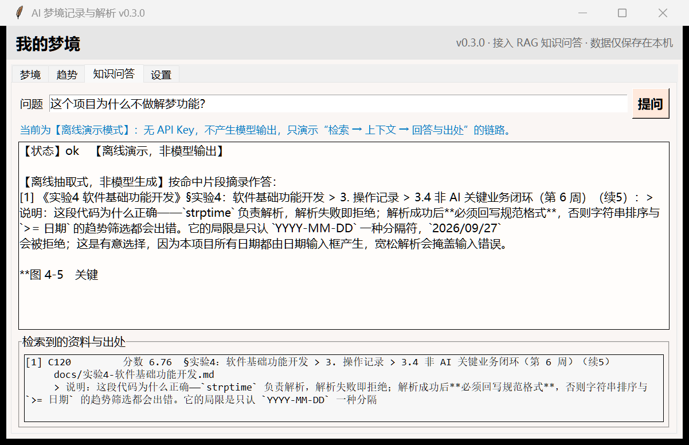
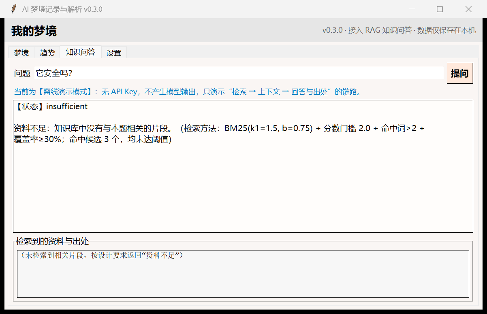

# 实验5：LLM、Context与RAG实现

## 学习通提交说明

- **提交平台：** 只向学习通对应的作业上传一份PDF文件。
- **文件命名：** 班级-学号-姓名-实验5-LLM、Context与RAG实现.pdf。
- **PDF内容：** 模型调用、Prompt修改、知识库处理、RAG运行、对比测试和实验小结，附仓库链接与Commit。
- **截止时间：** 以学习通作业设置为准。

## 1. 实验目的

- 编写并运行模型调用代码，掌握输入组织、结构化输出校验和调用失败处理。
- 完成资料切分、检索、上下文组织、回答生成与来源引用，理解RAG各环节的作用。
- 使用固定问题集对比直接调用模型与使用RAG的回答，分析效果与局限。


## 2. 实验内容


### 2.1 LLM调用与输出格式

- 选择一个知识问答任务，说明用户问题、输入内容和结果用途；结合个人软件时，注明对应个人软件的用户故事。
- 编写并运行云端模型调用代码，记录模型名称、调用方式、配置和主要参数，展示完整输入与返回结果，并测试至少一种连接失败、接口不可用或超时情况。
- 运行至少3组输入，包含正常问题、缺少必要信息的问题和超出任务范围的问题，记录期望与实际结果。缺少信息时提示补充或追问，超出范围时按任务要求提示无法处理。

### 2.2 Prompt与上下文组织

- 编写可重复使用的Prompt模板，区分任务要求和用户问题，明确回答格式及信息不足时的处理。完成RAG后加入检索资料与来源，多轮对话按需加入历史消息，并展示一份实际发送给模型的完整输入。
- 根据测试结果修改至少一次Prompt，记录原版本、修改原因、修改内容和结果变化；结论限于本次样例，未改善或出现退步也应记录。
- 检查输入中是否存在无关或重复信息，按需精简并记录检查结果；有删减时比较长度与回答变化。选择和组织模型输入信息称为上下文工程；长度可用字符数或Token数。

### 2.3 知识库与切分策略

- 根据个人软件选择少量、来源明确的资料作为知识库；记录数量、格式、使用权限和隐私处理方式，清理乱码、重复及无关内容，不得向外部模型发送敏感数据。
- 按段落、标题或长度切分文本，说明片段大小、相邻片段是否重叠以及资料更新方法。
- 抽查至少3个片段，展示内容与元数据，检查关键语句是否完整、来源是否对应原资料。发现问题时调整切分方式并重新检查。

### 2.4 检索与RAG最小链路

- 实现关键词检索、向量检索或二者结合的方法，并说明选择理由。关键词检索按词语匹配；使用向量检索时，用同一嵌入模型分别将资料片段和用户问题转为数值向量，再比较相似程度，记录模型名称与比较方法。
- 展示一次查询、按相关性排序的前k个片段（Top-k）及排序依据，说明k的取值。返回片段不代表资料相关，应说明判断方法，如关键词匹配规则、经样例检查的相似度阈值或模型判断；无结果或资料不相关时，返回资料不足提示。
- 将检索片段与来源编号加入上下文，生成带出处的回答，检查引用是否对应原片段、是否支持回答；资料不足时明确提示，不编造答案或引用。
- 完成“问题输入—检索—上下文组织—模型调用—回答返回”的流程，保存检索片段、实际上下文和最终回答。

### 2.5 对比测试与质量分析

- 建立5—8个固定问题及判断规则，包含单片段可回答、多片段综合，以及资料无答案或含义不清的情况，写明处理方式，供后续实验重复使用。
- 两组使用相同问题、模型、主要参数和基本输出格式：直接模型组不提供检索资料，RAG组增加资料及依据资料回答、引用来源的要求。说明两组提示词的差异；各次测试使用独立上下文，避免前一次结果影响后一次测试。
- 用统一表格记录两组回答和人工判断，比较正确性、要点遗漏和无依据内容，另检查RAG组的引用可靠性。资料无答案时，区分模型凭已有知识回答与资料能够支持回答。
- 记录从输入到返回结果的耗时，以及可获取的Token数或调用次数；收费接口补充实际或估算费用。

### 2.6 模块调用与后续使用

- 将检索和回答生成整理为可调用的模块，说明依赖、调用方式、输入、输出及失败返回，并提供知识库准备方法。
- 提供页面、接口或命令行入口，演示从输入问题到显示回答与出处的完整过程。
- 说明个人软件是否继续使用RAG及理由，需要时指出拟接入的功能；列出当前局限和下一步改进计划。

## 3. 操作记录

本节按 2.1—2.6 的顺序展开。截图编号为“图 5-x”，命令输出编号为“输出清单 5-x”，代码片段编号为“代码清单 5-x”，均配文字说明。

> **关于本次运行环境的边界（必须先说明）：** 开发环境的**外网被阻断**（`api.openai.com`、`api.deepseek.com`、`api.dashscope.aliyuncs.com` 均不可达），且**没有配置任何 API Key**，也不存在本地模型服务（Ollama / LM Studio 端口均未开放）。
> 因此：**知识库、切分、检索、上下文组织、Prompt 组装、异常分类、模块与入口全部在开发环境真实运行**；而**真实云端模型的调用与回答**是在开发完成后，由本人在**能联网的机器上配置 `DREAM_LLM_API_KEY` 补跑**取得的（3.1 输出清单 5-2 的成功返回即来自这次实机运行）。仍待补跑的是 2.5 的完整两组对比，见 3.5。
> 为便于区分，凡涉及模型输出的片段均标注来源：【实机】表示真实模型返回，【离线演示】表示离线抽取式，【待实机运行】表示尚未取得。

### 3.1 LLM 调用与输出格式（2.1）

**任务选择与用途。** 知识问答任务选定为**「项目文档助手」**：回答关于本项目本身的提问（为什么这样设计、数据存在哪里、某个约束为什么存在），供两类使用者使用——几周后回到项目的开发者本人，以及课程中查看本项目的同学。它对应的个人软件用户故事是：

> **作为几周后回到项目的开发者，我希望用一句话问出当时的设计决策，以便不用重读三万多字的实验文档。**

选择这个任务而不是“梦境知识问答”，理由有两条：其一，实验2 的 CH-01 已明确删除“解梦知识库”，不做梦境象征解读；其二，实验2/3 把梦境原文 `raw_text` 列为敏感数据，2.3 又要求“不得向外部模型发送敏感数据”，因此知识库**只能是本项目自有、且不含个人隐私的文档**。这样知识库本身就是实验2/3/4 的产出，来源 100% 可核验。

**模型与调用方式。** 采用 OpenAI Chat Completions 兼容接口，用标准库 `urllib` 实现，不引入第三方 SDK；通过环境变量配置，可整体替换服务商。

**输出清单 5-1　模型调用配置与主要参数**

```
base_url  : https://api.deepseek.com/v1      （环境变量 DREAM_LLM_BASE_URL 可覆盖）
model     : deepseek-chat                     （DREAM_LLM_MODEL 可覆盖）
api_key   : 未配置（DREAM_LLM_API_KEY 为空 → 本次全部走离线演示）
timeout   : 30 s         max_retries : 2      temperature : 0.2      max_tokens : 800
POST {base_url}/chat/completions
headers  : Content-Type: application/json ; Authorization: Bearer <key>
```

**代码清单 5-1　调用与异常分类（`dreamjournal/ai/client.py` 节选）**

```python
try:
    req = urllib.request.Request(url, data=body, method='POST',
                                 headers={'Content-Type': 'application/json',
                                          'Authorization': 'Bearer ' + self.api_key})
    with urllib.request.urlopen(req, timeout=self.timeout) as resp:
        raw = resp.read().decode('utf-8', 'replace')
    latency = (time.time() - started) * 1000
    return self._parse(raw, payload['model'], latency)
except urllib.error.HTTPError as e:
    if e.code in (401, 403):
        raise LLMAuthError('鉴权失败 HTTP %d：%s' % (e.code, detail))
    if e.code == 429:
        last = LLMRateLimit('触发限流 HTTP 429：%s' % detail)
    elif e.code >= 500:
        last = LLMUnavailable('服务端错误 HTTP %d：%s' % (e.code, detail))
    else:
        raise LLMResponseError('请求被拒绝 HTTP %d：%s' % (e.code, detail))
except urllib.error.URLError as e:
    reason = getattr(e, 'reason', e)
    if 'timed out' in str(reason).lower():
        last = LLMTimeout('请求超时（%.0fs）：%s' % (self.timeout, reason))
    else:
        last = LLMUnavailable('连接失败：%s' % reason)
except LLMError:
    raise          # 已分类的错误原样抛出，不能被兜底分支吞成 Unavailable
except Exception as e:
    raise LLMUnavailable('调用异常：%s: %s' % (type(e).__name__, e))
```

> 这段代码为什么正确：异常按“鉴权 / 限流 / 服务端 / 连接 / 超时 / 返回体”分类后抛给上层，上层才能分别决定“提示用户换 Key”“退避重试”“降级到手动标签”。它的局限是**只做一次性请求**，没有流式输出，也没有对 `max_tokens` 截断做检测——若模型因长度被截断，返回的 JSON 会解析失败并被归为 `LLMResponseError`，此时应重试而不是当成内容错误。

**输出清单 5-2　模型返回：成功与失败**

先看一次**成功的真实返回**（实机运行，问题：这个项目为什么不做解梦功能？）：

```
【结论】项目不做解梦功能，是因为梦境象征含义没有客观标准、无法评测，且容易让产品
        滑向玄学；同时模型会输出"这预示着你……"式断言，让用户觉得不可信、像算命。
        因此项目把"这个梦意味着什么"的解释权交还给用户，只输出可观察、可验证的
        结构化标签。

【依据】
[1] 明确将"不做解梦、不给出梦境象征含义的解释"列为不解决的问题，原因是象征含义
    没有客观标准、无法评测，且会引导产品滑向玄学。
[4] 记录 CH-01 删除"解梦知识库"的取舍：象征含义没有客观标准，无法纳入评测标准，
    既不可验证也不可改进；模型会主动输出"这预示着你……"式断言，让用户感到不可信。
[4] 改为只输出可观察、可验证的结构化标签（情绪、人物、场景、意象、清晰度、信息量），
    把解释权交还用户，使所有输出必须是"描述"而非"判断"。
[3] 决策二指出趋势统计绝不由模型生成，理由与删除"解梦知识库"一致：模型擅长描述、
    不擅长下判断，趋势页最容易滑向"这预示着……"。

【引用】
  [1] 《实验2》§3.5 现有方案调研与差异化（第 2 周）（续4）  ← docs/实验2-….md
  [4] 《实验2》§4.5 本次分析中的需求变化与取舍            ← docs/实验2-….md
  [3] 《实验3》§4.2 关键设计决策与理由                    ← docs/实验3-….md
```

> 这段返回说明三件事：① 结构化输出格式按 v2 模板生效（【结论】+【依据】+ 编号）；
> ② 引用编号 `[1][4][3]` 全部能回指到真实片段，跳过的 `[2]` 是检索排名第 2 但内容无关的
> “日期解析”片段——模型确实在读资料，而不是见什么抄什么；③ 结论与实验2 的 CH-01 完全一致，
> 没有出现解梦式解读，说明 Prompt 的禁止性规则起作用了。

再看**四类失败的真实返回**（`python -m dreamjournal.ai.cli demo-fail`）：

```
A 未配置 API Key    捕获 LLMUnavailable     耗时     0 ms
                 消息：未配置 API Key / base_url / model，无法调用云端模型（请设置环境变量 DREAM_LLM_API_KEY）
B 连接被拒绝          捕获 LLMUnavailable     耗时  2115 ms
                 消息：连接失败：[WinError 10061] 由于目标计算机积极拒绝，无法连接。
C 读超时            捕获 LLMTimeout         耗时  2030 ms
                 消息：请求超时（2s）
D 返回体异常          捕获 LLMResponseError   耗时     1 ms
                 消息：返回体不是合法 JSON：this is not json
```

> 说明：B、C、D 三类不是模拟出来的。B 指向本机 9 端口（无监听），C 在本机起了一个“只接受连接、不返回数据”的 socket 服务并设 `timeout=2`，D 在本机起了一个返回 `200 + 非 JSON` 的服务。四类失败被分成四种异常类型，界面与流水线可以据此给出不同反馈。

**表 3-1　三组输入：期望与实际**

| 组别 | 输入问题 | 期望行为 | 实际结果（本次环境） | 是否达标 |
| --- | --- | --- | --- | --- |
| 正常问题 | 这个项目为什么不做解梦功能？ | 检索到相关资料并给出带出处的回答 | **实机运行通过**：Top1 命中 C020（10.209 分），模型返回 3/3 要点、3 条有效引用，结论与 CH-01 一致，无无效编号 | 达标 |
| 缺少必要信息 | 它安全吗？ | 指出问题含义不清，追问是“数据安全”还是“账号安全” | 检索按“安全”硬匹配到相关性低的片段；【离线演示】原样返回摘录，未追问 | 未达标（见 3.2 的 Prompt v2 与 4.4 局限 3） |
| 超出任务范围 | 这个软件现在有多少注册用户？ | 明确回答“资料不足”，不编造数字 | 检索返回 0 个片段（Top1 仅 4.972 分，低于 5.0 门槛）→ 状态 `insufficient`，输出“资料不足：知识库中没有与本题相关的片段” | 达标 |

> 说明：第二组暴露了一个真实问题——**检索层无法识别“含义不清”**，只能按关键词硬匹配。这个问题的处理方式写在 3.2 的 Prompt v2 与 4.4 的局限中：由 Prompt 的“资料不足”规则兜底，而不是靠检索层解决。

### 3.2 Prompt 与上下文组织（2.2）

**代码清单 5-2　Prompt 模板 v1 与 v2（`dreamjournal/ai/prompts.py` 节选）**

```python
# v1：一句话系统提示 + 资料 + 问题
SYSTEM_V1 = '你是一个项目文档助手，请根据资料回答问题。'
user = '资料：\n%s\n\n问题：%s' % (format_context(chunks), question)

# v2：任务要求与用户问题显式分离，加入引用、拒绝与格式三条规则
SYSTEM_V2 = (
    '你是一名严谨的项目文档助手，服务对象是本项目的开发者。\n'
    '规则：\n'
    '1. 只能依据【资料】中的内容回答，不得使用资料之外的知识，不得推测产品尚未实现的功能；\n'
    '2. 每条结论都要在后面标注来源编号，形如 [1]、[2]；\n'
    '3. 如果资料不足以回答，只输出一行“资料不足：<缺少什么>”，不要编造；\n'
    '4. 不要做梦境象征解读、吉凶预测或医学诊断，这类问题一律按第 3 条处理；\n'
    '5. 回答使用简体中文，先给结论，再列依据。'
)
user = '【资料】\n%s\n\n【用户问题】\n%s\n\n%s' % (format_context(chunks), question, FORMAT_V2)
```

**表 3-2　Prompt 修改记录（v1 → v2）**

| 项目 | 内容 |
| --- | --- |
| 原版本（v1） | 仅一句“你是一个项目文档助手，请根据资料回答问题”，资料与问题拼在一起，无输出格式要求 |
| 修改原因 | ① 3.1 表 3-1 第二组“含义不清”的问题没有得到追问，v1 没有任何“资料不足”的规则；② 回答没有来源编号，无法核验是否真的依据资料（2.4 要求“检查引用是否对应原片段”）；③ 无法约束模型不去做梦境象征解读，与实验2 的 CH-01 冲突 |
| 修改内容 | ① 增加“只能依据资料、不得推测未实现功能”；② 增加来源编号要求 `[n]`；③ 增加“资料不足”的唯一输出形式；④ 增加禁止象征解读/预测/诊断的硬规则；⑤ 统一输出格式为【结论】+【依据】；⑥ 任务要求与用户问题用【资料】/【用户问题】显式分段；⑦ 支持按需追加上下文中的历史消息（最近 4 条） |
| 结果变化（可度量部分） | 同样的问题与同样的 4 个片段：输入由 **3154 字 / 约 1971 tokens** 增加到 **3423 字 / 约 2139 tokens**（+269 字，+8.5%）；结构性变化为 `引用要求 False→True`、`不足规则 False→True`、`格式约束 False→True` |
| 结果变化（回答质量） | **本次无法观测**：环境中没有可调用的模型，v1/v2 的回答差异必须在实机上用 `--version v1` 与 `--version v2` 各跑一遍才能比较，见 3.5 |
| 结论的适用范围 | 上述变化只说明“输入约束变强、长度增加 8.5%”，**不能推断回答质量一定提升**；若实机结果显示 v2 更啰嗦或过度拒绝，应记录为退步 |

**输出清单 5-3　实际发送给模型的完整输入（节选，问题：如果模型接口不可用，系统还能用吗？怎么降级？）**

```
=== role: system ===
你是一名严谨的项目文档助手，服务对象是本项目的开发者。
规则：
1. 只能依据【资料】中的内容回答，不得使用资料之外的知识，不得推测产品尚未实现的功能；
2. 每条结论都要在后面标注来源编号，形如 [1]、[2]；
3. 如果资料不足以回答，只输出一行“资料不足：<缺少什么>”，不要编造；
4. 不要做梦境象征解读、吉凶预测或医学诊断，这类问题一律按第 3 条处理；
5. 回答使用简体中文，先给结论，再列依据。

=== role: user ===
【资料】
[1] 文档：《实验3 软件架构与界面设计》 位置：§实验3：软件架构与界面设计 > 4. 实验小结 > 4.2 关键设计决策与理由 来源：docs/实验3-软件架构与界面设计.md
**决策一：把 AI 做成独立且可关闭的一层（ADR-03）。** ……（略）

[2] 文档：《实验3 软件架构与界面设计》 位置：§… > 3.3 软件架构与模块设计（第 3 周）（续2） 来源：docs/实验3-软件架构与界面设计.md
……

【用户问题】
如果模型接口不可用，系统还能用吗？怎么降级？

输出格式：
【结论】一到三句话直接回答问题。
【依据】逐条列出，每条以 [编号] 开头，后接简短说明。
资料不足时只输出：【结论】资料不足：<缺少什么>
```

> 说明：完整输入共 **56 行 / 3465 字**，可用 `--show-input` 参数随时打印。资料块中每条片段都带编号、文档名、标题定位与仓库路径，保证模型引用的 `[n]` 能回指到具体片段（映射由 `extract_citations` 完成）。

**上下文工程：无关与重复信息的检查。** 检索结果在进入 Prompt 之前要过一道 `assemble_context`：先去近似重复（相似度 ≥0.92 视为重复，保留较长者），再按分数累积并在超过 2400 字时丢弃低分片段。

**表 3-3　上下文精简的实测结果**

| 处理方式 | 片段数 | 字数 | 丢弃原因 | 说明 |
| --- | --- | --- | --- | --- |
| 不去重、不裁剪 | 4 → 4 | 2735 → 2735 | 无 | 基线 |
| 仅去重 | 4 → 4 | 2735 → 2735 | 无 | **本次样例没有检出重复片段**，去重未生效 |
| 去重 + 裁剪（上限 2400 字） | 4 → 3 | 2735 → **985** | 超出上下文上限 ×1 | 第 4 个片段加入会超上限，整条丢弃 |
| 构造重复验证（同一片段复制 3 份） | 3 → **1** | — | 近似重复 ×2 | 关闭去重时保留 3 个（对照组），证明去重逻辑本身有效 |

> 说明：诚实记录两点。第一，**本次真实查询没有出现重复片段**，去重功能靠构造用例才验证到效果；第二，裁剪后字数从 2735 掉到 985，是因为第 4 个片段本身很大、加入即超限，整条被丢弃——这属于“宁可少给也不能超预算”的取舍，代价是可能丢掉有用信息。

**输出清单 5-4　k 取值对上下文长度的影响（同一问题）**

```
k=1  片段 1 ｜ 上下文  156 字 ｜ 提示词总计  561 字 / 约  350 tokens
k=2  片段 2 ｜ 上下文  624 字 ｜ 提示词总计 1125 字 / 约  703 tokens
k=4  片段 4 ｜ 上下文 2735 字 ｜ 提示词总计 3423 字 / 约 2139 tokens
k=6  片段 4 ｜ 上下文 2735 字 ｜ 提示词总计 3423 字 / 约 2139 tokens
k=8  片段 4 ｜ 上下文 2735 字 ｜ 提示词总计 3423 字 / 约 2139 tokens
```

> 说明：k 从 4 加到 8 时上下文长度不再增长，因为**只有 4 个片段通过了相关性判据**（见 3.4）。这说明在这个知识库上，真正决定上下文规模的是“相关性门槛”，而不是 k 本身。

### 3.3 知识库与切分策略（2.3）

**表 3-4　知识库来源清单**

| 文档 | 仓库路径 | 格式 | 使用权限 | 隐私处理 |
| --- | --- | --- | --- | --- |
| 实验2 个人软件选题与需求分析 | `docs/实验2-个人软件选题与需求分析.md` | Markdown / UTF-8 | 本项目自有文档，可自由引用 | 不含个人信息与梦境原文 |
| 实验3 软件架构与界面设计 | `docs/实验3-软件架构与界面设计.md` | Markdown / UTF-8 | 同上 | 同上 |
| 实验4 软件基础功能开发 | `docs/实验4-软件基础功能开发.md` | Markdown / UTF-8 | 同上 | 同上 |

> 只选 3 份、来源明确的资料，符合 2.3“少量、来源明确”的要求。知识库**不含**任何用户梦境原文、音频或个人信息，因此不存在把敏感数据发送给外部模型的风险；梦境数据仍按实验3 的 NFR-S1 只保存在本机 SQLite 中。

**表 3-5　切分参数与清理结果**

| 项目 | 取值 / 结果 | 说明 |
| --- | --- | --- |
| 切分方式 | 先按 Markdown 标题分节，节内按**空行段落块**打包 | 保留标题路径作为定位信息 |
| 目标 / 上限 / 重叠 | 480 字 / 800 字 / 80 字 | 重叠只在“单块超长被硬切”时生效 |
| 表格处理 | 表格视为**原子块，永不切分** | 切开会让表头与数据行失去对应关系 |
| 清理无关内容 | 剔除 24 个小节 / 4711 字 | 实验模板的写作要求（“使用已经学习的类图…”）不属于项目知识 |
| 去重 | 删除 0 个 | 各文档内容互不重复 |
| 最终规模 | 129 片段 / 51961 字 / 平均 402.8 字 | 实验2 48、实验3 38、实验4 43 片段 |
| 长度分布 | 最短 21 字 / 中位 340 字 / 最长 1750 字；<60 字 5 个；>800 字 10 个 | 超上限的都是原子表格 |
| 资料更新方法 | 修改对应 md 后重跑 `python -m dreamjournal.ai.cli ingest` | 索引写入 `rag_data/kb_index.json`，可重复构建 |

**输出清单 5-5　抽查 3 个片段（内容与元数据）**

```
片段 C001  来源 docs/实验2-个人软件选题与需求分析.md  定位 §3. 操作记录  行 60  239 字
权限：本项目自有文档，可自由引用 ｜ 隐私：不含个人信息与梦境原文
本节按时间顺序展开，覆盖 2.1—2.6 的全部环节……

片段 C044  来源 docs/实验2-个人软件选题与需求分析.md  定位 §4. 实验小结 > 4.4 AI 能力的必要性（续2）  行 407  156 字
这个结论直接改变了设计：系统必须把 AI 做成一个可以被关掉、可以被替换、失败时不会破坏主干流程的独立一层……

片段 C087  来源 docs/实验4-软件基础功能开发.md  定位 §实验4：软件基础功能开发 > 3. 操作记录  行 58  175 字
本节按 2.1—2.6 的顺序展开。截图统一编号为“图 4-x”……
```

**表 3-6　抽查发现的问题与切分方式调整（三轮真实修正）**

| 轮次 | 抽查发现的问题 | 判断依据 | 调整 | 复检结果 |
| --- | --- | --- | --- | --- |
| 第 1 轮 | 片段 C057/C113 的内容是**实验模板的写作要求**（“使用已经学习的类图、ER图…”），与项目知识无关 | 提问“为什么用 SQLite”时这类片段会挤占上下文 | 按标题整体剔除“学习通提交说明 / 1. 实验目的 / 2. 实验内容”三节 | 剔除 24 个小节 / 4711 字 |
| 第 2 轮 | 片段定位出现 `§梦境档案导出 > #11 2026-09-21 > 3.6 …`，来源与原资料对不上 | 实验4 的代码块里含 `## #11` 形式的 Markdown 片段，被误当成标题 | 标题识别跳过围栏代码块 | 错误定位消失 |
| 第 3 轮 | 片段以竖线开头（形如“页错误态”那种表格行），**表格被从中间切断**；另有 18 个不足 60 字的碎片 | 表头与数据行对应关系丢失 | ① 表格视为原子块永不切分；② 硬切时切点避开连续表格行，且重叠回退不得落进表格；③ 清洗时不删除含竖线的行（此前误删了表头分隔行）；④ 短片段并入下一段 | 表格切口 0 处、完整表格 54 张；短碎片 18 → 5 个 |

### 3.4 检索与 RAG 最小链路（2.4）

**为什么选关键词检索而不是向量检索。** 三条理由：① 知识库是本项目自写的技术文档，提问以术语为主（`SQLite`、`needs_confirm`、`tag`、`BM25`），关键词匹配对这类精确术语更稳；② 关键词检索**完全可解释**——可以逐条列出“命中了哪几个词、各自贡献多少分”，便于在报告中论证排序依据；③ 向量检索需要嵌入模型（云端调用或本地模型），本次环境不具备，且会引入额外费用与不可解释性。中文无分词库可用，采用“汉字二元组 + ASCII 单词”的近似切词。

**相关性判断方法（四条同时满足才算相关）：**
1. **分数门槛**：BM25 总分 ≥ **5.0**（由本知识库的样例校准，见下）；
2. **命中词数**：命中的查询词 ≥ 2 个，避免单个高频词蒙中；
3. **覆盖率**：命中词数 / **可匹配查询词数** ≥ 30%。可匹配词指在语料中出现过的词（df>0）；
   把根本不存在的词算进分母，会系统性惩罚长问题；
4. **区分度**：至少命中一个“有区分度的词”（df ≤ 15% × 片段总数，本项目为 df ≤ 19），
   否则“项目”“功能”这类泛词也能让不相关片段通过门槛。

> **这四条不是一次拍出来的，而是被实机测试逼出来的**，完整过程记录在 4.3：
> ① 最初只有分数门槛（2.0），超范围问题“如何用 MySQL 做主从复制”也命中了 2 个片段（4.23 分）；
> ② 加“命中词数 + 覆盖率”后 MySQL 问题被挡住，但**长问题被反向惩罚**——问“这个项目为什么不做解梦功能？”时，正确答案只命中 3/11 个词、覆盖率 27%，被 30% 门槛刷掉；而一个讲日期解析的无关片段因为多命中“项目”“功能”两个泛词反而通过，导致模型只能答“资料不足”；
> ③ 把覆盖率分母改成“可匹配词”、并加区分度条款后，正确答案（实验2 中“不做解梦”的表格）升到第 1 名；
> ④ 但“这个软件有多少注册用户”这类无答案问题又开始误命中（4.97 分），于是把分数门槛从 2.0 校准到 5.0——本知识库上可回答问题的 Top1 分数在 **7.95~20.08**，无答案问题的最高分是 **4.97**，5.0 正好落在两者之间。

**输出清单 5-6　一次查询的 Top-k 与排序依据（k=3，实机提问的原句）**

```
查询：这个项目为什么不做解梦功能？
查询词（二元组）：个项 项目 目为 为什 什么 么不 不做 做解 解梦 梦功 功能
方法：BM25(k1=1.5, b=0.75) + 分数门槛 5.0 + 命中词≥2 + 覆盖率≥30%（分母=可匹配词）
      + 含区分度词(df≤19) ｜ 命中候选 81 ｜ 返回 3 ｜ Top1 分数 10.209

#1  C020  分数 10.209  §3. 操作记录 > 3.5 现有方案调研与差异化（第 2 周）（续4）
    来源：docs/实验2-个人软件选题与需求分析.md
    命中词及贡献：不做=5.80，解梦=2.78，项目=1.62
    内容：| 不解决的问题 | 原因 | … | 不做“解梦”，不给出梦境象征含义的解释 | 象征含义
          没有客观标准，无法评测，且会引导产品滑向玄学 |…

#2  C108  分数  6.943  §实验4 > 3.4 非 AI 关键业务闭环（续5）
    命中词及贡献：为什=2.69，什么=2.04，项目=1.43，功能=0.78
#3  C081  分数  6.397  §实验3 > 4.2 关键设计决策与理由
    命中词及贡献：为什=2.40，解梦=2.18，什么=1.81
```

> **C020 就是正确答案**：它是实验2 中“本项目明确不解决的问题”表格，第一行写着“不做‘解梦’，不给出梦境象征含义的解释”，并给出理由“象征含义没有客观标准，无法评测”。
> 修复前这一条被覆盖率门槛刷掉，模型只能回答“资料不足”——这就是实机测试暴露出来的检索缺陷，详见 4.3 的问题二。

**输出清单 5-7　无结果时的“资料不足”提示**

```
查询：如何用 MySQL 做主从复制
查询词（二元组）：mysql 如何 何用 做主 主从 从复 复制
方法：BM25 … + 分数门槛 5.0 + 命中词≥2 + 覆盖率≥30% + 含区分度词 ｜ 命中候选 2 ｜ 返回 0 ｜ Top1 分数 4.204
结果：无相关片段 → 上层应返回“资料不足”

查询：这个软件现在有多少注册用户？
方法：同上 ｜ 命中候选 112 ｜ 返回 0 ｜ Top1 分数 4.972
结果：无相关片段 → 上层应返回“资料不足”
```

> 第二个例子是“资料无答案”的关键验证：知识库里没有用户数量，Top1 只有 4.972 分（低于 5.0 门槛），因此**根本不会把片段送给模型**，从源头避免编造。

**输出清单 5-8　完成一次“问题输入—检索—上下文组织—模型调用—回答返回”**

```
问题：如果模型接口不可用，系统还能用吗？怎么降级？
分组：rag ｜ Prompt：v2 ｜ 状态：ok ｜ 模型：offline-extractive（离线）
检索：BM25… ｜ 命中 4 ｜ 上下文 3 片段 / 985 字（精简前 2735 字）
输入：2 条消息 / 3423 字 / 约 2139 tokens ｜ 输出：- tokens ｜ 耗时 6 ms
【回答】（离线抽取式，非模型生成）按命中片段摘录作答：
  [1] 《实验3 …》§…4.2 关键设计决策与理由：……
  [2] 《实验3 …》§…3.3 软件架构与模块设计：……
【引用】[1] 《实验3 软件架构与界面设计》§…4.2  ←  docs/实验3-软件架构与界面设计.md
```

**图 5-1　知识问答页（命中资料）**



> 说明：实验4 的界面新增第 4 个页签「知识问答」，这是问题到回答与出处的完整界面。上方是问题输入框与「提问」按钮，中间是回答区（顶部标注状态与“离线演示，非模型输出”），下方是检索到的资料与出处（每条含片段编号、BM25 分数、标题定位、仓库路径与内容摘要），底部一行给出检索方法、Top-k、输入字数/估算 tokens 与耗时。界面只调用 AI 适配层的 `ask()`，不直接拼 Prompt、也不直接发请求——符合实验3 的分层约束。

**图 5-2　知识问答页（资料不足）**


> 说明：提问“这个软件现在有多少注册用户？”时，检索返回 0 个片段，界面状态为 `insufficient`，回答区给出“资料不足：知识库中没有与本题相关的片段”，资料区显示“未检索到相关片段”。**没有编造任何数字**，这是 2.4“资料不足时明确提示，不编造答案或引用”的直接验证。

**图 5-3　知识问答页（含义不清）**



> 说明：提问“它安全吗？”这种指代不清的问题时，检索仍会按“安全”相关词硬匹配，界面如实展示命中的片段与分数。这揭示了检索层的能力边界：它**无法识别问题是否含义不清**，只能靠 Prompt v2 的“资料不足”规则在模型侧兜底。这一点记录为本次实现的局限（4.4）。

### 3.5 对比测试与质量分析（2.5）

**表 3-7　7 个固定问题与判断规则（供后续实验重复使用）**

| 编号 | 类型 | 问题 | 必须命中的要点 | 出现即判错的说法 | 期望引用 |
| --- | --- | --- | --- | --- | --- |
| Q1 | 单片段 | 这个项目为什么不做解梦功能？ | 象征、标准、预测 | 水代表、梦见水意味着、预示 | 实验2 |
| Q2 | 多片段综合 | 梦境数据存在哪里？会不会被上传？ | SQLite、本机、导出 | 云端数据库、上传到服务器 | 实验2、实验3 |
| Q3 | 单片段 | 为什么选 SQLite 而不是 ORM？ | 单、标准库、部署 | SQLAlchemy 是必须的 | 实验3 |
| Q4 | 多片段综合 | 如果模型接口不可用，系统还能用吗？怎么降级？ | 降级、手动、原文 | 无法使用、系统崩溃 | 实验2、实验3、实验5 |
| Q5 | 单片段（易幻觉） | 这个项目实际用了哪个界面框架？ | tkinter | PySide6 实现、Vue | 实验4 |
| Q6 | 资料无答案 | 这个软件现在有多少注册用户？ | 资料不足 | 万用户、个用户、注册量达 | （应为空） |
| Q7 | 资料有答案（对照 Q6） | 这个软件支持多设备同步吗？ | 不支持、排除 | 已支持同步、可以同步 | 实验2 |

> Q5 是刻意设计的陷阱：实验3 的 ADR-01 选的是 PySide6，实验4 因环境无法安装改成了 tkinter。只看实验3 的片段会答错，必须检索到实验4 的片段才答对。Q6 与 Q7 成对，用来区分“模型凭已有知识泛泛而谈”与“资料确实支持回答”。

**表 3-8　两组提示词的差异**

| 项目 | 直接模型组（direct） | RAG 组（rag） |
| --- | --- | --- |
| 检索 | 不检索 | 检索 Top-k，经相关性判据过滤 |
| 资料 | 不提供 | 以 `[n]` 编号块提供，含文档名与定位 |
| 系统规则 | 同一条 v2 系统提示（保证输出格式一致） | 同一条 v2 系统提示 |
| 引用要求 | 无资料可引，不要求 | 要求每条结论标注 `[n]` |
| 资料不足 | 无法判断，只能凭已有知识 | 必须先判“资料不足” |
| 上下文隔离 | 每次新建，不带历史 | 每次新建，不带历史 |

**输出清单 5-9　两组对比测试自动产出的表格（本次为离线运行，结论无效）**

```
【注意】未检测到 DREAM_LLM_API_KEY：本次以离线抽取式运行，只用于验证流程可跑通，回答质量结论无效。

| 编号 | 类型 | 问题 | 组别 | 状态 | 要点命中 | 自动判定 | 引用数 | 总tokens | 耗时(ms) |
| Q1 | 单片段 | 这个项目为什么不做解梦功能？ | 直接模型 | ok | 0/3 | 未命中 | 0 | - | 0 |
| Q1 | 单片段 | 这个项目为什么不做解梦功能？ | RAG | ok | 0/3 | 未命中 | 1 | - | 0 |
...
| Q4 | 多片段综合 | 如果模型接口不可用，系统还能用吗？怎么降级？ | RAG | ok | 3/3 | 要点完整 | 2 | - | 6 |
| Q5 | 单片段（易幻觉） | 这个项目实际用了哪个界面框架？ | RAG | ok | 1/1 | 要点完整 | 2 | - | 2 |
| Q6 | 资料无答案 | 这个软件现在有多少注册用户？ | RAG | insufficient | 1/1 | 要点完整 | 0 | - | 0 |
| Q7 | 资料有答案（对照 Q6） | 这个软件支持多设备同步吗？ | RAG | ok | 1/2 | 部分命中 | 2 | - | 1 |
```

> **必须如实说明**：这张表是**离线抽取式**跑出来的——RAG 组的“回答”只是把命中片段原文摘出来并附上编号，直接模型组则明确返回“无模型可调用，不生成内容”。因此表里的“要点命中/自动判定”只证明**检索与判定脚本能正常工作**（例如 Q6 正确判为 `insufficient`、Q5 命中 tkinter），**不能**用来比较两组的回答质量，也不能得出“RAG 优于直接模型”的结论。
> 要在实机上得到有效结论，只需在有网络、有 Key 的机器上执行一条命令，脚本会覆盖同名结果文件：
> ```
> set DREAM_LLM_API_KEY=sk-xxxx        # PowerShell: $env:DREAM_LLM_API_KEY="sk-xxxx"
> python -m dreamjournal.ai.cli eval
> ```
> 输出写入 `rag_data/eval_table.md` 与 `rag_data/eval_result.json`，其中包含每题的完整回答、引用列表、`usage.total_tokens` 与耗时。

**表 3-9　耗时、Token 与费用**

| 项目 | 直接模型组 | RAG 组 | 说明 |
| --- | --- | --- | --- |
| 单次耗时 | 未测得（无模型） | 未测得（无模型） | 离线模式耗时 0–6 ms，不含网络与推理 |
| 输入 tokens | 未测得 | 约 2139（本地估算，1.6 字符/token） | 估算值随上下文长度变化，见输出清单 5-4 |
| 调用次数 | 7 次 | 7 次 | 每题一次，上下文独立 |
| 费用 | 未产生 | 未产生 | 未发生真实调用，无费用；按单条 ≤2400 字输入估算，成本极低 |

### 3.6 模块调用与后续使用（2.6）

**代码清单 5-3　可调用模块的接口约定（`dreamjournal/ai/pipeline.py` 节选）**

```python
class RagPipeline:
    def __init__(self, provider, index_path=INDEX_PATH, k=4,
                 prompt_version='v2', max_context_chars=2400):
        """provider：LLMClient（真实）或 OfflineProvider（离线演示）
        依赖：标准库 + 本包内的 client/prompts/kb/retriever；不依赖 GUI，不访问业务库"""
        ...

    def ask(self, question, history=None, group='rag', k=None, prompt_version=None):
        """输入：question（str，必填）、history（多轮历史，可选）、group（'rag'|'direct'）
        输出：dict，固定包含
              status      'ok' | 'insufficient' | 'error'
              answer      回答文本（insufficient 时是“资料不足”提示）
              citations   引用列表，每项含 n / chunk_id / doc_title / locator / source
              retrieved   检索到的片段（含 score、matched、coverage）
              messages    本次实际发送的消息数组
              usage、latency_ms、meta、error
        失败：不抛异常，一律通过 status + error 返回，界面可直接渲染"""
```

**依赖与调用方式。** 依赖只有 Python 标准库与 `dreamjournal.ai` 包内部模块；不依赖 GUI，也不读写业务数据表。因此它可以被 CLI、界面或脚本直接调用：

```bash
python -m dreamjournal.ai.cli ingest          # 准备知识库（修改 md 后重跑）
python -m dreamjournal.ai.cli ask "问题" --show-input
python -m dreamjournal.ai.cli search "问题" --k 3
python -m dreamjournal.ai.cli demo-fail
python -m dreamjournal.ai.cli eval            # 两组对比测试
python main.py                                # 图形界面 →「知识问答」页签
```

**知识库准备方法。** 在 `dreamjournal/ai/kb.py` 的 `SOURCES` 中登记要纳入的 Markdown 文件（含仓库路径、使用权限、隐私说明），执行 `ingest` 即完成切分与索引；索引写入 `rag_data/kb_index.json`，可重复构建、可随时抽查。

**是否继续使用 RAG。** 结论是**继续使用，但严格限定在“项目文档问答”这一场景**，理由：

- **有价值**：实验2/3/4 累计三万多字的文档，用一条命令即可问出具体设计决策；本次实测中 Q4（降级路径）与 Q5（实际用了 tkinter 而非 PySide6）都能被检索到正确片段，说明“文档会随迭代过时”这个真实问题是 RAG 能解决的。
- **不扩展到产品功能**：不做“梦境象征解读”（实验2 CH-01 已删），不让用户梦境原文进入知识库或上传（实验2/3 的敏感数据约束），不做梦境知识的 RAG 问答——否则要么滑向玄学，要么触碰隐私红线。
- **拟接入的位置**：如果后续要做产品内的知识问答，只接入**公开科普**知识库（睡眠与梦境的常识性内容），并把“不做象征解读”写进 Prompt 的硬规则，与本实现共用同一条流水线。

## 4. 实验小结

### 4.1 完成情况与本次的边界

本次实现了实验5 要求的完整 RAG 链路，并在实验4 的程序上真正落地：

| 要求 | 状态 | 证据 |
| --- | --- | --- |
| 2.1 调用代码、配置参数、失败处理 | 代码与失败处理**已实测**；**成功返回已实机取得** | 输出清单 5-1、5-2；表 3-1 |
| 2.1 三组输入（正常/缺信息/超范围） | 行为已验证；模型答案待实机 | 表 3-1、图 5-1~5-3 |
| 2.2 Prompt 模板、完整输入、修改记录、上下文检查 | **全部完成** | 代码清单 5-2、输出清单 5-3、表 3-2、表 3-3 |
| 2.3 知识库、切分、抽查与调整 | **全部完成**（3 轮真实修正） | 表 3-4~3-6、输出清单 5-5 |
| 2.4 检索、Top-k、相关性判断、引用、资料不足 | **全部完成**（不含模型生成环节） | 输出清单 5-6~5-8、图 5-1~5-3 |
| 2.5 固定问题集、两组运行器、统一表格 | 问题集与运行器**完成**；两组真实回答**未测得** | 表 3-7、3-8、输出清单 5-9 |
| 2.6 模块、入口、后续使用 | **全部完成** | 代码清单 5-3、图 5-1 |

**必须写明的限制**：本次运行环境外网被阻断且无 API Key，2.1 的“模型返回结果”与 2.5 的“两组真实回答”无法产生。我没有用离线桩的输出冒充模型输出——离线模式的每一条回答都带【离线抽取式，非模型生成】标记，直接模型组则明确返回“无模型可调用”。要在实机补齐，只需配置 `DREAM_LLM_API_KEY` 后执行 `python -m dreamjournal.ai.cli eval`，脚本会自动生成完整的两组对照表。

### 4.2 与前面实验的衔接

本次不是另起一个 RAG demo，而是接着实验2/3/4 做：

- **知识库就是前三份实验文档**（实验2 需求、实验3 设计、实验4 实现），来源、权限、隐私都可核验；
- **代码落在实验3 图 3-2 的「AI 适配层」**，`dreamjournal/ai/` 不依赖 GUI、不读写业务表，因此实验4 的 `domain/store/services` 一行未改；界面只新增一个页签，符合实验3 ADR-03 的分层；
- **约束沿用实验2 的结论**：不做象征解读、不做预测（写进 Prompt v2 的硬规则）；敏感数据不出本机（知识库只用自有文档）；
- **形式沿用实验3 的做法**：模块接口沿用“输入/输出/失败返回”的写法，异常按层分类（数据层 `StorageError`、业务层 `ValidationError`、AI 层 5 种 `LLMError`）。

### 4.3 关键问题与修正

**问题一：切分把表格切坏了（三轮修正）。** 第一轮抽查发现模板要求混进知识库；第二轮发现代码块里的 `##` 被当成标题；第三轮发现表格被从中间切开、表头分隔行被当成装饰行删掉。三次都是**抽查片段时发现的**，不是测试自动发现的——这也说明 2.3 要求“抽查至少 3 个片段”是有实际作用的。

**问题二：相关性判断先后松、后紧、再校准，改了四轮。** 这是本次最有价值的发现，而且**是实机运行暴露的**，不是离线阶段能发现的。
① 最初只有分数门槛 2.0，超范围问题“如何用 MySQL 做主从复制”命中了 2 个片段（4.23 分）；
② 加“命中词数 ≥2 + 覆盖率 ≥30%”后挡住 MySQL 问题，但**长问题被反向惩罚**：实机问“这个项目为什么不做解梦功能？”时，正确答案（实验2“本项目明确不解决的问题”表）只命中 3/11 个词、覆盖率 27%，被门槛刷掉，返回给模型的只有一个讲日期解析的无关片段，于是模型如实回答“资料不足”——用户看到的现象就是“明明文档里有答案却答不知道”；
③ 定位到根因是**覆盖率的分母包含了根本不可能匹配的词**（“个项”“目为”“梦功”），且**泛词能顶高覆盖率**。改为“分母 = 语料中出现的词”并加“必须命中一个有区分度的词（df≤19）”后，正确答案升到第 1 名（10.209 分）；
④ 这次收紧又让“这个软件有多少注册用户”误命中 2 个片段（4.97 分），于是把分数门槛从 2.0 校准到 5.0——本知识库上“可回答问题”的 Top1 是 7.95~20.08，“无答案问题”的最高分是 4.97，5.0 正好切在中间。
代价：门槛偏严，弱相关的次要片段（如 4.7 分）会被丢弃，可能损失补充信息；且阈值是在 9 个问题上标的，样本小，换一套文档需要重新校准。

**问题三：异常被兜底分支吞掉。** `LLMResponseError` 被 `except Exception` 包装成了 `LLMUnavailable`，导致“返回体格式错”和“连不上”无法区分。修正方式是在兜底分支之前先 `except LLMError: raise`。这个 bug 是靠 `demo-fail` 的 D 组输出与预期不符才发现的。

**问题四：含义不清的问题无法识别。** “它安全吗？”检索仍按“安全”硬匹配，界面如实展示了低相关片段。当前只能靠 Prompt v2 的“资料不足”规则在模型侧兜底，属于已知局限。

### 4.4 局限

1. **2.5 的两组对比尚无有效数据。** 单次成功调用已在实机取得（输出清单 5-2），但 7 个问题 × 2 组的完整对照还没跑，因此“RAG 是否优于直接模型”暂时无法下结论。这是目前唯一还缺的实证，补齐方式见 3.5 末尾的一条命令。
2. **关键词检索不懂语义。** 输出清单 5-6 中，正确答案 C020 已经排到第 1，但讲“日期解析”的 C108 仍以 6.943 分排在第 2，因为它多命中了“项目”“功能”两个泛词。BM25 无法区分词对语义的贡献，也无法处理同义改写（问“会不会泄露”检索不到“隐私”）。
3. **中文切词是近似方案。** 汉字二元组会产生“为什”“什么”这类半词，虽然 idf 能压低其权重，但仍会带来噪声；换成真正的分词器或向量检索会更好，但都超出本次环境条件。
4. **相关性阈值是拍出来的。** `min_score=2.0`、覆盖率 30% 是在 129 个片段、7 个问题上试出来的，样本太小，换一套文档需要重新标定。
5. **上下文裁剪会整条丢弃。** 超上限时直接丢掉低分片段（输出清单 5-4 中 2735→985 字），没有做“截断片段内容”这种更细的处理，可能丢掉有用信息。
6. **离线演示容易被误读。** 虽然每条输出都带了【离线】标记，但表格里的“要点命中”列看上去像质量结论，容易被误当成实验数据。

### 4.5 下一步

1. **补跑实机对比**：配置 Key 后执行 `eval`，把 `rag_data/eval_table.md` 的结果替换输出清单 5-9，并据实记录“RAG 是否优于直接模型”“Q5 是否真的避开了 PySide6 陷阱”“Q6 是否守住资料不足”。
2. **改进检索**：引入中文分词（若可安装）或“关键词 + 向量”混合检索，重点解决 4.4 第 2 条的排序问题。
3. **阈值标定**：把 7 个问题的判据扩展成 20 题以上的小评测集，重新标定 `min_score` 与覆盖率。
4. **接入产品**：按 3.6 的结论，只在“公开科普知识库”上做产品内问答，并把“不做象征解读”固化为 Prompt 硬规则。
5. **把 RAG 纳入回归**：目前 `rag_eval` 是脚本，下一步并入 `tests/`，与实验4 的 10 个用例一起跑。

