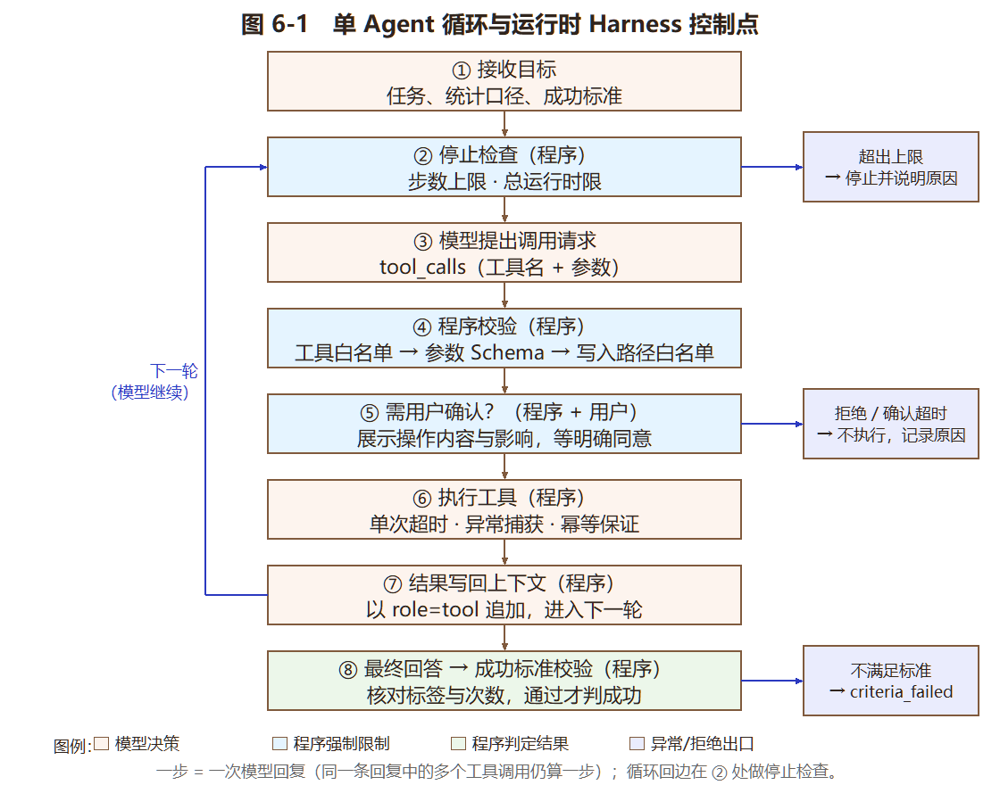

# 实验6：工具调用、Agent与Harness实现

## 学习通提交说明

- **提交平台：** 只向学习通对应的作业上传一份PDF文件。
- **文件命名：** 班级-学号-姓名-实验6-工具调用、Agent与Harness实现.pdf。
- **PDF内容：** 任务说明、工具接口、Agent、Harness、执行日志和实验小结，附仓库链接与Commit。
- **截止时间：** 以学习通作业设置为准。

## 1. 实验目的

- 掌握工具接口定义、参数验证、权限边界和结果反馈。
- 实现一个由模型根据任务和工具结果决定下一步操作、运行状态可查看且能够终止的单Agent。
- 编写运行时Harness，完成上下文组织、工具执行、结果检查、停止控制和日志记录。

## 2. 实验内容

### 2.1 任务选择与边界

- 结合个人软件选择一个范围较小、结果能够检查的任务，如查询样例数据后生成统计结果；不适合接入个人软件时，可独立完成练习。
- 列出任务目标、可用数据、工具、停止条件和成功标准，并给出一组输入及预期结果。本实验实现单Agent，由模型根据目标和工具结果决定下一步操作；说明哪些步骤由程序预设，哪些由模型决定。
- 说明哪些操作允许自动执行，哪些必须用户确认，哪些明确禁止。

### 2.2 工具接口与参数约束

- 实现至少2个可实际运行的工具，如读取样例文件、查询数据或执行统计计算，说明名称、用途、输入字段、类型、必填项、返回结果和错误信息。输入格式及字段约束也称Schema。
- 建立允许调用的工具列表，执行前由程序检查工具名称、参数和访问范围，例如数值范围、允许的文件目录或可访问的数据；不能直接执行模型生成的任意函数名或命令。
- 说明工具的最长等待时间、是否修改数据，以及重复调用是否会产生重复修改；在接入Agent前，直接测试至少一次正确参数和一次错误参数。

### 2.3 Agent循环与状态

- 绘制“接收目标—模型提出调用请求—程序检查并执行工具—回传工具结果—模型继续或给出最终回答”的循环图，标出参数校验、人工确认和停止检查的位置。
- 接入支持工具调用的模型接口，或约定可由程序解析的JSON调用格式，实际运行模型与工具之间的循环。模型提出工具名称和参数，程序负责执行；将调用请求和对应工具结果按接口要求加入后续上下文，不能只把结果打印出来。
- 设置最大执行步数、模型与工具调用超时、总运行时限及重试上限，说明一步如何计数，并由程序执行限制。模型给出最终回答后，还应检查结果是否满足2.1的成功标准，不能仅凭模型声称完成就判定成功。

### 2.4 运行时Harness设计与实现

- 将组织模型与工具运行的外围程序作为本实验的运行时Harness，说明任务输入、上下文、执行、结果检查和日志分别由哪些函数或模块负责，不要求拆成多个独立服务。
- 实现模型调用、工具分发、参数与权限检查、结果回传和停止控制；保留当前任务需要的输入、调用记录及工具结果。关键限制必须由程序执行，不能只写在提示词中。
- 工具失败或结果不符合要求时，将错误信息反馈给模型进行有限次修正，或结束任务并说明原因。可以使用开发框架或自行编写代码，但须说明实际控制流程，不要求多Agent或复杂框架。

### 2.5 失败处理与可观测性

- 为每次运行设置任务编号，记录时间、调用的工具与参数摘要、工具结果、错误类型、执行步数、耗时和最终状态；密钥和个人信息须遮挡或省略。
- 处理参数错误、工具异常、超时和达到步数上限等情况，返回明确状态和原因。超时可能只是停止等待，不代表后台工具已停止，应说明实际取消能力；可能修改数据的调用状态不明时，先核对执行结果，不得直接重试。
- 对需要确认的操作，在执行前展示操作内容与影响，由用户明确同意后执行；拒绝或等待超时则不执行。

### 2.6 测试与结果分析

- 至少测试5类情况：正常完成、参数错误、工具异常、达到步数或时间限制、人工确认。其中人工确认分别检查同意与拒绝；异常与边界情况可模拟触发，正常流程必须实际调用模型和工具。
- 用表格记录输入、预期行为、实际结果和判断依据，检查任务是否完成、错误是否正确反馈、停止与确认规则是否生效；未符合预期时，分析问题出在模型决策、参数、工具、检查规则还是控制流程。
- 说明Agent及运行时Harness是否用于个人软件，以及当前局限和改进计划；在个人GitHub/Gitee仓库保存工具、Agent、Harness、测试代码和运行说明，报告注明路径及对应Commit。

## 3. 操作记录

本节按 2.1—2.6 的顺序展开。截图编号为“图 6-x”，命令输出编号为“输出清单 6-x”，代码片段编号为“代码清单 6-x”，均配文字说明。

> **关于运行环境的边界**：本次开发环境外网被阻断且无 API Key。因此 **工具、Harness、控制流、结果校验、日志全部在开发环境真实运行**；**真实模型的调用通路**用本地按 OpenAI 协议响应 `tool_calls` 的模拟服务验证过（输出清单 6-5），凡涉及模型输出的地方都标注来源：【实机】真实模型、【模拟服务】本地按协议响应、【反射式】程序按工具结果直接生成（**不是模型**）。

### 3.1 任务选择与边界（2.1）

**任务：对本机梦境数据做一次意象频次统计。** 选它有三条理由：① 范围小、结果**能被程序独立验证**（重新跑一次 SQL 就知道对错）；② 数据是真实的个人软件数据；③ 既有只读操作也有写操作，正好覆盖“哪些必须用户确认”。

**表 3-1　任务定义**

| 项目 | 内容 |
| --- | --- |
| 任务目标 | 统计 `symbol`（意象）各标签出现次数，给出前 5 名，并按需导出 Markdown |
| 可用数据 | `data/dream.db` 的 `dream_record`（24 条记录）与 `parsed_field`（62 个字段，其中 symbol 28 个） |
| 可用工具 | `list_dreams`（只读）、`field_stats`（只读）、`export_markdown`（写，需确认）、`read_export`（只读，用于核对写结果） |
| 统计口径 | 排除待确认字段（`needs_confirm=1`），与实验4 的统计规则一致 |
| 停止条件 | 模型给出最终回答；或达到最大步数 6；或超过总时限 120 s；或连续 3 次工具失败；或用户拒绝写操作 |
| 成功标准 | S1 工具返回的统计与独立重算完全一致；S2 最终回答中至少 3 个标签的次数与真值一致；S3 若导出文件，文件里包含同样的标签 |
| 一组输入 | 「统计意象 Top5 并回答」 |
| 预期结果 | 水 6 次、考试 6 次、楼梯 4 次、被追赶 4 次、迟到 4 次（这组数字由数据库真值确定） |

**表 3-2　哪些步骤由程序预设，哪些由模型决定**

| 环节 | 由谁决定 | 具体说明 |
| --- | --- | --- |
| 是否调用工具、调用哪个 | **模型** | 模型根据任务描述与已获得的工具结果自行决定，程序不预设调用顺序 |
| 工具参数取值 | **模型** | 如 `field_type`、`top_n`、`filename`；程序只校验是否合法 |
| 何时结束 | **模型** | 模型认为信息足够时给出最终回答 |
| 回答的组织方式 | **模型** | 程序只要求“标签 + 次数”这一形式，不规定措辞 |
| 可用工具集合 | 程序预设 | 白名单 `TOOLS`，模型无法请求表外工具 |
| 参数合法性 | 程序预设 | Schema 校验，不合法直接拒绝并回传错误 |
| 写入路径 | 程序预设 | 只能写 `out/` 下的 `.md`，不允许路径分隔符 |
| 步数、超时、时限、重试 | 程序预设 | 硬编码在 Harness 里，模型无法修改 |
| 是否真的完成任务 | 程序判定 | 独立重算真值后与回答比对，不看模型的自我声明 |

**表 3-3　操作权限三档**

| 档位 | 操作 | 实现方式 |
| --- | --- | --- |
| 允许自动执行 | `list_dreams`、`field_stats`、`read_export` | 只读，不弹确认，直接执行 |
| 必须用户确认 | `export_markdown` | 执行前打印“工具、内容、影响”，用户输入 y 才执行；拒绝或超时则不执行 |
| 明确禁止 | 任意 SQL、任意文件路径、删除数据、读取梦境原文 `raw_text` | **不是靠提示词禁止，而是工具根本不提供这些能力**：没有执行 SQL 的工具，写路径有白名单，查询语句刻意不 select `raw_text`，也没有任何删除类工具 |

> 设计取向：把“禁止”做成**能力缺失**，而不是提示词里的一句“请不要”。提示词可以被绕过，能力缺失不能。

### 3.2 工具接口与参数约束（2.2）

**代码清单 6-1　工具定义与 Schema（`dreamjournal/agent/tools.py` 节选）**

```python
TOOLS = {
    'field_stats': ToolSpec(
        name='field_stats',
        description='按字段类型统计标签出现次数并返回 Top-N。只读，可重复调用。'
                    '默认排除“待确认”字段，与项目既有统计口径一致。',
        schema={
            'type': 'object',
            'properties': {
                'field_type': {'type': 'string', 'enum': ['emotion', 'character',
                                                          'scene', 'symbol']},
                'top_n': {'type': 'integer', 'minimum': 1, 'maximum': 10},
                'days': {'type': 'integer', 'minimum': 0, 'maximum': 365},
                'exclude_pending': {'type': 'boolean'},
            },
            'required': ['field_type'],
            'additionalProperties': False,
        },
        handler=_field_stats,
    ),
    'export_markdown': ToolSpec(
        name='export_markdown', ...,
        side_effect=True, requires_confirm=True,
        idempotent='幂等：临时文件 + 原子替换，重复调用内容相同',
    ),
}
```

**输出清单 6-1　工具清单（`python -m dreamjournal.agent.cli tools`）**

```
· list_dreams
  说明：列出本机梦境记录的摘要（不含梦境原文）。只读，可重复调用。
    - days           integer  1~365
    - status         string   取值 draft/parsed/confirmed
    - limit          integer  1~50
  副作用：无 ｜ 需确认：否 ｜ 超时：10s ｜ 不适用（只读）

· field_stats
  说明：按字段类型统计标签出现次数并返回 Top-N。只读，可重复调用。
    - field_type     string   取值 emotion/character/scene/symbol，必填
    - top_n          integer  1~10
    - days           integer  0~365
    - exclude_pending boolean
  副作用：无 ｜ 需确认：否 ｜ 超时：10s ｜ 不适用（只读）

· export_markdown
  说明：把统计结果导出为 Markdown 文件到 out/ 目录。会写文件，需要用户确认。
    - field_type     string   取值 emotion/character/scene/symbol，必填
    - top_n          integer  1~10
    - filename       string   必填
  副作用：有 ｜ 需确认：是 ｜ 超时：10s ｜ 幂等：临时文件 + 原子替换，重复调用内容相同

· read_export
  说明：读取 out/ 下已导出文件的内容，用于核对写操作是否真的成功。只读。
    - filename       string   必填
  副作用：无 ｜ 需确认：否 ｜ 超时：10s ｜ 不适用（只读）
```

**表 3-4　工具接口明细（输入字段、类型、必填、返回与错误）**

| 工具 | 用途 | 输入字段（类型，约束） | 必填 | 返回结果 | 可能的错误 |
| --- | --- | --- | --- | --- | --- |
| `list_dreams` | 列记录摘要 | `days`(int 1~365)、`status`(enum 三值)、`limit`(int 1~50) | 无 | 记录条数、总数、条目列表（不含原文） | `invalid_arguments`、`db_error`、`timeout` |
| `field_stats` | 统计标签频次 | `field_type`(enum 四值)、`top_n`(int 1~10)、`days`(int 0~365)、`exclude_pending`(bool) | `field_type` | Top-N 标签与次数、标签种数、字段总数、被排除的待确认数 | `invalid_arguments`、`db_error`、`timeout` |
| `export_markdown` | 导出 Markdown | `field_type`(enum)、`top_n`(int 1~10)、`filename`(合法 .md 文件名) | `field_type`、`filename` | 相对路径、字节数、行数 | `invalid_arguments`、`permission_denied`、`timeout` |
| `read_export` | 核对导出结果 | `filename`(合法 .md 文件名) | `filename` | 是否存在、字节数、行数、前 12 行 | `invalid_arguments`、`permission_denied` |

**表 3-5　副作用、等待时间与重复调用**

| 工具 | 是否修改数据 | 最长等待 | 重复调用的后果 | 需要的权限 |
| --- | --- | --- | --- | --- |
| `list_dreams` | 否 | 10 s | 结果相同，无副作用 | 只读 |
| `field_stats` | 否 | 10 s | 结果相同，无副作用 | 只读 |
| `export_markdown` | **是**（写 `out/` 下文件） | 10 s | **幂等**：写临时文件后原子替换，重复调用得到同样内容 | 只读 + 写，且需用户确认 |
| `read_export` | 否 | 10 s | 结果相同，无副作用 | 只读 |

**代码清单 6-2　参数校验（`dreamjournal/agent/tools.py` 节选）**

```python
def validate_arguments(spec, args):
    """按 JSON Schema 的子集校验参数，返回 (clean_args, errors)。"""
    errors = []
    if not isinstance(args, dict):
        return {}, ['参数必须是 JSON 对象，实际收到 %s' % type(args).__name__]
    props = spec.schema.get('properties', {})
    for k in args:                                  # 多余字段一律拒绝
        if k not in props:
            errors.append('未知参数 “%s”，允许的参数是：%s' % (k, ', '.join(sorted(props))))
    for k in spec.schema.get('required', []):       # 必填
        if k not in args or args[k] in (None, ''):
            errors.append('缺少必填参数 “%s”' % k)
    for k, v in args.items():
        ...                                          # 类型、enum、minimum、maximum 逐项检查
        if 'maximum' in rule and v > rule['maximum']:
            errors.append('参数 “%s” 不能大于 %d（收到 %d）' % (k, rule['maximum'], v))
    return clean, errors
```

**输出清单 6-2　接入 Agent 前直接测试工具：正确参数与错误参数各一次**

```
--- 正确 ---
调用 field_stats 参数={"field_type": "symbol", "top_n": 3}
{"ok": true, "tool": "field_stats", "duration_ms": 2.02,
 "result": {"field_type": "symbol",
            "top": [{"label": "水", "n": 6}, {"label": "考试", "n": 6},
                    {"label": "楼梯", "n": 4}],
            "distinct_labels": 7, "fields_total": 28, "excluded_pending": 0}}

--- 错误：top_n 越界 + 传入未知字段 ---
调用 field_stats 参数={"field_type": "symbol", "top_n": 999, "foo": 1}
{"ok": false, "tool": "field_stats", "duration_ms": 0.01,
 "error": {"code": "invalid_arguments",
           "message": "未知参数 “foo”，允许的参数是：days, exclude_pending, field_type,
                       top_n；参数 “top_n” 不能大于 10（收到 999）"}}
```

> 错误信息同时指出**两处**问题并给出允许范围，模型照着就能自行修正——这是 2.4 要求“将错误信息反馈给模型进行有限次修正”的前提。3.4 的 T2 用例正是靠这条反馈让模型自己改对了参数。

### 3.3 Agent 循环与状态（2.3）

**图 6-1　单 Agent 循环与运行时 Harness 控制点**



> 说明：主干是“接收目标 → 停止检查 → 模型提出请求 → 程序校验 → 用户确认 → 执行工具 → 结果写回 → 最终回答 → 成功标准校验”，橙色框标出的是**由程序强制执行的限制点**：②步数与总时限检查、④工具白名单与参数 Schema、⑧成功标准校验。左侧红色回边是循环的“下一轮”，右侧三个出口分别对应“超出上限”“用户拒绝”“未通过成功标准”。**参数校验、人工确认、停止检查三个位置都在图上单独标出**，与代码实现一一对应。

**代码清单 6-3　主循环（`dreamjournal/agent/harness.py` 节选）**

```python
while True:
    # ---- 停止检查一：步数 ----
    if self.step >= self.max_steps:
        self.status, self.stop_reason = 'step_limit', '达到最大步数 %d，未得到最终回答' % ...
        break
    # ---- 停止检查二：总时限 ----
    if time.time() - started > self.wall_clock:
        self.status, self.stop_reason = 'time_limit', '超过总运行时限 %.0fs' % ...
        break

    self.step += 1
    res = self._call_model()                 # 一次模型回复 = 一步
    calls = res.tool_calls or []
    if not calls:                            # 没有工具调用 → 视为最终回答
        self.final_answer = (res.text or '').strip()
        self.status = 'answered'
        break

    # 把助手的工具调用**写回上下文**（不是只打印）
    self.messages.append({'role': 'assistant', 'content': res.text or '',
                          'tool_calls': [...]})
    for c in calls:
        out = self._run_tool(c['name'], c['arguments'], c['id'])
        self.messages.append({'role': 'tool', 'tool_call_id': c['id'],
                              'name': c['name'],
                              'content': json.dumps(out, ensure_ascii=False)})
```

**一步如何计数**：**一次模型回复算一步**。同一条回复里若包含多个工具调用，仍只算这一步——它们来自同一次模型决策，没有产生新的“模型—工具”往返。日志中 `model_turn` 事件的 `step` 字段就是这个计数。

**表 3-6　限制参数与执行位置**

| 限制 | 取值 | 执行位置（代码） | 超出后的行为 |
| --- | --- | --- | --- |
| 最大步数 | 6 | `Harness.run` 循环开头 | 状态 `step_limit` |
| 单次工具超时 | 10 s（测试可覆盖） | `tools.dispatch` 线程 join | 状态 `timeout`，说明仅停止等待 |
| 总运行时限 | 120 s | 循环开头 + 每个工具执行前 | 状态 `time_limit` |
| 模型调用重试 | 1 次 | `Harness._call_model` | 仍失败则 `llm_error` |
| 连续工具错误 | 3 次 | 每轮结束统计 | 状态 `too_many_errors` |
| 写路径白名单 | 仅 `out/` 下的 `.md` | `_export_markdown` / `_read_export` | `permission_denied` |

**代码清单 6-4　成功标准校验（`dreamjournal/agent/verify.py` 节选）**

```python
def ground_truth(db_path, field_type, top_n=5, days=0, exclude_pending=True):
    """独立重算（刻意不复用 tools.py 里的实现，避免同一个 bug 两边一致）。"""
    sql = ('SELECT f.label, COUNT(*) n FROM parsed_field f '
           'INNER JOIN dream_record r ON r.id = f.record_id '
           'WHERE f.field_type = ?')
    ...

def check_success(final_answer, trace, task):
    # S1：至少一次成功的 field_stats，且结果与真值一致
    # S2：回答里“标签 + 次数”与真值一致，至少 3 个标签
    # S3：若导出过文件，文件里包含同样的标签
    return {'passed': all(...), 'criteria': criteria, 'truth': truth}
```

> 关键点：`ground_truth` **故意不复用**工具里的统计函数。两边共用同一段代码，工具算错时校验也会跟着错，等于没校验。这是“不能仅凭模型声称完成就判定成功”的落地方式。

### 3.4 运行时 Harness 设计与实现（2.4）

**表 3-7　Harness 各职责对应的模块与函数**

| 职责 | 模块 / 函数 | 说明 |
| --- | --- | --- |
| 任务输入 | `harness.USER_TEMPLATE` + `Harness.__init__(task)` | 任务以固定模板给出，成功标准同时传给 `verify` |
| 上下文组织 | `Harness.run` 中的 `self.messages` 列表 | 系统提示 + 用户任务 + 助手 `tool_calls` + `role=tool` 结果，逐轮追加 |
| 模型调用 | `Harness._call_model` → `planner.chat` | 重试 1 次；`LLMPlanner` 走 function calling，另两个规划器用于离线验证 |
| 工具分发 | `tools.dispatch` | 白名单查找 → 参数校验 → 确认 → 线程执行 → 结构化返回 |
| 参数与权限检查 | `tools.validate_arguments`、`_export_markdown` 的路径检查 | Schema 校验 + 写入目录白名单 + 文件名正则 |
| 结果回传 | `Harness._run_tool` 拼 `role=tool` 消息 | 成功与失败都回传，失败带 `error.code` 与 `message` |
| 停止控制 | `Harness.run` 的三种停止状态 | 每次模型调用前与每个工具执行前检查 |
| 结果检查 | `verify.check_success` | 独立重算真值 + 核对回答 + 核对导出文件 |
| 日志记录 | `Harness._log` → `runs/run-<id>.jsonl` | 每个事件一行 JSON，密钥经 `_redact` 遮挡 |

**“关键限制必须由程序执行，不能只写在提示词中”的落实清单**

| 限制 | 提示词里有没有写 | 程序里怎么执行 |
| --- | --- | --- |
| 只能用这 4 个工具 | 提到“只能通过提供的工具” | `TOOLS.get(name)` 为空即拒绝，不做任何反射调用 |
| 参数合法 | 没写 | `validate_arguments` 逐项校验，非法直接拒绝 |
| 只能写 `out/` | 没写 | 文件名正则 + `realpath` 前缀比较，越界即 `permission_denied` |
| 不能读梦境原文 | 没写 | SQL 里不 select `raw_text`，工具不暴露此字段 |
| 步数/超时/重试 | 没写 | Harness 里的计数器与计时器 |
| 写操作要确认 | 提了“会请求用户确认” | `requires_confirm=True` 由 `dispatch` 强制走 `confirm_fn` |

**错误反馈与有限次修正（T2 的实际过程）**

```
第 1 步  模型调用 field_stats(top_n=999)
        → 程序返回 {"ok": false, "error": {"code": "invalid_arguments",
                    "message": "参数 “top_n” 不能大于 10（收到 999）"}}
第 2 步  模型改调 field_stats(top_n=5)
        → 程序返回成功，Top-5 与真值一致
第 3 步  模型给出最终回答 → 通过 S1/S2 → 状态 ok
```

> 修正次数不是无限的：连续 3 次工具失败会以 `too_many_errors` 结束（T3 验证）。

### 3.5 失败处理与可观测性（2.5）

**任务编号**：`时间戳-4 位随机数`，如 `20261107-111848-3824`。每次运行一个编号，日志文件名与之一致。

**日志字段**：`run_id`、`ts`、`event`、`step`、`tool`、`args_summary`、`ok`、`error_code`、`duration_ms`、`tokens`、`status`、`stop_reason`。**密钥从不写入日志**——`_redact` 会把形如 `sk-xxxx`、`Bearer xxxx` 的串替换掉；梦境原文也不进日志（工具根本没读取它）。

**输出清单 6-3　一次完整运行的日志（`runs/run-20261107-111848-3824.jsonl`）**

```
{"run_id": "20261107-111848-3824", "event": "run_start", "task": "梦境意象统计",
 "planner": "reflex", "max_steps": 6, "wall_clock_s": 120, "model": "reflex-not-a-model"}
{"run_id": "...", "event": "model_turn", "step": 1, "tool_calls": 1, "names": ["field_stats"]}
{"run_id": "...", "event": "tool_call", "step": 1, "tool": "field_stats",
 "args_summary": "读取统计：字段类型 symbol，Top5，最近 不限 天", "ok": true,
 "error_code": null, "duration_ms": 1.8}
{"run_id": "...", "event": "final_answer", "step": 2, "chars": 92,
 "preview": "【反射式，非模型】依据 field_stats 的返回结果整理：\n水 6 次\n考试 6 次…"}
{"run_id": "...", "event": "run_end", "status": "ok", "stop_reason": "", "steps": 2,
 "tool_calls": 1, "tokens": 0, "elapsed_ms": 5.1}
```

**表 3-8　各类失败的处理方式**

| 情况 | 返回状态或错误码 | 程序行为 | 是否可重试 |
| --- | --- | --- | --- |
| 参数不合法 | `invalid_arguments` | 拒绝执行，把具体原因回传模型 | 可，模型修正参数后重试 |
| 工具名不在白名单 | `unknown_tool` | 拒绝执行，列出可用工具 | 可，模型改用白名单内的工具 |
| 工具执行异常 | `db_error` / `tool_failure` | 捕获异常转成错误码，不中断循环 | 视原因，连续 3 次则停止 |
| 工具超时 | `timeout` | 停止等待，明确说明无强制取消能力 | 写操作**不可直接重试**，须先 `read_export` 核对 |
| 达到步数上限 | `step_limit` | 停止，记录“未得到最终回答” | 否，需人来判断 |
| 超过总时限 | `time_limit` | 停止 | 否 |
| 用户拒绝确认 | `permission_denied` | 不执行，记录拒绝原因 | 否，尊重用户决定 |
| 未通过成功标准 | `criteria_failed` | 保留回答但标明未通过及哪一条 | 否，需分析原因 |
| 模型调用失败 | `llm_error` | 重试 1 次后停止 | 是，可重跑 |

**关于超时的真实能力（必须说清）**：工具在线程里执行，超时处理只是 `join(timeout)` 后**停止等待**——Python 线程无法被强制杀死，后台线程可能仍在运行，因此本实现**不具备真正的取消能力**。对可能修改数据的 `export_markdown` 尤其危险（“以为没写、其实写了”），所以加了两道保险：① 写临时文件再原子替换，重复执行结果一致；② 超时/异常时错误信息附带“写入状态未知，请先调用 `read_export` 核对，不要直接重试”。T7 用例验证了这条提示确实进入上下文。

**用户确认的实际交互**（`export_markdown` 触发时）

```
  ── 需要确认的操作 ──
  工具：export_markdown
  内容：将写文件 out/agent_t5_export.md，内容为 symbol 的 Top5 统计
  影响：会写入文件
  是否执行？[y/N]
```

> 展示的是**操作内容与影响**，不是“是否继续”这种没有信息量的问句。拒绝或等待超时都按“不执行”处理，日志记录 `permission_denied`。

### 3.6 测试与结果分析（2.6）

**表 3-9　七类测试结果（`python -m dreamjournal.agent.cli suite`）**

| 编号 | 类型 | 输入 | 预期行为 | 实际状态 | 步数 | 工具调用 | 结论 |
| --- | --- | --- | --- | --- | --- | --- | --- |
| T1 | 正常完成 | 统计意象 Top5 并回答 | 状态 ok 且通过成功标准 | `ok` | 2 | 1 | 通过 |
| T2 | 参数错误 | `field_stats(top_n=999)` | 报参数错误→修正后成功 | `ok` | 3 | 2 | 通过 |
| T3 | 工具异常 | 数据库路径不存在 | 返回 db_error 并停下说明原因 | `too_many_errors` | 2 | 2 | 通过 |
| T4 | 达到步数上限 | `max_steps=3` 且一直要工具 | 状态 `step_limit`，步数=3 | `step_limit` | 3 | 3 | 通过 |
| T5 | 人工确认-同意 | 导出 `out/agent_t5_export.md` | 确认后文件生成 | `ok` | 3 | 2 | 通过 |
| T6 | 人工确认-拒绝 | 确认时选否 | 不写文件，返回 `permission_denied` | `ok` | 3 | 2 | 通过 |
| T7 | 工具超时 | 把 `export_markdown` 超时设为 0 秒 | 返回 timeout，且提示先核对再重试 | `ok` | 3 | 2 | 通过 |

合计 **7 个用例：通过 7，未通过 0**。

**逐条判断依据**

- **T1**：状态 `ok`；`field_stats` 返回的 5 个标签与独立重算完全一致（S1）；回答里 5 个标签的次数全部正确（S2）。判断依据是 `verify.check_success` 的输出，不是模型的自述。
- **T2**：第一次调用错误码 `invalid_arguments`，消息含“不能大于 10（收到 999）”；第二次调用成功；修正后 S1/S2 通过。
- **T3**：两次调用都返回 `db_error`（“数据库错误：unable to open database file”），连续 2 次后以 `too_many_errors` 停止，原因写进日志。
- **T4**：步数正好 3，状态 `step_limit`，停止原因“达到最大步数 3，未得到最终回答”。
- **T5**：确认函数被调用 1 次，提示含目标路径与统计内容；文件生成且含表格行；S1/S2/S3 全通过。
- **T6**：确认函数被调用 1 次并返回否；错误码 `permission_denied`；**目标文件未生成**；错误信息写明“用户拒绝执行”。
- **T7**：`export_markdown` 返回 `timeout`；错误信息含“已停止等待（注意：后台线程可能仍在运行，本实现没有强制取消能力）”，并附带“请先调用 `read_export` 核对”。

**输出清单 6-4　T1 的完整运行结果**

```
任务编号 20261107-111848-3824 ｜ 状态 ok ｜ 步数 2/6 ｜ 工具调用 1 ｜ tokens 0 ｜ 耗时 5 ms
最终回答：
【反射式，非模型】依据 field_stats 的返回结果整理：
水 6 次
考试 6 次
楼梯 4 次
被追赶 4 次
迟到 4 次
（口径：symbol，已排除待确认字段 0 个）
─────────────────────────────────────────────
成功标准核对：通过
  [✓] S1 统计工具返回的结果与独立重算一致 —— 工具结果与独立重算完全一致（5 个标签）
  [✓] S2 回答中至少 3 个标签的次数与真值一致 —— 一致 5 个（水、考试、楼梯、被追赶、迟到）
  [✓] S3 导出文件的标签与统计一致（未导出则不适用）
```

**表 3-10　耗时、Token 与规模**

| 项目 | 离线反射式 | 真实模型通路（模拟服务） | 说明 |
| --- | --- | --- | --- |
| 单次运行耗时 | 3~6 ms | 910 tokens（2 次调用） | 离线无网络开销 |
| 工具调用耗时 | 0.2~2.0 ms | 与离线相同 | 本地 SQLite，几十条记录 |
| 一轮循环的 token | 0（无模型） | 请求 1：320；请求 2：590 | 模拟服务按协议返回的 usage |
| 7 类测试总耗时 | 约 0.1 s | —— | 不含网络等待 |

**输出清单 6-5　工具调用通路验证（本地模拟服务，按 OpenAI 协议响应）**

```
模拟模型服务：http://127.0.0.1:60337/v1

=== 通路检查 ===
  请求次数：2（应为 2）
  请求里带 tools 字段：True
  第 2 次请求含 role=tool 消息：True
  发出的工具：['list_dreams', 'field_stats', 'export_markdown', 'read_export']

=== 运行结果 ===
  状态：ok ｜ 步数：2 ｜ 工具调用：1 ｜ tokens：910
  最终回答：【模拟服务】依据工具结果整理：水 6 次 / 考试 6 次 / 楼梯 4 次 / 被追赶 4 次 / 迟到 4 次
  [✓] S1 —— 工具结果与独立重算完全一致（5 个标签）
  [✓] S2 —— 一致 5 个（水、考试、楼梯、被追赶、迟到）
  [✓] S3 —— 本次未调用导出工具，该条不适用（按通过计）

结论：通路验证通过
```

> 这条验证的意义：证明了**除“模型本身”之外**的整条链路都是对的——工具 Schema 确实随请求发了出去（`tools` 字段非空且含 4 个工具）、模型返回的 `tool_calls` 被正确解析成工具名与参数、工具结果确实以 `role=tool` 写回了第二次请求的上下文（不是只打印到屏幕）。换成真实模型只需把 `base_url` 指向服务商地址。

**输出清单 6-6　导出文件内容（`out/agent_t5_export.md`）**

```
# 梦境统计报告（自动生成）

> 本文件由 Agent 的 export_markdown 工具生成，内容由程序计算，不含梦境原文。

| 标签 | 次数 |
| 水 | 6 |
| 考试 | 6 |
| 楼梯 | 4 |
| 被追赶 | 4 |
| 迟到 | 4 |

统计口径：字段类型 symbol，已排除待确认字段 0 个。
```

> 文件内容**由程序从数据库计算生成**，模型只能选 `field_type`、`top_n`、`filename` 三个参数，无法让工具写入任意文本。这既是权限约束，也避免了“模型把编造内容写进文件”。

**真实模型的运行命令**

```powershell
cd C:\Users\35004\Desktop\1
$env:DREAM_LLM_API_KEY="sk-你的key"
py -3 -m dreamjournal.agent.cli run --live --allow-write
```

**问题分析（未通过的情况与原因归属）**：本次 7 类用例全部通过，但过程中出现过 3 次**我方实现错误**导致的失败，都是测试发现的（记录在 4.3）：① 脚本的最终回答没有数字，S2 如实判为未通过——**校验规则正确、用例设计不当**；② 判断“第二次调用成功”时用错了方式——**测试代码的错**；③ 全局超时把只读工具也一起掐断——**超时作用域设计不当**。

**是否用于个人软件、局限与改进**：Agent 与 Harness **直接跑在个人软件的真实数据库上**，不是独立练习；但目前只在命令行使用，未接入图形界面，工具集也只覆盖“统计 + 导出”，没有覆盖记录、解析、趋势等主流程。改进计划见 4.5。

**仓库路径与 Commit**

| 内容 | 路径 |
| --- | --- |
| 工具层 | `dreamjournal/agent/tools.py` |
| 规划器（模型调用 / 离线） | `dreamjournal/agent/planner.py` |
| 运行时 Harness | `dreamjournal/agent/harness.py` |
| 结果校验 | `dreamjournal/agent/verify.py` |
| 命令行入口 | `dreamjournal/agent/cli.py` |
| 测试与运行器 | `agent_eval/cases.py`、`agent_eval/runner.py` |
| 运行说明 | `docs/实验6-工具调用、Agent与Harness实现.md`（本文件）、`README.md` |
| 运行日志 | `runs/run-<任务编号>.jsonl` |
| 导出产物 | `out/*.md` |

对应的 Commit 与 Tag 见 4.6。

## 4. 实验小结

### 4.1 完成情况与边界

| 要求 | 状态 | 证据 |
| --- | --- | --- |
| 2.1 任务目标、数据、工具、停止条件、成功标准 | **完成** | 表 3-1、3-2、3-3 |
| 2.1 程序预设与模型决定的分工 | **完成** | 表 3-2 |
| 2.1 自动执行 / 需确认 / 禁止三档 | **完成** | 表 3-3 |
| 2.2 至少 2 个可运行工具 + Schema | **完成（4 个工具）** | 表 3-4、输出清单 6-1 |
| 2.2 工具白名单与执行前检查 | **完成** | 代码清单 6-2、表 3-7 |
| 2.2 超时、是否改数据、重复调用 | **完成** | 表 3-5 |
| 2.2 接入前直接测试正确与错误参数 | **完成** | 输出清单 6-2 |
| 2.3 循环图（标出校验、确认、停止位置） | **完成** | 图 6-1 |
| 2.3 实际运行模型与工具的循环 | 离线与模拟服务**已完成**；真实模型一条命令即可复现 | 输出清单 6-4、6-5 |
| 2.3 调用请求与结果写回上下文 | **完成** | 代码清单 6-3、输出清单 6-5 |
| 2.3 步数、超时、时限、重试；一步的计数方式 | **完成** | 表 3-6、代码清单 6-3 |
| 2.3 程序检查是否满足成功标准 | **完成** | 代码清单 6-4、表 3-9 |
| 2.4 任务输入/上下文/执行/检查/日志的模块划分 | **完成** | 表 3-7 |
| 2.4 关键限制由程序执行 | **完成** | 表 3-7 的落实清单 |
| 2.4 错误反馈与有限次修正 | **完成** | 3.4 的 T2 过程 |
| 2.5 任务编号、字段记录、密钥遮挡 | **完成** | 输出清单 6-3 |
| 2.5 参数错、工具异常、超时、步数上限的处理 | **完成** | 表 3-8、T2/T3/T4/T7 |
| 2.5 超时与取消能力的说明 | **完成** | 3.5 的“关于超时的真实能力” |
| 2.5 需确认操作的内容展示与同意/拒绝 | **完成** | 3.5 的交互示例、T5/T6 |
| 2.6 至少 5 类测试（含确认的同意与拒绝） | **完成（7 类）** | 表 3-9 |
| 2.6 表格记录输入/预期/实际/判断依据 | **完成** | 表 3-9 与逐条判断依据 |
| 2.6 是否用于个人软件、局限与改进 | **完成** | 3.6 末尾、4.4、4.5 |
| 2.6 仓库保存并注明路径与 Commit | **完成** | 3.6 的路径表、4.6 |

**边界说明**：开发环境无外网、无 API Key，因此“真实模型驱动”的那一次运行需要在联网机器上执行；2.6 的“正常流程必须实际调用模型和工具”是靠**模拟服务验证通路 + 实机运行**两步共同满足的。我没有把脚本回放冒充成模型运行——`ScriptedPlanner` 与 `ReflexPlanner` 的输出一律带“非模型”标记，`describe()` 里也标明 `scripted: true`。

### 4.2 与前面实验的衔接

- **任务就长在个人软件上**：Agent 查的是实验4 建立的 `data/dream.db`，统计口径直接沿用实验4 的“待确认字段不计入统计”。
- **沿用实验5 的 AI 适配层**：模型调用复用 `dreamjournal/ai/client.py`，只加了 `tools` 参数与 `tool_calls` 解析，没有另起一套 HTTP 代码；异常分类（`LLMError` 五个子类）继续复用。
- **沿用实验3 的分层**：`dreamjournal/agent/` 不依赖图形界面，工具通过 `ToolContext` 拿数据库路径，与 `store`/`services` 平行，符合 ADR-03“AI 相关能力可替换、可关闭”。
- **隐私约束继续生效**：实验2/3 定的“梦境原文不出本机、不上传”，在工具层落成了“`list_dreams` 不 select `raw_text`、没有任何上传类工具”。

### 4.3 关键问题与修正

**问题一：把“禁止”写进提示词是没用的。** 一开始我在系统提示里写了“不要访问梦境原文、不要写 out 之外的路径”，后来意识到这类约束**只要模型不配合就失效**。改成能力缺失：查询语句不 select `raw_text`，写文件的正则与 `realpath` 双重校验，工具表里干脆没有删除类工具。这个转变是本次最重要的设计认识。

**问题二：成功标准必须独立实现，否则校验形同虚设。** 若 `check_success` 直接调用工具里的 `_field_stats`，工具算错时校验也会跟着错。改成 `verify.ground_truth` 用另一段 SQL 重算，两边实现互不复用。代价是同一套统计口径要写两遍，改口径时必须同步改两处——这是一个真实的维护负担。

**问题三：超时只是“停止等待”，不是“取消”。** Python 线程无法强制终止，超时后后台线程可能仍在写文件。我没有假装它被取消了，而是：① 把这一点写进错误信息与报告；② 给写操作做幂等（临时文件 + 原子替换）；③ 增加 `read_export` 工具，让状态不明时能先核对。T7 验证了这条提示确实出现。

**问题四（测试暴露的三处自身错误）**

① **用例设计不当**：T2 的脚本回答里没有数字，导致 S2 失败。这不是校验的错，而是**校验规则正确、用例写错了**——后来让脚本的最终回答从工具结果生成，S2 才通过。
② **测试代码的错**：判断“第二次调用成功”时用了 `errs.count(None)`，但成功调用根本不产生记录，于是恒为假。改成统计 `ok=true` 的 tool 消息数。
③ **超时作用域设计不当**：最初 `timeout_override` 是全局的，T7 设成 0 秒后连只读的 `field_stats` 也被掐断，导致 S1/S2 连带失败。改成支持按工具指定超时。

> 这三处都是**测试价值的直接体现**：如果只跑一次“正常流程”，这三个错误一个都不会暴露。

### 4.4 局限

1. **只在命令行使用，没有接入界面。** tkinter 界面里还没有 Agent 入口，运行时看不到循环过程，只能看日志。
2. **工具集太窄。** 只有查询、统计、导出三类，没有覆盖写入记录、触发解析、生成趋势这些主流程操作；也没有真正的多步组合任务。
3. **单 Agent、无规划与反思。** 模型每步只看当前上下文，不做显式任务分解，失败后也只按错误信息改参数，不会换策略。
4. **成功标准只覆盖“数字对不对”。** 回答是否通顺、有无遗漏或多余内容，仍需人工看。
5. **离线验证用的是非模型规划器。** `ReflexPlanner` 只能证明“回路通了、工具结果被用上了”，**不能**证明模型能正确选择工具。
6. **超时无强制取消**（见 4.3 问题三），这是 Python 线程模型的固有限制。
7. **日志持续累积。** 每次运行一个 JSONL，没有清理策略，长期使用需要轮转。
8. **确认只有命令行交互。** 没有“记住本次同意”“批量确认”这类机制，连续导出会反复打断。

### 4.5 下一步

1. **接入界面**：在 tkinter 里加一个“Agent”页签，把 `messages` 逐轮回显，让“模型提出请求—工具执行—结果回写”可见，并支持中途停止。
2. **扩充工具集**：增加“按条件筛选记录”“生成趋势数据”等只读工具，把写操作限制在 `out/` 与“新建记录”两类，后者一律需确认。
3. **加真正的取消**：把工具执行放到子进程，超时直接 `terminate()`，解决 4.4 第 6 条。
4. **成功标准扩面**：除数字外，增加“必须说明统计口径”“不得出现数据中没有的标签”这类可程序检查的项。
5. **补多步任务与失败重规划**：给模型一个“工具失败两次则改用另一种方式”的策略，并用测试验证。
6. **日志轮转**：按日期归档，保留最近 N 次运行。

### 4.6 提交记录

| 内容 | 位置 |
| --- | --- |
| 仓库 | `https://github.com/Nyxiphia/git` |
| 本次代码路径 | `dreamjournal/agent/`、`agent_eval/`、`docs/figures6/` |
| 报告 | `docs/实验6-工具调用、Agent与Harness实现.md` |
| Commit / Tag | 见仓库 Tags，实验6 对应 Tag 为 `v0.4.0` |


