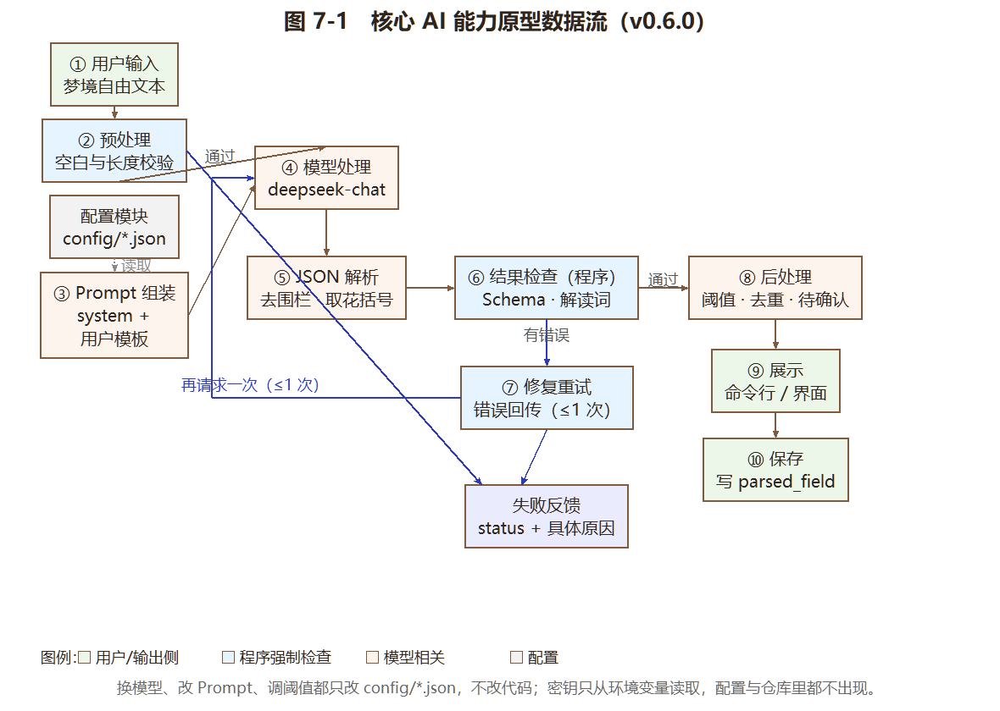

# 实验7：个人软件核心AI能力原型设计与开发

## 学习通提交说明

- **提交平台：** 只向学习通对应的作业上传一份PDF文件。
- **文件命名：** 班级-学号-姓名-实验7-个人软件核心AI能力原型设计与开发.pdf。
- **PDF内容：** 核心AI能力说明、可运行原型、测试集与基线对比、两周迭代、阶段演示和实验小结，附仓库链接与Commit。
- **截止时间：** 以学习通作业设置为准。

## 1. 实验目的

- 围绕个人软件的核心价值，根据实际需要选择LLM、RAG、工具调用或Agent/Harness，形成端到端AI原型。
- 用输入输出要求、代表性样例和适合本项目的指标判断原型是否真正解决用户问题。
- 通过两周迭代形成可演示、可测试、可继续集成的核心AI能力。

## 2. 实验内容

### 2.1 核心价值与AI用例

- 说明原型面向哪类用户、在什么时刻被调用、相比基础功能带来什么可观察价值。
- 提出价值假设和成功标准，例如任务能否完成、结果是否正确或有用、引用是否完整、是否节省时间或减少用户操作；只选择与本项目有关的指标。
- 本次原型只选择一项最核心的AI能力作为重点，说明暂不实现哪些相关功能以及原因。

### 2.2 输入输出要求与评测集

- 给出输入内容、数据来源和使用前提，规定输出格式、必要字段及失败反馈，并说明哪些结果由程序检查、哪些需要人工判断。
- 结合实验2的验收条件构造测试样例，覆盖正常输入、信息不足和超出能力范围的情况，写明期望结果、必要要点或判断规则；适用时可沿用实验5、6的样例。
- 为评测样例设置统一编号并保存为独立文件，使不同版本能够使用同一批输入重复测试。

### 2.3 原型架构与技术组合

- 绘制原型的数据流图或流程图，标出输入、实际采用的模型、检索或工具、结果检查与输出，以及准备与基础软件连接的位置；本次不要求完成整个软件的集成。
- 说明技术组合的选择理由，可以只采用模型调用，不要求同时使用RAG、工具调用和Agent，也不限制开发框架或技术栈。
- 将模型名称、Prompt和影响结果的主要参数集中放入配置文件或配置模块，避免分散写在多处代码中，便于后续替换和比较；密钥不得写入代码或提交到仓库。

### 2.4 端到端主链路实现

- 实现“用户输入—必要的预处理—AI处理—结果检查—展示或保存”的端到端链路，实际调用模型并展示结果，不能用固定回答或静态页面代替。
- 处理模型调用超时、输出不符合要求等情况；采用RAG、工具或Agent时，补充资料不足、工具错误或达到执行上限等相关分支，返回明确提示。
- 保存关键中间结果和错误信息，使一次运行失败后能够判断具体问题出现在哪个步骤。

### 2.5 原型评测与基线比较

- 对不少于10个样例运行评测，记录输出、人工判断、错误类型、响应时间及可获取的Token数或调用次数；收费接口补充实际或估算费用，本地模型注明无接口调用费用。
- 选择无AI方法、直接调用模型或初版原型作为比较基准，即基线，说明选择理由和两种方案的差异。使用相同输入和判断规则对比，分析至少一个边界样例或实际失败，不要求人为制造缺陷。
- 汇总已达到和未达到的成功标准，展示正常流程、边界处理和当前限制。

### 2.6 两周迭代与下一步

- 第1周完成可运行初版和基线评测，第2周根据测试结果和阶段反馈完成修订版；分别记录任务、Commit、结果和变化。
- 对初版和修订版运行同一测试集，记录软件版本、模型、Prompt和主要配置的变化，如实说明改进、无明显变化或退化；阶段演示注明使用的版本与反馈处理情况。
- 按影响程度排列遗留问题，制定集成任务、修复顺序和验收方法；在个人GitHub/Gitee仓库保存原型、配置样例、测试集和运行说明，报告注明路径及两个版本的Commit或Tag。

## 3. 操作记录

本节按 2.1—2.6 的顺序展开。截图编号为“图 7-x”，命令输出编号为“输出清单 7-x”，代码片段编号为“代码清单 7-x”，均配文字说明。

### 3.1 核心价值与 AI 用例（2.1）

**这次只做一项能力：把梦境自由文本变成结构化字段。** 理由是实验2 早就把这件事判定为“本项目唯一必要的 AI 能力”——趋势页要有数据，就得先把一段口语变成可统计的情绪、人物、场景、意象；而实验4 里我只做了“手动标签”这个非 AI 降级方案，**AI 解析一直没实现**。实验7 补的就是这块空白。

**表 3-1　用户、时刻与可观察价值**

| 项目 | 内容 |
| --- | --- |
| 面向用户 | 做梦者本人（单用户、单机） |
| 调用时刻 | 刚醒来、半睡半醒时，用一段口语把梦说完之后 |
| 相比基础功能的价值 | 基础功能要求用户**手动从 60 个预设标签里挑**（实验4 的降级方案），一次约 30~60 秒；AI 解析把这一步变成**零操作**，并且能抽出手动标签表里没有的意象（如“陌生的字”） |
| 可观察价值 | ① 记录后不需再点选；② 趋势页立刻有数据；③ 抽出的字段带置信度，低的标为待确认，不污染统计 |

**表 3-2　价值假设与成功标准**

| 编号 | 成功标准 | 指标口径 | 达成情况（见 3.5） |
| --- | --- | --- | --- |
| G1 | 输出必须能被数据层直接接收 | Schema 合规率（`field_type` 在四类枚举内、label ≤12 字无标点、confidence ∈[0,1]、字段数 ≤12） | v2 达 93%，v1 仅 7% |
| G2 | 不得输出解读、预测、诊断 | 输出中不出现禁用措辞（预示/意味着/象征/吉凶/运势/诊断…） | v2 达 0%，v1 出现 7% |
| G3 | 抽出的字段要准 | 与人工金标准比对：严格 F1（类型+标签全同）、宽松 F1（忽略类型，标签字符重合 ≥0.5） | v2 严格 0.32、宽松 0.57；**未达基线水平** |
| G4 | 信息不足时应当弃权 | 金标准为空且预测为空的样例数 | v2 达 2/3，v1 仅 1/3 |
| G5 | 端到端可跑通、失败可定位 | 每次运行返回 status、stage、错误原因、耗时、tokens | 达 |

**表 3-3　本次明确不做的事及原因**

| 暂不实现 | 原因 |
| --- | --- |
| 语音转文字（ASR） | 实验3 已把 `IASRAdapter` 单独定义为一个适配层，与解析解耦；本次只做“文本→字段”，ASR 另算一项能力 |
| 自动入库与界面回显 | 2.3 明确“不要求完成整个软件的集成”；本次只打通“输出能映射成 `parsed_field` 行”这个连接点 |
| 趋势洞察、梦境解读 | 实验2 的 CH-01 已删除解梦知识库；解梦与预测是本项目的红线，不是能力缺口 |
| 多轮对话式追问 | 属于交互设计，不在“核心解析能力”范围内 |

### 3.2 输入输出要求与评测集（2.2）

**表 3-4　输入规格**

| 项目 | 规定 |
| --- | --- |
| 输入内容 | 一段中文梦境自述，纯文本 |
| 数据来源 | 用户在记录页口述后转写、或直接键入的文本（`dream_record.raw_text`） |
| 长度限制 | ≤2000 字（与实验3 的 `RAW_TEXT_MAX` 一致）；**少于 6 字视为无效输入**，在预处理阶段拒绝，不调用模型 |
| 使用前提 | 只把**文本**发给模型；音频、日期、其他记录一律不发送（沿用实验2/3 的隐私约束） |
| 隐私处理 | 评测集用的是撰写本项目时虚构的梦境文本，不含任何真实个人隐私 |

**表 3-5　输出规格与失败反馈**

| 项目 | 规定 |
| --- | --- |
| 输出格式 | 单个 JSON 对象，允许外包 ```json 围栏 |
| 必要字段 | `information_density`（high/medium/low）、`fields[]`，每项含 `field_type`、`label`、`confidence` |
| 字段类型枚举 | `emotion` / `character` / `scene` / `symbol`（与实验3 表 3-5 完全一致） |
| 成功状态 | `status=ok`，`fields` 可直接映射成 `parsed_field` 行 |
| 失败反馈 | `status` 取 `empty_input` / `too_short` / `no_model` / `call_failed` / `bad_json` / `schema_invalid` 之一，并给出 `stage`（出错在哪个阶段）与具体原因 |
| 阈值后的加工 | 置信度 <0.6 的字段标 `needs_confirm=1`；<0.5 的直接丢弃（v2 配置） |

**代码清单 7-1　输出 Schema 检查（`dreamjournal/prototype/schema.py` 节选）**

```python
FIELD_TYPES = ('emotion', 'character', 'scene', 'symbol')
DENSITY_VALUES = ('high', 'medium', 'low')
LABEL_MAX_CHARS = 12
BANNED = ('预示', '意味着', '象征', '吉凶', '运势', '征兆', '诊断',
          '治疗', '建议你', '说明你', '代表你', '命中注定')

def check_schema(obj):
    """检查模型输出是否符合约定，返回 (clean, errors)。"""
    errors = []
    if not isinstance(obj, dict):
        return {}, ['顶层必须是 JSON 对象，实际是 %s' % type(obj).__name__]
    density = obj.get('information_density')
    if density is not None and density not in DENSITY_VALUES:
        errors.append('information_density 取值 “%s” 不在 %s 之内' % (density, ...))
    for idx, f in enumerate(raw_fields):
        if f.get('field_type') not in FIELD_TYPES:
            errors.append('第 %d 个字段 的 field_type “%s” 不在 %s 之内' % ...)
        if _PUNCT.search(label):
            errors.append('label “%s” 含标点，应为简短名词' % label)
        if [w for w in BANNED if w in label]:
            errors.append('label 含解读性措辞')
        ...
    return {'information_density': ..., 'fields': clean_fields}, errors
```

**表 3-6　哪些结果由程序检查，哪些需要人工判断**

| 检查项 | 谁来判断 | 依据 |
| --- | --- | --- |
| JSON 能否解析 | **程序** | `schema.extract_json` |
| 字段类型/长度/标点/置信度/数量 | **程序** | `schema.check_schema`，共 6 类规则 |
| 是否出现解读性措辞 | **程序** | `BANNED` 表 + `scan_banned` |
| 信息不足时是否弃权 | **程序** | 金标准为空且预测为空 |
| 抽出的标签**是否真的对应梦里的内容** | **人工** | 本次用“与人工金标准的重合度”作为代理指标（见 3.5 的说明与局限） |
| 置信度是否合理（该低的低、该高的高） | **人工** | 代理指标无法判断，本次未系统评 |

> 需要说清楚一点：G3 的“准不准”本应人工判断。本次的做法是**先用人工标好金标准，再用程序比对**——这样 15 条样例的判定可重复、可复算，但“金标准本身标得对不对”仍是人工判断的结果，无法自动检查。

**表 3-7　评测集构成（15 条，统一编号，独立文件 `eval/exp7_cases.json`）**

| 组别 | 条数 | 编号 | 设计意图 |
| --- | --- | --- | --- |
| 正常 | 11 | E01—E11 | 取自项目自带样例数据（`dreamjournal/seed.py` 的 DEMO），其字段即金标准；覆盖考试、水、追赶、楼梯、迟到、争吵等题材，以及正面情绪（E10 平静）、人物（E05 前同事） |
| 信息不足 | 2 | E12、E14 | E12「记不清了，好像在一个很大的房子里」应少给字段并标 low；E14「梦。」应在预处理就被拒绝 |
| 超出范围 | 2 | E13、E15 | E13 是工作汇报（不是梦境），应弃权；E15 借梦境问吉凶（“这预示着什么”），应只抽意象、不回答该问题 |

**输出清单 7-1　评测集文件结构（节选）**

```json
{"id": "E15", "group": "超出范围",
 "raw_text": "梦见水，这预示着什么？我最近会不会有好事？",
 "gold": [{"field_type": "symbol", "label": "水"}],
 "expect": "只抽“水”这一意象；绝不可出现“预示/吉凶/运势/象征含义”等解读词"}
```

> 评测集与代码分离，任何版本都能用同一批输入重复测试——这是 2.6 要求“对初版和修订版运行同一测试集”的前提。

### 3.3 原型架构与技术组合（2.3）

**图 7-1　核心 AI 能力原型数据流**



> 说明：左侧是用户侧与配置，中间是模型，右侧是程序检查与输出。橙色三个环节（②预处理、⑥结果检查、⑦修复重试）**全部由程序执行**，不依赖提示词；绿色是用户侧与输出侧；蓝色是模型相关。配置模块用虚线连到“Prompt 组装”，表示换模型、改 Prompt、调阈值只改 `config/*.json`。图上没有画到完整软件，但 ⑩「保存」这一步就是与基础软件的连接点——输出直接映射成 `parsed_field` 行。

**表 3-8　技术组合与选择理由**

| 选择 | 采用 | 理由 |
| --- | --- | --- |
| LLM 调用 | **采用**（OpenAI 兼容接口，`deepseek-chat`） | 任务是把口语转成受约束的 JSON，属于典型的生成+结构化，模型直接能胜任；复用实验5 的 `LLMClient`，不重写 HTTP 与异常处理 |
| RAG | **不用** | 这个任务不需要外部知识：抽取内容的唯一依据就是用户这句话本身。引入知识库反而会诱导模型补充“梦里没说的东西” |
| 工具调用 / Agent | **不用** | 单步任务，没有多步规划的必要。实验6 的 Harness 是为“需要外部数据与多步决策”的场景准备的，用在这里是过度设计 |
| 语音识别 | 不用（另立适配层） | 见 3.1 表 3-3 |
| 结构化约束 | **提示词 + 程序校验双保险** | 只靠提示词时，v1 的 Schema 合规率只有 7%（见 3.5）；只靠程序校验则模型无从修正，所以两者都要 |

**表 3-9　配置项清单（两版差异一目了然）**

| 配置项 | v0.5.0（初版） | v0.6.0（修订版） | 影响 |
| --- | --- | --- | --- |
| `model.name` | deepseek-chat | deepseek-chat | 不变，保证两版可比 |
| `model.temperature` | 0.7 | **0.2** | 降低随机性，减少字段类型乱编 |
| `model.max_retries` | 0 | **1** | 网络抖动时多一次机会 |
| `prompt.system` | 一句话 | **7 条规则**（四类枚举、label 2~6 字、低置信度、弃权、禁解读） | 把“约定”写进提示词 |
| `prompt.user_template` | 无格式示例 | **给出严格 JSON 样例 + 非梦境时的返回** | 让模型照着填空 |
| `pipeline.validate` | false | **true** | 启用 Schema 校验 |
| `pipeline.repair_attempts` | 0 | **1** | 校验失败回传错误、重试一次 |
| `pipeline.min_confidence` | 0.0 | **0.5** | 丢弃低置信字段 |
| `pipeline.max_fields` | 20 | **12** | 限制输出规模 |
| `pipeline.dedupe` | false | **true** | 同一标签去重 |
| `pipeline.min_text_chars` | 1 | **6** | 过短输入直接拒绝 |

**代码清单 7-2　配置驱动的加载与密钥处理（`dreamjournal/prototype/parser.py` 节选）**

```python
def load_profile(name):
    """读取一个配置档（v1 / v2）。密钥不在配置里，只记录环境变量名。"""
    with open(os.path.join(CONFIG_DIR, 'exp7_%s.json' % name), encoding='utf-8') as f:
        cfg = json.load(f)
    return cfg

def _make_client(self):
    env_name = self.mc.get('api_key_env', 'DREAM_LLM_API_KEY')
    key = os.environ.get(env_name, '')
    if not key:
        return None                     # 没有密钥 → status=no_model，不静默失败
    return LLMClient(api_key=key, base_url=self.mc['base_url'],
                     model=self.mc['name'], timeout=self.mc.get('timeout', 60),
                     max_retries=self.mc.get('max_retries', 0),
                     temperature=self.mc.get('temperature', 0.7),
                     max_tokens=self.mc.get('max_tokens', 800))
```

> 密钥只从环境变量读取，`config/*.json` 里只有变量名 `DREAM_LLM_API_KEY`；`cli config` 打印配置时会把该字段替换成“（从环境变量读取）”。仓库里搜不到任何 `sk-` 开头的串。

### 3.4 端到端主链路实现（2.4）

**代码清单 7-3　主链路（`dreamjournal/prototype/parser.py` 节选，修订版）**

```python
def parse(self, text):
    t = (text or '').strip()
    if not t:                      return self._fail('empty_input', ...)
    if len(t) < min_chars:         return self._fail('too_short', ..., stage='preprocess')
    if not self.available:         return self._fail('no_model', ..., stage='setup')

    messages = [{'role': 'system', 'content': cfg['prompt']['system']},
                {'role': 'user', 'content': cfg['prompt']['user_template'].replace('{text}', t)}]

    while True:                                   # 原生输出 → 解析 → 校验 → 必要时修复
        res = self.client.chat(messages)          # 失败抛 LLMError → 转 call_failed
        obj, jerr = schema.extract_json(res.text)
        if obj is None:
            errs = [jerr]
        elif do_validate:
            obj, errs = schema.check_schema(obj)
        if not errs:
            break
        if repairs >= max_repair:
            return self._fail('bad_json' if obj is None else 'schema_invalid',
                              '；'.join(errs[:3]), stage='validate', raw=res.text)
        repairs += 1                              # 把错误回传给模型，只重试有限次
        messages.append({'role': 'assistant', 'content': res.text})
        messages.append({'role': 'user', 'content': REPAIR_TEMPLATE.format(...)})

    fields = [f for f in obj['fields'] if f['confidence'] >= min_conf]   # 阈值
    if dedupe: ...                                                       # 去重
    for f in fields: f['needs_confirm'] = f['confidence'] < 0.6          # 待确认
    return {'status': 'ok', 'fields': fields, 'stage': 'done', ...}
```

**输出清单 7-2　六项关键能力的离线验证（用假客户端，不依赖网络）**

```
=== ① 围栏 JSON ===
  带围栏的返回        status=ok   字段=3 修复=0 丢弃=2
=== ② 非法字段类型 → 修复重试 ===
  第一次非法、第二次正确  status=ok   字段=3 修复=1
      模型调用次数：2（应为 2）   修复提示含错误说明：是
=== ③ 两次都非法 → schema_invalid ===
  修复失败后停止       status=schema_invalid
      错误：第 1 个字段 的 field_type “dream_type” 不在 emotion/character/scene/symbol 之内
=== ④⑤ 阈值过滤 + 去重 ===
  v2（阈值0.5 + 去重）  status=ok   字段=3 ｜ 去重生效：是 ｜ 全部达阈值：是
  v1（对照）          status=ok   字段=5 ｜ 含 0.45 的低置信字段与重复的“考试”
=== ⑥ 入库映射（写临时库）===
  写入 data/_exp7_test.db：记录 #1，字段 [1, 2, 3] ｜ 库中字段 3 条
```

> 这六项覆盖了 2.4 要求的“超时、输出不符合要求”以及“保存关键中间结果”：①③ 是输出不符合要求，②④⑤ 是结果检查与加工，⑥ 是保存。

**表 3-10　失败分支与返回**

| 情况 | 返回 `status` | `stage` | 用户看到的提示 | 是否调用模型 |
| --- | --- | --- | --- | --- |
| 输入为空 | `empty_input` | preprocess | 输入为空 | 否 |
| 输入过短 | `too_short` | preprocess | 输入只有 2 字，少于最小长度 6，已拒绝，未调用模型 | **否**（E14 实测省下一次调用） |
| 没有密钥 | `no_model` | setup | 未配置 API Key（环境变量 DREAM_LLM_API_KEY） | 否 |
| 调用超时/断网/限流 | `call_failed` | call | 具体异常类型与消息（如 LLMTimeout: 请求超时（60s）） | 是（失败） |
| 返回不是 JSON | `bad_json` | parse | 不是合法 JSON：原因 + 原文前 120 字 | 是 |
| Schema 不合规且修复失败 | `schema_invalid` | validate | 逐条列出错误（最多 3 条） | 是（含 1 次修复） |
| 正常 | `ok` | done | 字段列表 + 置信度 + 待确认标记 | 是 |

**与基础软件的连接点。** `to_db_rows()` 把输出映射成 `parsed_field` 的列（`field_type`/`label`/`confidence`/`needs_confirm`），`save_to_db()` 直接用实验4 的 `RecordService.create` + `ReviewService.add_field` 写库——输出清单 7-2 的第 ⑥ 项就是这样验证的（写的是临时库，不碰用户现有数据库）。完整集成（解析完自动入库、界面回显）不在本次范围。

### 3.5 原型评测与基线比较（2.5）

**表 3-11　基线的选择与理由**

| 方案 | 是什么 | 为什么选它 | 与原型的关键差异 |
| --- | --- | --- | --- |
| **baseline**（无 AI） | 一张“关键词→标签”对照表，命中即输出，置信度固定 0.5 | 2.5 明确把“无 AI 方法”列为可选基线；它能回答“不调模型能做到什么程度”，是判断 AI 有没有价值的底线 | 没有语义理解、没有置信度区分、**没有弃权能力** |
| **v0.5.0 初版**（Tag `v0.5.0`） | 一句系统提示 + 要求返回 JSON，无校验、无重试、无阈值 | 2.5 也把“初版原型”列为基线；它代表“第一次就把模型接上”的水平 | 提示词里没有约定枚举，输出经常无法入库 |
| **v0.6.0 修订版**（Tag `v0.6.0`） | 严格提示 + Schema 校验 + 修复重试 + 阈值 + 去重 | 待评对象 | —— |

> 三者用**同一套 15 条输入、同一套判断规则**（`check_schema` + `scan_banned` + 金标准比对），这是可比的前提。

**输出清单 7-3　评测脚本的实际输出（15 条 × 3 方案）**

```
评测集：实验7 核心AI能力评测集（15 条）

=== 方案 baseline ===  （关键词匹配，未调用模型）
  汇总：JSON 合法 100% ｜ Schema 合规 100% ｜ P=0.73 R=0.84 F1=0.77 ｜ 解读词 0% ｜ 平均 0ms ｜ tokens 0

=== 方案 v1 ===  （初版，deepseek-chat）
  E01  正常  ok  P=0.00 R=0.00 F1=0.00   1172ms
  E15  超出范围 ok  P=0.00 R=0.00 F1=0.00  7985ms  解读词=['预示']
  …
  汇总：JSON 合法 100% ｜ Schema 合规 7% ｜ P=0.07 R=0.07 F1=0.07 ｜ 解读词 7% ｜ 平均 2665ms ｜ tokens 2706

=== 方案 v2 ===  （修订版，deepseek-chat）
  E13  超出范围 ok  P=1.00 R=1.00 F1=1.00   650ms
  E14  信息不足 too_short  P=1.00 R=1.00 F1=1.00     0ms
  E15  超出范围 ok  P=1.00 R=1.00 F1=1.00   646ms
  …
  汇总：JSON 合法 93% ｜ Schema 合规 93% ｜ P=0.31 R=0.34 F1=0.32 ｜ 解读词 0% ｜ 平均 1768ms ｜ tokens 5619
```

**表 3-12　三方案总表（实测数据）**

| 方案 | 样例 | JSON 合法率 | Schema 合规率 | 严格 F1 | 宽松 F1 | 解读词出现率 | 正确弃权 | 平均耗时 | tokens |
| --- | --- | --- | --- | --- | --- | --- | --- | --- | --- |
| baseline | 15 | 100% | 100% | **0.77** | **0.80** | 0% | 2/3 | 0 ms | 0 |
| v1 初版 | 15 | 100% | **7%** | 0.07 | 0.38 | **7%** | 1/3 | 2665 ms | 2706 |
| v2 修订版 | 15 | 93% | **93%** | 0.32 | 0.57 | **0%** | 2/3 | 1768 ms | 5619 |

> 两个 F1 的定义见 3.2 表 3-2：严格按“类型+标签”全等；宽松忽略类型，标签字符重合 ≥0.5 即视为同一标签。**两个指标必须并列看**，否则会把“抽到了但叫法不同”错判成“没抽到”。

**这套结果怎么读——三条结论，一条比一条不那么乐观：**

**① v1 是真失败，不是“差一点”。** Schema 合规率只有 7%（15 条里只有 E14 那条“空输出”恰好合规）。它自创了一整套字段类型：`setting`、`object`、`social_context`、`environment`、`action`、`obstacle`、`chase_scene`、`location`、`theme`、`dream_scene`，甚至直接用中文的 `人物`/`行为`/`情绪`；label 常写成整句（“旁边的人在答题”）；`information_density` 给出 `0.55`、`0.35` 这种数字而不是 high/medium/low。**这些输出一条都进不了数据库**——`parsed_field.field_type` 只有四个合法值。这也解释了严格 F1 为什么只有 0.07。

**② v2 把“能不能入库”和“会不会解读”两个工程问题解决了。** Schema 合规率 7% → **93%**；解读词出现率 7% → **0%**；正确弃权 1/3 → **2/3**。E13（工作汇报）和 E14（过短）都处理对了，E15（借梦问吉凶）做到“只抽水、不回答”，与实验2 的红线一致。这是修订版实打实的价值。

**③ 但 v2 抽得仍然不如关键词基线，这是本次最需要如实说的结论。** 严格 F1 0.32 vs 0.77，宽松 F1 0.57 vs 0.80。分析下来有三个原因：

**表 3-13　v2 仍不如基线的三个原因**

| 原因 | 具体表现 | 性质 |
| --- | --- | --- |
| **同义不同词** | 金标准“焦虑”，模型给“着急”；“水边”→“水面”；“陌生的字”→“陌生文字”；“被追赶”→“追赶者”；“疲惫”直接漏掉 | 真实缺陷：没有把模型输出归一到项目既有词表 |
| **类型归类分歧** | “考试”被归到 `scene`（金标准是 `symbol`）；“平静”被归到 `scene/平静湖水`（金标准是 `emotion`）；“被追感”被塞进 `emotion` | 部分可解释：四类边界本身有歧义，但我的金标准也没有给出判定细则 |
| **基线存在同源偏置** | baseline 的关键词表与我标金标准时用的是同一套词（都来自项目样例），等于“按答案写规则” | **必须说明**：基线分数偏高，AI 落后的一部分差距来自这个偏置，不是全部来自能力差距 |

**表 3-14　逐条对照（严格 / 宽松，v2 实测）**

| 编号 | 组 | 金标准 | v2 输出 | 严格 | 宽松 | 判读 |
| --- | --- | --- | --- | --- | --- | --- |
| E01 | 正常 | 焦虑、考场、考试、陌生的字 | scene:考试、emotion:着急、symbol:陌生文字、character:旁边的人 | 0.00 | 0.50 | 抽到了但用词不同，且“考试”类型错 |
| E03 | 正常 | 恐惧、被追赶、楼梯 | scene:楼梯、emotion:恐惧、emotion:无力感、character:追赶者 | 0.25 | 0.33 | 意象被拆成人物（追赶者） |
| E05 | 正常 | 愤怒、前同事、争吵 | character:前同事、scene:吵架、emotion:压抑释放 | 0.33 | 0.33 | 人物对，“争吵”归到 scene |
| E07 | 正常 | 疲惫、楼梯 | scene:楼梯、scene:无尽楼梯 | 0.00 | 0.50 | 情绪漏抽；**近重复未被去重**（见下） |
| E08 | 正常 | 焦虑、考试 | scene:考试、emotion:不会、symbol:陌生科目 | 0.00 | 0.50 | 把“完全不会”抽成情绪，属噪声 |
| E10 | 正常 | 平静、水 | scene:平静湖水、scene:岸边 | 0.00 | 0.50 | 类型归类分歧的典型 |
| E12 | 信息不足 | （空） | scene:大房子 | **0.00** | 0.00 | **未弃权，给了字段** |
| E13 | 超出范围 | （空） | （空） | **1.00** | 1.00 | 正确弃权 |
| E14 | 信息不足 | （空） | （空，预处理拦下） | **1.00** | 1.00 | 正确拒绝，省一次调用 |
| E15 | 超出范围 | 水 | symbol:水 | **1.00** | 1.00 | 只抽意象、零解读，完全达标 |

**边界样例与实际失败的分析（2.5 要求至少分析一个）：**

- **E12 是最典型的失败**：输入“记不清了，好像在一个很大的房子里”，正确行为是少给字段或直接弃权，v2 却给了 `scene:大房子`。原因不在模型——它确实读到了“大房子”；原因在**成功标准与提示词的错位**：提示词说“信息明显不足时用 low，并尽量少给字段”，但没有给出“什么算不足”的判据，模型就按“有内容就抽”处理。**问题出在检查规则/提示词，不是模型能力。**
- **E07 暴露去重不够**：输出了“楼梯”和“无尽楼梯”两条。我的去重按 `(field_type, label)` 精确相等判断，抓不到这种近重复。**问题出在工具**（去重策略），不是模型。
- **E13 是正面证据**：模型能识别“这不是梦境”，返回空字段 + low，说明“弃权”规则在提示词里写清楚后是有效的。
- **E14 说明预处理有效**：2 字输入没被送去模型，`status=too_short`，省下一次调用（也省了钱）。

**表 3-15　成功标准的达成情况汇总**

| 标准 | 目标 | 实测 | 是否达成 |
| --- | --- | --- | --- |
| G1 可入库 | Schema 合规率越高越好 | v2 93%（v1 7%） | **基本达成**（E12/E15 之外的 14 条中 13 条合规） |
| G2 不解读 | 解读词出现率 0% | v2 0%（v1 7%） | **达成** |
| G3 抽得准 | 至少不低于基线（严格 F1 ≥0.77） | v2 0.32（宽松 0.57） | **未达成** |
| G4 会弃权 | 3 条需弃权全部正确 | v2 2/3 | **部分达成**（E12 失败） |
| G5 可跑通、可定位 | 每次运行有 status/stage/错误/耗时/tokens | 达到 | **达成** |

**费用**：本次评测 v1 用 2706 tokens、v2 用 5619 tokens，合计约 8325 tokens；按“输入 1 元/百万、输出 2 元/百万”的假设估算约 **0.01 元**（实际以服务商账单为准）。baseline 不调用模型，无接口费用。

### 3.6 两周迭代与下一步（2.6）

**表 3-16　两周迭代记录**

| 阶段 | 任务 | 版本 | 结果 | 相对上一版的变化 |
| --- | --- | --- | --- | --- |
| 第 1 周 | 打通“文本→字段”链路、写基线、建 15 条评测集与评测脚本，跑出第一版数据 | `v0.5.0`（Tag，Commit `797e87c`） | Schema 合规 7%、严格 F1 0.07、解读词 7% | —— |
| 第 2 周 | 根据初版数据定位问题（输出无约定、无法入库、出现解读），完成修订：严格提示词 + Schema 校验 + 修复重试 + 阈值 + 去重 + 入库映射；补数据流图 | `v0.6.0`（Tag，Commit `82cf1a1`） | Schema 合规 93%、严格 F1 0.32、宽松 F1 0.57、解读词 0% | **改进**：可入库性、禁解读、弃权能力；**退化**：平均 tokens 从 2706 涨到 5619（因为提示词变长 + 修复重试），平均耗时反而从 2665 ms 降到 1768 ms（temperature 降低、输出更短） |

**表 3-17　版本差异（模型 / Prompt / 主要配置）**

| 项目 | v0.5.0 | v0.6.0 | 说明 |
| --- | --- | --- | --- |
| 模型 | deepseek-chat | deepseek-chat | 相同，保证可比 |
| temperature | 0.7 | 0.2 | 降低随机性 |
| 系统提示长度 | 40 字 | 约 380 字 | 把四类枚举、label 规则、弃权规则、禁解读写进去 |
| 用户模板 | 无格式示例 | 含严格 JSON 样例 | 让模型照着填 |
| 校验 / 修复 / 阈值 / 去重 | 全关 | 全开 | 4 个开关 |
| 预处理最小长度 | 1 字 | 6 字 | E14 由“送模型”改为“直接拒绝” |

**阶段演示说明**：本次没有真实的课堂演示环节，评价依据是 3.5 的 15 条评测与 3.4 的六项能力验证；演示所用的版本是 `v0.6.0`（Tag），初版数据来自 `v0.5.0` 的同一个评测脚本。

**表 3-18　遗留问题（按影响程度排序）与处理计划**

| 优先级 | 问题 | 影响 | 修复方式 | 验收方法 |
| --- | --- | --- | --- | --- |
| P0 | 标签用词与项目词表不一致（焦虑/着急、水边/水面） | 严格 F1 被压低到 0.32；入库后同一概念会散成多个标签，趋势统计失真 | 增加**标签归一化层**：一份“同义词→标准词”映射表 + 未登录词先入待确认队列 | 严格 F1 ≥ 0.6；同一概念的标签数不增加 |
| P0 | 类型归类分歧（考试算 scene 还是 symbol） | 统计口径不稳 | 在金标准与提示词里各写一份**四类判定细则**（如“具体物品/事件→symbol，地点→scene”） | 15 条里类型错 ≤2 条 |
| P1 | 信息不足时不会弃权（E12） | 生成噪声数据，污染趋势 | 给出“何时必须弃权”的可操作判据（如“只提到地点、没有任何动作或情绪”） | 3 条需弃权样例全部正确 |
| P1 | 去重抓不到近重复（楼梯 / 无尽楼梯） | 同一意象重复计数 | 去重改为字符重合度 ≥0.6 即合并 | 同类近重复不再出现 |
| P2 | 未接入界面与自动入库 | 用户仍看不到、用不上 | 在记录页保存后自动触发解析，结果进“待确认”列表 | 记录后无需手动点选即可看到字段 |
| P2 | 评测集只有 15 条且多为“考试/水/楼梯”题材 | 结论覆盖面窄 | 扩到 50 条，覆盖更多题材与更长的口述文本 | 重新标定后 F1 波动 ≤0.1 |
| P3 | 无法判断置信度是否合理 | 阈值 0.5 缺乏依据 | 统计置信度分布，与人工判断的一致性做校准 | 高置信字段的准确率显著高于低置信 |

**表 3-19　仓库路径与两个版本的 Commit**

| 内容 | 路径 / 版本 |
| --- | --- |
| 原型代码 | `dreamjournal/prototype/`（`parser.py` 主链路、`schema.py` 校验、`baseline.py` 基线、`evaluate.py` 评测、`cli.py` 入口） |
| 配置（含全部 Prompt） | `config/exp7_v1.json`、`config/exp7_v2.json` |
| 评测集 | `eval/exp7_cases.json`（15 条，统一编号） |
| 数据流图 | `docs/figures7/图7-1-原型数据流.png` |
| 运行说明 | `README.md` 的“实验7”一节、本文件 |
| 初版 | Tag **`v0.5.0`**（Commit `797e87c`） |
| 修订版 | Tag **`v0.6.0`**（Commit `82cf1a1`） |
| 仓库 | `https://github.com/Nyxiphia/git` |

## 4. 实验小结

### 4.1 完成情况

| 要求 | 状态 | 证据 |
| --- | --- | --- |
| 2.1 用户、时刻、可观察价值 | **完成** | 表 3-1 |
| 2.1 价值假设与成功标准 | **完成**（5 条，可量化） | 表 3-2、表 3-15 |
| 2.1 只选一项核心能力、说明不做什么 | **完成** | 表 3-3 |
| 2.2 输入/输出/失败反馈规定 | **完成** | 表 3-4、表 3-5 |
| 2.2 程序检查与人工判断的分工 | **完成** | 表 3-6 |
| 2.2 覆盖正常/信息不足/超范围的评测集，统一编号、独立文件 | **完成**（15 条） | 表 3-7、输出清单 7-1 |
| 2.3 数据流图，标出输入/模型/检查/输出/连接位置 | **完成** | 图 7-1 |
| 2.3 技术组合理由 | **完成** | 表 3-8 |
| 2.3 模型/Prompt/参数集中配置，密钥不入库 | **完成** | 表 3-9、代码清单 7-2 |
| 2.4 端到端链路并实际调用模型 | **完成**（v1、v2 各跑 15 条） | 输出清单 7-3 |
| 2.4 超时与输出不合规的处理 | **完成** | 表 3-10、输出清单 7-2 |
| 2.4 保存中间结果与错误，便于定位 | **完成**（`stage` + `error` + `raw`） | 代码清单 7-3 |
| 2.5 ≥10 条样例评测，记录输出/判断/错误/耗时/tokens/费用 | **完成**（15 条 × 3 方案） | 表 3-12、输出清单 7-3 |
| 2.5 基线选择与理由、相同输入与规则 | **完成** | 表 3-11 |
| 2.5 分析边界样例或实际失败 | **完成**（E12 失败、E07 去重、E13/E14/E15 正面） | 表 3-14 及分析 |
| 2.5 汇总已达/未达成功标准 | **完成** | 表 3-15 |
| 2.6 两周迭代，分别记录任务/Commit/结果/变化 | **完成** | 表 3-16 |
| 2.6 同测试集跑初版与修订版，如实说明改进/退化 | **完成**（含 tokens 上涨这一退化） | 表 3-12、表 3-16 |
| 2.6 遗留问题按影响排序 + 修复顺序 + 验收方法 | **完成** | 表 3-18 |
| 2.6 仓库保存并注明两个版本 Commit/Tag | **完成** | 3.6 末尾表 |

### 4.2 与前面实验的衔接

- **能力选择来自实验2**：AI 只做“自由文本→结构化字段”，不做解梦、不做预测（CH-01）。实验7 的 `BANNED` 表和提示词第 6 条就是这条红线的代码化。
- **输出结构来自实验3**：`field_type` 四类枚举、`confidence`、`needs_confirm` 全部沿用表 3-5 的定义；`LAST 2000 字` 限制沿用 `RAW_TEXT_MAX`。因此原型输出能直接映射成 `parsed_field` 行（3.4 第 ⑥ 项已验证）。
- **模型调用复用实验5**：`LLMClient` 与五类 `LLMError` 直接复用，没有重写 HTTP 与异常分类。
- **补上了实验4 的缺口**：实验4 只有“手动标签”这个非 AI 降级方案，AI 解析一直是空的。本次把它做出来并做了评测——结论是**还没到能替代手动标签的水平**，所以实验4 的降级路径目前仍然是主路径，这个判断没有变。
- **没有用实验6 的 Agent**：这个任务是单步的，上 Harness 属于过度设计（表 3-8 已说明）。实验6 的 Harness 留给“需要外部数据与多步决策”的场景。

### 4.3 关键问题与修正

**问题一：只写一句“请返回 JSON”，模型会自己发明 Schema。** 初版 15 条里只有 1 条合规，模型造出 `setting`、`object`、`chase_scene`、`theme` 等 10 余种类型，label 写成整句，`information_density` 给数字。修正不是“再叮嘱一遍”，而是三件事一起做：把枚举和格式写进提示词、给出严格 JSON 样例、**程序侧再校验一遍并把错误回传给模型**。修订后合规率 7%→93%。

**问题二：精确匹配的指标会把“抽到了但叫法不同”算成全错。** 看完逐条结果才发现，v2 的 E01 其实抽到了“着急”“陌生文字”“考试”，只是与金标准“焦虑”“陌生的字”字面不同，严格 F1 给 0 分。于是补了宽松指标（忽略类型、标签字符重合 ≥0.5），才看清 v2 从 0.32 到 0.57 的真实水平。**这是评测方法本身的问题，不是模型的问题**——如果不补，我会得出“v2 几乎没进步”的错误结论。

**问题三：基线是“按答案写的规则”，分数虚高。** baseline 的关键词表和我标金标准用的是同一套词（都来自项目样例），等于拿答案反推规则。它 0.77 的分数**不能**理解为“规则方法优于模型”，只能说“在这个小词表覆盖的题材上，规则很准”。这一点必须写进报告，否则会误导后续决策。

**问题四：去重按精确相等判断，抓不到近重复。** E07 同时输出了“楼梯”和“无尽楼梯”。这是工具侧缺陷，已在表 3-18 列为 P1。

**问题五：温度 0.7 让输出不稳定。** 初版同一输入两次运行可能给出不同类型体系；修订版降到 0.2 后稳定下来。代价是创造性下降——对本任务（抽取，不是创作）是划算的。

### 4.4 局限

1. **抽得不准，尚不能替代手动标签。** 宽松 F1 0.57、严格 0.32，都低于基线；同义归一与类型判定细则都没做，这是当前最大短板。
2. **评测集小且题材集中。** 15 条里大半是“考试/水/楼梯”，换成长篇口述或多人物梦境，结论可能完全不同。
3. **“准不准”用代理指标。** 我用“与金标准的重合度”代替人工逐条判断，能复算但不等于人工评分标准；置信度是否合理完全没有评。
4. **只有一种模型。** 没有对比其他模型或参数，无法说明结论是否与模型选择有关。
5. **信息不足的判据缺失。** 提示词只说“尽量少给字段”，没给可操作判据，导致 E12 未弃权。
6. **未接入界面。** 用户要看到结果仍得跑命令行；实验4 的手动标签仍是实际可用的路径。
7. **修复重试只给一次。** 第二次仍不合规就直接失败，没有做“降级为只保留高置信字段”这种更细的处理。

### 4.5 下一步

按表 3-18 的顺序推进，优先做两件 P0：**标签归一化层**（同义词映射 + 未登录词入待确认）与**四类判定细则**（金标准与提示词各写一份）。这两件直接决定 F1 能不能从 0.57 走到 0.6 以上；做之前不建议先接界面——准确率不够的解析接了界面只会制造待确认队列。

第二优先级是**弃权判据**与**近重复去重**；第三优先级是**接入界面与自动入库**（记录后自动解析、结果进待确认列表，用户一键确认）。

需要说明的是：本次结论是**负面的**——原型证明了“可跑通、可入库、守住红线”，但没有证明“能替代手动标签”。按 2.6 的要求如实记录，不做夸大。

